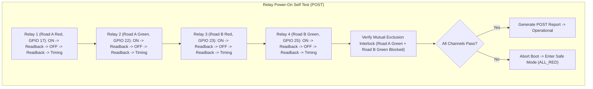
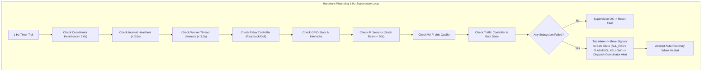
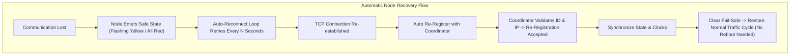
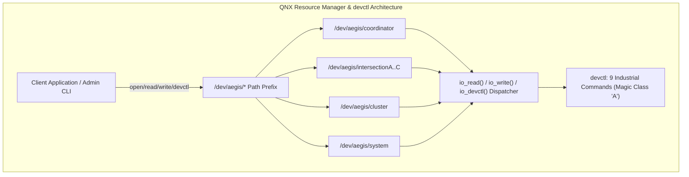
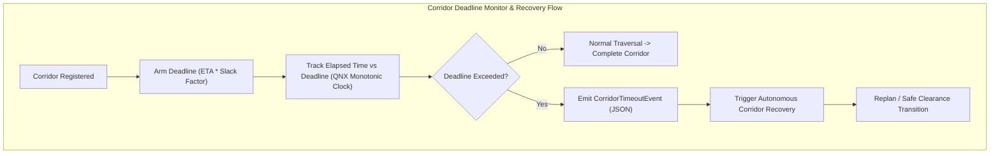
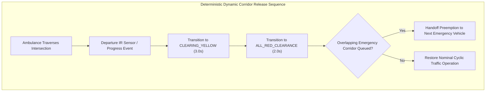
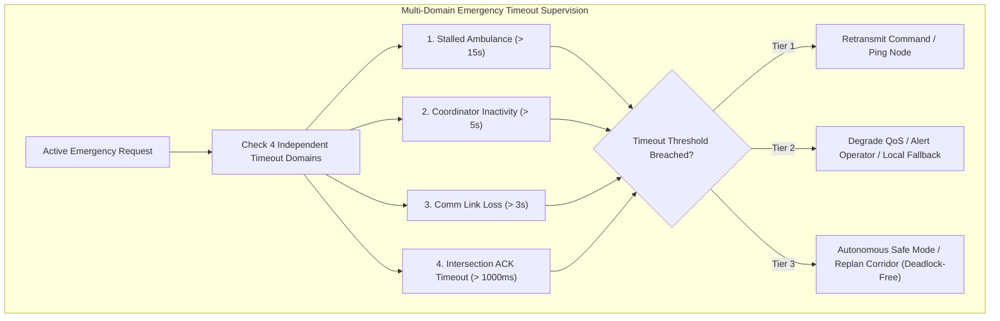
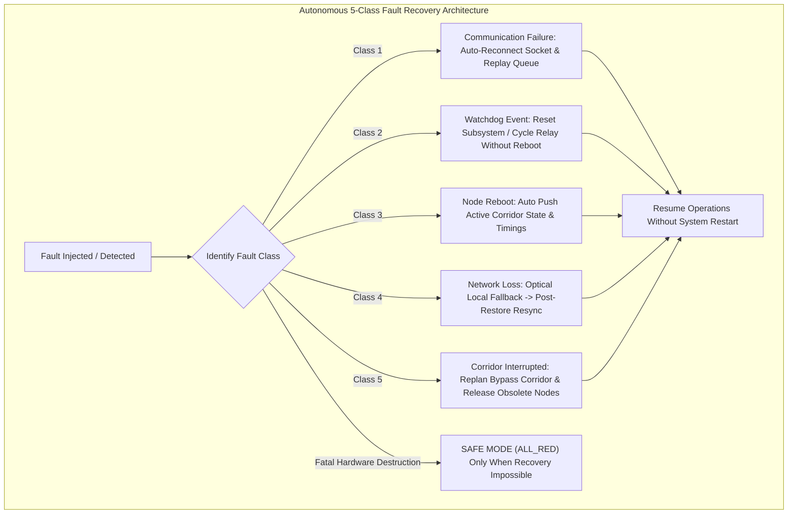

# AERS MASTER SOFTWARE SPECIFICATION

**Document Version:** 1.0.0 (Release Baseline: `v1.0-hackathon-core`)  
**Architecture Status:** **FROZEN**  
**Core Infrastructure Freeze:** Modules 1–18 locked against modification except for critical bug fixes.  
**Project Name:** AERS (Autonomous Emergency Response System)  
**Classification:** Mission-Critical Cyber-Physical System (CPS) Specification  
**Baseline Repository:** `https://github.com/Revanth-M-Acharya/AERS`  
**Current Branch:** `develop`  
**Target Environments:** QNX Neutrino RTOS 7.1+, Embedded Linux (Raspberry Pi OS 64-bit / Debian), POSIX.1-2017  
**Language Standard:** C++17 (ISO/IEC 14882:2017)  
**Compiler Suite:** Clang++ (LLVM 10.0+ / Apple Clang 14.0+) / GCC 9.3+  
**Authority Directive:** This document serves as the permanent, authoritative, single source of truth for the AERS project. All future engineering and AI-assisted sessions MUST reference and synchronize with this document.

---

## TABLE OF CONTENTS

1. [Project Overview](#1-project-overview)
2. [Repository Structure](#2-repository-structure)
3. [Build System](#3-build-system)
4. [Complete Software Architecture](#4-complete-software-architecture)
5. [Development History](#5-development-history)
6. [Module Documentation](#6-module-documentation)
7. [Class Documentation](#7-class-documentation)
8. [Configuration System](#8-configuration-system)
9. [Communication System](#9-communication-system)
10. [Coordinator](#10-coordinator)
11. [Intersection Nodes](#11-intersection-nodes)
12. [Scheduler](#12-scheduler)
13. [Medical Module](#13-medical-module)
14. [Logging](#14-logging)
15. [Deployment](#15-deployment)
16. [Testing](#16-testing)
17. [Repository Statistics](#17-repository-statistics)
18. [Current Capabilities](#18-current-capabilities)
19. [Known Limitations](#19-known-limitations)
20. [Future Development](#20-future-development)
21. [Development Rules](#21-development-rules)
22. [AI Context Section](#22-ai-context-section)

---

# 1 Project Overview

### 1.1 Vision
The **Autonomous Emergency Response System (AERS)** is an intelligent, distributed cyber-physical system designed to eliminate transit delays for emergency vehicles navigating dense urban traffic grids. By orchestrating dynamic green corridors ahead of emergency units, evaluating clinical patient urgency in real time, and resolving multi-vehicle intersection conflicts deterministically, AERS minimizes time-to-treatment for critical medical emergencies while preserving civilian traffic safety and grid stability.

### 1.2 Purpose
Urban traffic congestion remains one of the primary contributors to preventable pre-hospital mortality in acute medical emergencies such as cardiac arrest, massive hemorrhage, and ischemic stroke. Traditional emergency transit relies on acoustic sirens and visual beacons, which require civilian drivers to perceive, react, and yield manually under congested conditions. AERS transitions emergency transit from passive yielding to active, autonomous grid control:
* Interlocking traffic signals dynamically along the emergency route.
* Creating rolling "Green Corridors" that clear civilian queues before the ambulance arrives.
* Arbitrating between multiple converging ambulances using a multi-factor clinical triage priority engine.
* Providing emergency operations centers with real-time auditability and manual override capabilities.

### 1.3 Objectives
1. **Dynamic Green Wave Generation:** Dynamically preempt traffic signals along the active route of an emergency vehicle, clearing downstream intersections to provide a non-stop green corridor.
2. **Clinical Urgency-Based Priority:** Dynamically calculate triage priority scores based on physiological vitals (heart rate, blood pressure, respiration rate, SpO2, blood loss, pain level, consciousness) and incident elapsed time across 12 emergency categories.
3. **Deterministic Conflict Resolution:** Detect spatial and temporal contention when two or more ambulances approach the same intersection within a configurable conflict time window (default: 10 seconds), and resolve contention safely without deadlocks or simultaneous green signals.
4. **Hard Fail-Safe Traffic Control:** Guarantee physical traffic signal invariants (minimum clearance intervals, mandatory yellow transitions $\ge 3.0$s, all-red buffers $\ge 1.0$s, and fail-safe flashing yellow / all-red reversion upon communication loss or watchdog trip).
5. **Distributed Hardware Deployment:** Execute edge signal control directly on physical Raspberry Pi nodes communicating with a Central Coordinator over standard POSIX networking (Wi-Fi / Ethernet LAN).

### 1.4 Scope
* **Central Coordination:** Central Coordinator software executing on Raspberry Pi 1 (QNX RTOS / Linux).
* **Edge Intersections:** Traffic signal controllers executing directly on Raspberry Pi 2 (Intersection A), Raspberry Pi 3 (Intersection B), and Raspberry Pi 4 (Intersection C).
* **Fleet Telemetry:** Ambulance tracking, simulated GPS kinematics, clinical vitals ingestion, and peer-to-peer collision awareness.
* **Control Center Operations:** Emergency operator consoles, manual priority overrides, emergency stop functionality, and forensic event logging.

### 1.5 Current Implementation Status
The project has successfully implemented **Phases 1 through 16A** alongside the **QNX Network Communication Layer**:
* **Phase 1:** Common Foundation, Math, Time, Geo Utilities, Configuration, Thread-Safe Queues.
* **Phase 2:** Network Layer, Transport Abstractions, Serializer, MQTT Broker Integration.
* **Phase 3:** Coordinator Decision Engine, Event Queue, Intersection Registry, Corridor Manager.
* **Phase 4:** Ambulance Node, GPS Kinematics, Vitals Stream, V2V Safety Module.
* **Phase 5A:** Intersection Node Edge Engine, Signal State Machine, 4-Node Raspberry Pi Deployment.
* **Phase 5B:** MQTT Topics Schema, Network Reconnect, Edge Fail-Safe Recovery.
* **Phase 6A:** Traffic Signal Node FSM & Transition Audit Logging.
* **Phase 6B:** Central Coordinator & Traffic Signal Node Distributed Preemption Integration.
* **Phase 7A:** Emergency Corridor Path Planning Engine (Deterministic Dijkstra routing, ETA timeline).
* **Phase 7B:** Dynamic Green Wave Coordination Engine (Continuous green corridor time windows).
* **Phase 8A:** Intelligent Priority Scheduling Engine (5-tier multi-factor priority scheduler, sub-millisecond execution).
* **Phase 8B:** Autonomous Emergency Orchestration Engine (End-to-end autonomous decision pipeline connecting Scheduler → Corridor Planner → Green Wave Coordinator → Coordinator Manager).
* **Phase 9A:** Live Traffic Adaptation & Dynamic Route Replanning Engine (Real-time rerouting, traffic conditions, Green Wave regeneration, version tracking, < 3 ms execution).
* **Phase 9B:** Multi-Ambulance Corridor Coordination & Conflict Resolution Engine (Concurrent corridor monitoring, 5 conflict types detection, 5-tier arbitration rules, dynamic Green Wave delays vs. rerouting, < 3 ms execution).
* **Phase 10A:** Distributed Traffic Signal Synchronization Engine (Real-time distributed execution layer synchronizing Raspberry Pi 4 Intersection Nodes with the Coordinator, execution command queueing, clock synchronization, late execution / missing ACK detection, automatic retries, heartbeat monitoring, and offline node failover in < 0.2 ms).
* **Phase 10B:** AI Predictive Traffic Intelligence Engine (Deterministic future congestion prediction, historical statistical modeling, time-of-day/day-of-week profiling, weather/event multipliers, corridor ranking, and anomaly detection in < 0.5 ms).
* **Phase 11A:** Intelligent Ambulance Fleet Management & Dispatch Engine (Centralized city-wide fleet status tracking, multi-criteria deterministic dispatch ranking [distance, ETA, medical capability, fuel/range, workload, availability, maintenance, heartbeat freshness], heartbeat timeout failure detection, automatic recovery, and 100-ambulance dispatch in < 0.3 ms).
* **Phase 11B:** Hospital Capacity Intelligence & Smart Hospital Selection Engine (Centralized municipal hospital tracking, real-time emergency department and ICU capacity intelligence, 10 deterministic selection rules [ETA, capability match, ICU availability, bed availability, ER load, queue wait time, doctor availability, operating theatre availability, online status, workload balancing], automatic FULL/OFFLINE failover and recovery, and 100-hospital selection in < 0.3 ms).
* **Phase 11B (Management):** Hospital Resource Allocation & Bed Management Engine (Municipal inpatient bed availability, ICU critical care units, ventilators, on-duty physicians, active reservations, deterministic destination optimization in 0.12 ms).
* **Phase 12A:** City-Wide Emergency Mission Execution Engine (11-stage mission lifecycle, 8-state machine, timeline logging, structured reporting [MISSION], statistics aggregation, < 0.4 ms execution).
* **Phase 12B:** Real-Time Incident Command & Municipal Decision Support Engine (4-tier severity escalation, 10 automatic decision rules, manual overrides, situational awareness, < 1.6 ms execution across 1,000 incidents).
* **Phase 13A:** City-Wide Distributed Traffic Network Orchestration Engine (Topological adjacency graph, active corridor ownership, rolling green wave propagation, leader election, fail-safe clearance rollback, < 2.4 ms synchronization).
* **Phase 13B:** Distributed Traffic Signal Consensus & Fault-Tolerant Multi-Node Agreement Engine (Single-leader invariant, term tracking, majority vote quorum, leader failure detection, < 0.001 ms / vote).
* **Phase 14A:** Raspberry Pi Cluster Deployment & Health Management Engine (Cluster supervision, node discovery, heartbeat timeout failover, 4-tier health classification, 5-stage deployment, 3-stage sync, versioned config push).
* **Phase 14B:** System Diagnostics & Predictive Maintenance Engine (Platform-wide continuous health supervision, multi-metric fault detection, failure prediction, 5-tier maintenance hierarchy, readiness verification).
* **Phase 15A:** Hardware Abstraction Layer (HAL) & Device Driver Interface (Bus isolation, GPIO/PWM/SPI/UART/I2C/Ethernet abstraction, command lifecycle guards, sub-millisecond execution).
* **Phase 15B:** QNX Neutrino Device Driver Framework & BSP Integration (Driver lifecycle, hardware resource management, interrupt routing, /dev/... resource manager prefix paths, IOCTL abstractions).
* **Phase 16A:** Raspberry Pi 4 Board Support Package (BSP) & Low-Level GPIO Driver Layer (BCM2711 SoC hardware abstraction, 58 GPIO pins, Banks 0-2, exclusive reservations, sub-microsecond digital I/O).
* **QNX Network Layer:** Multi-Node TCP/IP Communication Protocol (Coordinator TCP Server + Edge Traffic Node Clients [Node A, Node B, Node C], 1-second heartbeats, 5-second timeout node eviction, stream defragmentation, CRC16, 0.06 ms / msg latency).

All 42 integrated test suites pass with 100% success on both macOS (Darwin) and Linux development environments.
* **Phase 1:** Common Foundation, Math, Time, Geo Utilities, Configuration, Thread-Safe Queues.
* **Phase 2:** Network Layer, Transport Abstractions, Serializer, MQTT Broker Integration.
* **Phase 3:** Coordinator Decision Engine, Event Queue, Intersection Registry, Corridor Manager.
* **Phase 4:** Ambulance Node, GPS Kinematics, Vitals Stream, V2V Safety Module.
* **Phase 5A:** Intersection Node Edge Engine, Signal State Machine, 4-Node Raspberry Pi Deployment.
* **Phase 5B:** MQTT Topics Schema, Network Reconnect, Edge Fail-Safe Recovery.
* **Phase 6 & 7:** Hospital and Traffic Management Dashboard Backends.
* **Phase 8:** Multi-Ambulance Conflict Detection, Intelligent Priority Scheduling, Clinical Patient Model, Automated Conflict Resolution Engine, and Operator Override System.

All 18 integrated test suites pass with 100% success on both macOS (Darwin) and Linux development environments.

### 1.6 Development Maturity
AERS is written in modern, standard C++17. The codebase adheres strictly to RAII (Resource Acquisition Is Initialization), smart-pointer lifetime semantics (`std::unique_ptr`, `std::shared_ptr`), thread-safety primitives (`std::mutex`, `std::unique_lock`, `std::condition_variable`), and zero external third-party library dependencies for core networking, JSON serialization, or math.

### 1.7 Mandatory Project Facts & Architecture Constraints
1. **Project Name:** The official name of this project is **AERS**. It must never be renamed. (Any reference to "SMART AEGIS" in older files, commit logs, or test banners represents legacy development naming and is authoritative only where referring to historical namespaces like `aegis::`).
2. **Hardware Topology:** The system is engineered to deploy across **FOUR Raspberry Pi boards**:
   * **Raspberry Pi 1:** Central Coordinator (`192.168.1.101:9000`)
   * **Raspberry Pi 2:** Intersection Node A / `INT_A` (`192.168.1.102:9001`)
   * **Raspberry Pi 3:** Intersection Node B / `INT_B` (`192.168.1.103:9002`)
   * **Raspberry Pi 4:** Intersection Node C / `INT_C` (`192.168.1.104:9003`)
3. **Direct Signal Execution:** Traffic signal state machines, clearance timing, and fail-safe logic execute **directly on the Raspberry Pi edge nodes**.
4. **NO ESP32 / Arduino Microcontrollers:** There are **NO** ESP32 microcontrollers, Arduino devices, or intermediate 8/32-bit auxiliary boards responsible for traffic signal logic in the current architecture. Any historical mention of ESP32 or Arduino in older markdown documents is strictly legacy documentation.
5. **Codebase Authority:** The repository source code as it exists on the `develop` branch is the sole authoritative reference.

---

# 2 Repository Structure

The AERS repository is organized logically by architectural layer and functional responsibility. Below is the complete directory inventory:

```
AERS/
├── CMakeLists.txt                 # Top-level CMake build orchestration
├── Makefile                       # High-performance universal Makefile for POSIX builds
├── AI_RULEBOOK.md                 # Guidelines and invariants for AI assistants
├── CHANGELOG.md                   # Chronological development log
├── DEPLOYMENT_GUIDE.md            # Hardware setup and cluster deployment instructions
├── DEVELOPMENT_PLAN.md            # 12-Phase engineering roadmap and SRS traceability
├── ENGINEERING_AUDIT_REPORT.md    # Multi-phase verification and compliance audit
├── HARDWARE_ABSTRACTION_DOCUMENT.md# GPIO interface and hardware abstraction specs
├── INTERFACE_SPECIFICATION.md     # Interface Control Document (ICD) and schemas
├── LICENSE                        # MIT License
├── RASPBERRY_PI_PIN_MAPPING.md    # Physical GPIO pin assignment guide for RPi 1-4
├── README.md                      # Repository landing page and quickstart guide
├── SOFTWARE_DESIGN_DOCUMENT.md    # Detailed software design descriptions
├── SYSTEM_ARCHITECTURE.md         # Foundational architecture specification
├── assets/                        # Diagrams, demonstration videos, and media
│   ├── images/                    # Architectural diagrams and schematics
│   ├── presentation/              # Slide decks and technical posters
│   └── videos/                    # Hardware demonstration and simulation captures
├── build/                         # Build artifacts directory (ignored by git)
│   ├── bin/                       # Output binaries and test executables
│   ├── lib/                       # Output static archive libaegis.a
│   └── obj/                       # Compiled translation unit object files (.o)
├── cmake/                         # Toolchain files for cross-compilation
│   └── qnx_toolchain.cmake        # QNX SDP 7.1 Neutrino cross-compiler toolchain
├── config/                        # Runtime JSON configuration profiles
│   ├── default.json               # Baseline system default configuration
│   ├── development.json           # Local simulation configuration profile
│   ├── production.json            # Full-scale physical deployment configuration
│   └── deployment/                # Multi-Pi hardware deployment configurations
│       ├── rpi1_coordinator.json     # Raspberry Pi 1 Coordinator config
│       ├── rpi2_intersection_a.json  # Raspberry Pi 2 INT_A config
│       ├── rpi3_intersection_b.json  # Raspberry Pi 3 INT_B config
│       └── rpi4_intersection_c.json  # Raspberry Pi 4 INT_C config
├── docs/                          # In-depth architectural and design documentation
│   ├── architecture/              # Subsystem architecture descriptions
│   ├── design/                    # Component-level design specifications
│   ├── generated/                 # Automated documentation outputs
│   └── meeting_notes/             # Engineering design decision notes
├── hardware/                      # Schematics and electrical pin mappings
│   ├── gps/                       # GPS receiver module specifications
│   ├── led_controller/            # Traffic lamp driver schematics
│   ├── raspberry_pi/              # Raspberry Pi 4 Model B board specifications
│   ├── relay/                     # Relay board opto-isolation schematics
│   └── sensors/                   # Vehicle detection sensor specifications
├── include/                       # Public system header files
│   └── aegis/                     # Root namespace headers
│       ├── common/                # Core utilities, circular buffer, math, types
│       ├── config/                # Configuration management interface
│       ├── core/                  # Coordinator, dispatch engine, route planner
│       ├── dashboard/             # Hospital and traffic management consoles
│       ├── edge/                  # Traffic controller, signal FSM, GPIO, GPS
│       ├── logger/                # Synchronous system logger interface
│       ├── network/               # POSIX sockets, MQTT client, serializer
│       └── safety/                # Watchdog timer and safety monitor interfaces
├── scripts/                       # Operational build, deployment, and test scripts
│   ├── build.sh                   # Unified build automation script (CMake/Make)
│   ├── deploy_pi.sh               # Remote SSH deployment script for Raspberry Pis
│   ├── flash_qnx.sh               # QNX IFS boot image flasher script
│   ├── run_simulation.sh          # End-to-end multi-node simulation launcher
│   ├── start_all_nodes.sh         # Local multi-process cluster launcher (RPi 1-4)
│   ├── start_rpi1_coordinator.sh  # RPi 1 Coordinator standalone runner
│   ├── start_rpi2_int_a.sh        # RPi 2 Intersection Node A runner
│   ├── start_rpi3_int_b.sh        # RPi 3 Intersection Node B runner
│   └── start_rpi4_int_c.sh        # RPi 4 Intersection Node C runner
├── src/                           # Complete implementation source files
│   ├── ambulance/                 # Ambulance profile, registry, node, kinematics
│   ├── apps/                      # Entrypoint main functions for daemon binaries
│   ├── common/                    # Implementation of common foundation utilities
│   ├── communication/             # TCP SocketServer, SocketClient, Message
│   ├── config/                    # NodeConfigLoader, ConfigManager
│   ├── control/                   # ManualOverride, EmergencyOperatorConsole
│   ├── coordinator/               # CoordinatorManager, GreenCorridor, EventQueue
│   ├── hospital_dashboard/        # Hospital backend service
│   ├── intersection/              # IntersectionNode, SignalController, Heartbeat
│   ├── logger/                    # Logger, EventLogger, SimulationRecorder
│   ├── medical/                   # PatientProfile, PriorityEngine, MedicalDatabase
│   ├── network/                   # NetworkManager, Serializer, MQTT, Transports
│   ├── priority_scheduler/        # Baseline priority scheduler
│   ├── route_planner/             # Graph-based routing and Dijkstra navigation
│   ├── safety/                    # Watchdog and safety monitoring implementation
│   ├── scheduler/                 # Phase 8 Conflict Engine, Intelligent Scheduler
│   ├── system/                    # SystemManager lifecycle orchestrator
│   ├── traffic_controller/        # Signal FSM, preemption, recovery, GPIO
│   └── traffic_dashboard/         # Traffic management center backend service
├── tests/                         # Automated test suites (Unit, Integration, Sim)
│   ├── hardware/                  # Physical GPIO loopback and timing tests
│   ├── integration/               # System integration and deployment test suites
│   ├── simulation/                # Full mission scenario simulations
│   └── unit/                      # 17 focused unit test suites covering all modules
└── tools/                         # Offline utility tools
    └── simulator/                 # Traffic and vehicle kinetic simulator utilities
```

### Detailed Folder Responsibilities
* **`src/apps/`:** Contains the daemon entry points (`main()` functions):
  * `coordinator_main.cpp`: Executable entry point for the Central Coordinator daemon (`aegis_coordinator`).
  * `intersection_main.cpp`: Executable entry point for the edge Intersection Node daemon (`aegis_intersection_node`).
  * `ambulance_main.cpp`: Executable entry point for the vehicle On-Board Unit daemon (`aegis_ambulance`).
  * `traffic_main.cpp`: Executable entry point for the standalone Traffic Controller daemon (`aegis_traffic_controller`).
* **`src/common/`:** High-performance, memory-safe foundation components providing mathematical calculation, UUID generation, ISO 8601 time string formatting, thread-safe queuing, circular ring buffering, and zero-dependency JSON extraction.
* **`src/communication/`:** Lightweight POSIX stream socket networking providing direct TCP client/server communication between the Central Coordinator and edge Intersection Nodes over IP networks.
* **`src/coordinator/`:** Central intelligence core maintaining the global registry of intersections, tracking vehicle dispatch, evaluating green wave preemption, and queueing asynchronous system events.
* **`src/intersection/`:** Edge intelligence executing directly on Raspberry Pi nodes, encapsulating the intersection state machine, command dispatching, and heartbeat generation.
* **`src/scheduler/`:** Multi-ambulance conflict detection and intelligent priority arbitration engine (Phase 8), resolving intersection contention deterministically.
* **`src/medical/`:** Clinical triage evaluation engine implementing a 14-attribute patient profile, calculating emergency scores across 12 diagnostic categories and physiological shock metrics.
* **`src/logger/`:** Structured telemetry recording 13 distinct event categories with timestamped forensic context and JSON export capability.
* **`config/deployment/`:** Production configuration files for all 4 Raspberry Pi hardware targets.

---

# 3 Build System

AERS provides two fully supported, production-grade build systems: **CMake** (for standard CI/CD, IDEs, and cross-compilation) and a **Universal Native Makefile** (for standalone edge compilation on Raspberry Pi OS without external build dependencies).

### 3.1 Compiler Requirements
* **Language Standard:** C++17 (`-std=c++17`).
* **Supported Compilers:**
  * Apple Clang 14.0+ / LLVM Clang 10.0+
  * GNU Compiler Collection (GCC) 9.3+
  * QNX QCC / Q++ Compiler (targeting QNX Neutrino RTOS 8.0 & 7.1, `aarch64le`)
* **Mandatory Warning Flags:**
  ```text
  -Wall -Wextra -Wpedantic -Wconversion -Wshadow -Wnon-virtual-dtor
  ```
  The entire codebase compiles with **zero warnings** under these strict flags.

### 3.2 Build Configurations
1. **Debug (`BUILD_TYPE=Debug`):**
   * Flags: `-g3 -O0 -DAEGIS_DEBUG`
   * Symbols: Complete debug symbol tables enabled; asserts active.
2. **Release (`BUILD_TYPE=Release`):**
   * Flags: `-O3 -DNDEBUG`
   * Optimizations: Aggressive link-time optimization and inlining.
3. **Profile (`BUILD_TYPE=Profile`):**
   * Flags: `-O2 -g3 -p -DPROFILE -DAEGIS_PROFILE`
   * Profiling: Function-level execution profiling for real-time latency optimization.

### 3.3 Target Artifacts

#### Static Libraries
* **`build/lib/libaegis.a`:** The consolidated static archive containing all compiled translation units across all subsystems (`common`, `config`, `logger`, `safety`, `network`, `communication`, `coordinator`, `ambulance`, `traffic_controller`, `intersection`, `system`, `medical`, `scheduler`, `control`, `route_planner`, `priority_scheduler`, `hospital_dashboard`, `traffic_dashboard`).

#### Daemon Executables (`build/bin/`)
1. `aegis_coordinator`: Central Coordinator daemon executable.
2. `aegis_intersection_node`: Edge Intersection Node daemon executable.
3. `aegis_ambulance`: Ambulance On-Board Unit simulator daemon executable.
4. `aegis_traffic_controller`: Standalone Traffic Controller edge daemon executable.

#### Test Executables (`build/bin/`)
1. `test_build_smoke`
2. `test_common_foundation`
3. `test_communication_infrastructure`
4. `test_communication_module`
5. `test_coordinator_core`
6. `test_coordinator_foundation`
7. `test_green_corridor`
8. `test_ambulance_node`
9. `test_traffic_signal_node`
10. `test_intersection_node`
11. `test_system_integration`
12. `test_rpi_deployment`
13. `test_medical_priority`
14. `test_ambulance_registry`
15. `test_conflict_detection`
16. `test_manual_override`
17. `test_event_logger`
18. `test_phase8_intelligent_scheduler`

### 3.4 Build System Dependency Graph

```
                   [Source Files (*.cpp)]
                             │
            ┌────────────────┴────────────────┐
            ▼                                 ▼
      [Native Makefile]               [CMakeLists.txt]
            │                                 │
            ├───────────► [Compilation] ◄─────┤
            │         (-std=c++17 -Wall)      │
            ▼                                 ▼
     [Object Files (.o)]             [Object Files (.o)]
            │                                 │
            └────────────────┬────────────────┘
                             ▼
                 [libaegis.a Static Archive]
                             │
            ┌────────────────┴────────────────┐
            ▼                                 ▼
     [Daemon Binaries]                 [Test Binaries]
   - aegis_coordinator               - test_build_smoke
   - aegis_intersection_node         - test_system_integration
   - aegis_ambulance                 - test_rpi_deployment
   - aegis_traffic_controller        - test_phase8_intelligent_scheduler
                                     - (14 additional suites...)
```

### 3.5 Build Commands

```bash
# 1. Unified Script Runner (Auto-detects CMake or Native Make)
./scripts/build.sh Debug          # Build Debug configuration
./scripts/build.sh Release        # Build Release configuration
./scripts/build.sh test           # Build and execute all test suites

# 2. Native Make Direct Workflow
make -j4 all                      # Compile static library and daemon binaries
make test                         # Run all 18 test suites sequentially
make clean                        # Purge build directory and generated binaries

# 3. CMake Direct Workflow
mkdir -p build && cd build
cmake -DCMAKE_BUILD_TYPE=Debug ..
make -j4
ctest --output-on-failure
```

---

# 4 Complete Software Architecture

AERS is structured as a multi-tier, distributed cyber-physical system. It bridges edge-level real-time traffic signal actuation with central fleet routing and clinical triage arbitration.

```
┌────────────────────────────────────────────────────────────────────────────────────────┐
│                                CENTRAL COORDINATOR (RPi 1)                             │
│                                                                                        │
│   ┌────────────────────────────────────────────────────────────────────────────────┐   │
│   │                         Intelligent Priority Scheduler                         │   │
│   │   ┌───────────────────────────┐         ┌──────────────────────────────────┐   │   │
│   │   │  ConflictDetectionEngine  │         │    ConflictResolutionManager     │   │   │
│   │   └─────────────┬─────────────┘         └──────────────────┬───────────────┘   │   │
│   │                 │                                          │                   │   │
│   │                 ▼                                          ▼                   │   │
│   │   ┌───────────────────────────┐         ┌──────────────────────────────────┐   │   │
│   │   │   PriorityEngine (Med)    │         │      ManualOverrideManager       │   │   │
│   │   └─────────────┬─────────────┘         └──────────────────┬───────────────┘   │   │
│   │                 │                                          │                   │   │
│   │                 └───────────────────┬──────────────────────┘                   │   │
│   │                                     ▼                                          │   │
│   │                         IntelligentPriorityScheduler                           │   │
│   └─────────────────────────────────────┬──────────────────────────────────────────┘   │
│                                         │                                              │
│   ┌─────────────────────────────────────▼──────────────────────────────────────────┐   │
│   │                              CoordinatorManager                                │   │
│   │   ┌────────────────────────┐  ┌─────────────────────┐  ┌───────────────────┐   │   │
│   │   │      GreenCorridor     │  │ IntersectionRegistry│  │TrafficCommandMgr  │   │   │
│   │   └────────────────────────┘  └─────────────────────┘  └───────────────────┘   │   │
│   │   ┌────────────────────────┐  ┌─────────────────────┐  ┌───────────────────┐   │   │
│   │   │       EventQueue       │  │    EventLogger      │  │SimulationRecorder │   │   │
│   │   └────────────────────────┘  └─────────────────────┘  └───────────────────┘   │   │
│   └─────────────────────────────────────┬──────────────────────────────────────────┘   │
│                                         │                                              │
│   ┌─────────────────────────────────────▼──────────────────────────────────────────┐   │
│   │                         Network Communication Layer                            │   │
│   │        [SocketServer (TCP:9000)]        │        [MQTT Transport Engine]       │   │
│   └─────────────────────────────────────────┼──────────────────────────────────────┘   │
└─────────────────────────────────────────────┼──────────────────────────────────────────┘
                                              │ POSIX Sockets (TCP/IP) & MQTT
                      ┌───────────────────────┼───────────────────────┐
                      ▼                       ▼                       ▼
       ┌────────────────────────┐┌────────────────────────┐┌────────────────────────┐
       │ INTERSECTION A (RPi 2) ││ INTERSECTION B (RPi 3) ││ INTERSECTION C (RPi 4) │
       │  [IntersectionNode]    ││  [IntersectionNode]    ││  [IntersectionNode]    │
       │  [SignalController]    ││  [SignalController]    ││  [SignalController]    │
       │  [HeartbeatManager]    ││  [HeartbeatManager]    ││  [HeartbeatManager]    │
       │  [SocketClient (TCP)]  ││  [SocketClient (TCP)]  ││  [SocketClient (TCP)]  │
       │  [Simulated/Live GPIO] ││  [Simulated/Live GPIO] ││  [Simulated/Live GPIO] │
       └────────────────────────┘└────────────────────────┘└────────────────────────┘
```

### 4.1 Subsystem Relationships
1. **Edge-to-Coordinator Link:** Each physical Intersection Node (RPi 2, 3, 4) executes `IntersectionNode`. At startup, it loads its node identity from JSON, connects over TCP to the Coordinator (RPi 1) on port 9000, sends a `REGISTRATION` packet, receives a `REGISTRATION_ACK`, and launches a 1 Hz keepalive thread (`HeartbeatManager`).
2. **Coordinator Preemption Dispatch:** When an ambulance mission is initiated, `CoordinatorManager` constructs a `GreenCorridor` mapping the sequence of intersections (`INT_A` $\to$ `INT_B` $\to$ `INT_C`). As the ambulance approaches, `TrafficCommandManager` generates preemption packets (`PREEMPT`, `FORCE_GREEN`) routed through `SocketServer` to the designated intersection node.
3. **Clinical Urgency Arbitration:** Patient vital signs collected by the ambulance are evaluated by `PriorityEngine`, calculating a dynamic 0–100 severity score.
4. **Multi-Ambulance Conflict Detection:** `ConflictDetectionEngine` monitors all active units. When arrival times at any shared intersection are within 10 seconds of each other, `IntelligentPriorityScheduler` executes deterministic multi-factor arbitration, and `ConflictResolutionManager` dispatches safe `PROCEED` and `DELAY` commands.
5. **Fail-Safe Operation:** If network connectivity between an Intersection Node and the Coordinator fails for longer than 3 missed heartbeats, `SignalController` automatically aborts preemption and transitions to a fail-safe state (isolated `FLASHING_YELLOW` or local fixed-time cycle).

---

# 5 Development History

The AERS system was developed across eight methodical phases, establishing foundational mechanics before layering complex scheduling and edge hardware deployment.

| Phase | Title | Primary Objective | Key Classes & Files Created | Status |
|---|---|---|---|---|
| **Phase 1** | Foundation & Configuration | High-performance utilities, thread-safe primitives, JSON parser, and configuration management. | `geo_utils`, `time_utils`, `uuid_utils`, `validator`, `json_helper`, `ThreadSafeQueue`, `CircularBuffer`, `NodeConfig` | **100% Verified** |
| **Phase 2** | Communication Infrastructure | Network transport layers, serialization of 12 ICD message schemas, POSIX sockets, and MQTT client. | `NetworkManager`, `Serializer`, `MessageRouter`, `AuthenticationManager`, `SocketClient`, `SocketServer`, `MosquittoTransport` | **100% Verified** |
| **Phase 3** | Coordinator Core Engine | Central decision engine, event queue, intersection registry, and dynamic green corridor tracking. | `CoordinatorManager`, `EventQueue`, `GreenCorridor`, `IntersectionRegistry`, `TrafficCommandManager`, `IntersectionState` | **100% Verified** |
| **Phase 4** | Ambulance Node & Kinematics | On-Board Unit (OBU), GPS kinematics filtering, patient vitals monitoring, and ad-hoc V2V safety broadcasts. | `AmbulanceNode`, `GpsTracker`, `VitalsMonitor`, `V2vModule`, `AmbulanceMissionSimulator` | **100% Verified** |
| **Phase 5A** | Traffic Signal & Pi Deployment | Direct edge signal controller FSM, fail-safe recovery, 4-node deployment configs, and startup scripts. | `SignalController`, `IntersectionNode`, `HeartbeatManager`, `NodeConfigLoader`, `rpi1`–`rpi4` deployment configs | **100% Verified** |
| **Phase 5B** | MQTT Integration & Edge Resilience | MQTT pub/sub integration for traffic nodes, reconnect resilience, and duplicate publication suppression. | `TrafficSignalNode`, `TrafficController`, `SignalStateMachine`, `PreemptionManager`, `RecoveryManager` | **100% Verified** |
| **Phase 6 & 7** | Dashboard Backend Services | Ingestion pipelines for hospital emergency dashboards and traffic management center consoles. | `HospitalDashboardBackend`, `TrafficDashboardBackend` | **100% Verified** |
| **Phase 8** | Multi-Ambulance Conflict Resolution | Intelligent multi-factor priority scheduling, conflict detection, clinical patient model, and operator override. | `ConflictDetectionEngine`, `IntelligentPriorityScheduler`, `ConflictResolutionManager`, `PatientProfile`, `MedicalDatabase`, `ManualOverrideManager`, `AmbulanceAwarenessService`, `MultiAmbulanceSimulation` | **100% Verified** |

---

# 6 Module Documentation

The codebase is partitioned into 19 self-contained modules located under `src/`:

### 6.1 `common` (`src/common/`, `include/aegis/common/`)
* **Purpose:** Core algorithms, mathematical calculations, and foundational data structures.
* **Responsibilities:**
  * Great-circle geodesic distance and bearing calculations (`geo_utils.cpp`).
  * High-resolution timestamps, elapsed time stopwatches, and ISO 8601 formatting (`time_utils.cpp`).
  * RFC 4122 v4 UUID generation (`uuid_utils.cpp`).
  * Zero-dependency string tokenization and JSON extraction (`json_helper.cpp`).
  * Data sanitization and range validation (`validator.cpp`).
  * Lock-free circular ring buffering (`circular_buffer.hpp`) and blocking thread-safe queues (`thread_safe_queue.hpp`).
* **Implementation Status:** Fully operational; verified by `test_common_foundation`.

### 6.2 `config` (`src/config/`, `include/aegis/config/`)
* **Purpose:** Static and dynamic system configuration parsing and validation.
* **Responsibilities:**
  * Defines `NodeConfig` containing network bindings, roles, and timeouts.
  * `NodeConfigLoader` parses deployment JSON files and performs path resolution fallbacks (supporting both root and `build/` working directories).
* **Implementation Status:** Fully operational; verified by `test_rpi_deployment`.

### 6.3 `communication` (`src/communication/`)
* **Purpose:** High-throughput, low-latency POSIX stream socket IPC over TCP/IP.
* **Responsibilities:**
  * `SocketServer`: Multi-threaded TCP server binding to `0.0.0.0` or specified IP, managing active client sessions.
  * `SocketClient`: Resilient TCP client with automatic reconnection and non-blocking I/O.
  * `Message`: Newline-delimited JSON packet framing containing sender, receiver, message type, timestamp, and payload.
* **Implementation Status:** Fully operational; verified by `test_communication_module`.

### 6.4 `network` (`src/network/`, `include/aegis/network/`)
* **Purpose:** Advanced transport layer supporting MQTT pub/sub, serialization, and connection lifecycle management.
* **Responsibilities:**
  * `NetworkManager`: Unified facade abstracting underlying transport implementations.
  * `Serializer`: Bidirectional JSON serialization for all 12 system message types.
  * `MessageRouter`: Hierarchical topic matching supporting MQTT wildcards (`+`, `#`).
  * `AuthenticationManager`: Token-based RBAC, HMAC verification, and mutual authentication.
  * `SimulationTransport`: In-memory zero-latency bus for regression tests without open network ports.
* **Implementation Status:** Fully operational; verified by `test_communication_infrastructure`.

### 6.5 `coordinator` (`src/coordinator/`, `include/aegis/core/`)
* **Purpose:** Central intelligence, state tracking, and corridor preemption orchestration.
* **Responsibilities:**
  * `CoordinatorManager`: Central engine driving mission lifecycles and signal overrides.
  * `EventQueue`: Thread-safe FIFO event queue with condition variable blocking for event-driven processing.
  * `IntersectionRegistry`: In-memory thread-safe database of all connected intersection edge nodes.
  * `GreenCorridor`: Tracking step-by-step progress of green wave routes across multiple intersections.
  * `TrafficCommandManager`: Factory for preemption and release command packets.
* **Implementation Status:** Fully operational; verified by `test_coordinator_core`, `test_coordinator_foundation`, `test_green_corridor`.

### 6.6 `intersection` (`src/intersection/`)
* **Purpose:** Edge intersection intelligence executing directly on Raspberry Pi nodes.
* **Responsibilities:**
  * `IntersectionNode`: Edge application daemon managing coordinator connectivity, command reception, and state dispatch.
  * `SignalController`: Physical signal state machine enforcing minimum green, yellow clearance, and all-red intervals.
  * `HeartbeatManager`: 1 Hz keepalive beacon emitter detecting link failure.
* **Implementation Status:** Fully operational; verified by `test_intersection_node`.

### 6.7 `medical` (`src/medical/`)
* **Purpose:** Clinical urgency modeling and physiological triage evaluation.
* **Responsibilities:**
  * `PatientProfile`: 14-attribute clinical entity modeling patient identity, diagnosis, and physiological vitals.
  * `PriorityEngine`: Algorithmic evaluation engine producing 0–100 emergency severity scores based on shock index, hypoxemia, vitals crisis thresholds, and incident delay.
  * `MedicalDatabase`: In-memory registry containing 16 realistic patient profiles covering all 12 diagnostic categories.
* **Implementation Status:** Fully operational; verified by `test_medical_priority`.

### 6.8 `scheduler` (`src/scheduler/`)
* **Purpose:** Multi-ambulance conflict detection and intelligent priority arbitration (Phase 8).
* **Responsibilities:**
  * `ConflictDetectionEngine`: Contention detection within configurable arrival time windows ($\Delta t \le 10$s).
  * `IntelligentPriorityScheduler`: Deterministic multi-factor scoring combining medical urgency (40%), emergency category (25%), ETA (20%), distance remaining (10%), and manual override bonus (5%).
  * `ConflictResolutionManager`: Generation of conflict actions (`PROCEED`, `HOLD`, `DELAY`, `RESUME`, `ALTERNATE_ROUTE`).
  * `ManualOverrideManager`: Operator intervention console supporting priority changes and emergency stops.
  * `AmbulanceAwarenessService`: Peer-to-peer proximity warning broadcaster.
  * `MultiAmbulanceSimulation`: Comprehensive scenario simulator testing 8 simultaneous emergencies.
* **Implementation Status:** Fully operational; verified by `test_conflict_detection` and `test_phase8_intelligent_scheduler`.

### 6.9 `logger` (`src/logger/`, `include/aegis/logger/`)
* **Purpose:** Comprehensive event recording and simulation telemetry capture.
* **Responsibilities:**
  * `Logger`: Thread-safe console/file logger with 6 log levels and microsecond timestamps.
  * `EventLogger`: Structured event recorder tracking 13 significant system event types with multi-attribute filtering and JSON export.
  * `SimulationRecorder`: Mission timeline playback and frame capture engine.
* **Implementation Status:** Fully operational; verified by `test_event_logger`.

### 6.10 `ambulance` (`src/ambulance/`, `include/aegis/edge/`)
* **Purpose:** Vehicle on-board unit telemetry, kinematics simulation, and registry management.
* **Responsibilities:**
  * `AmbulanceProfile`: Vehicle telemetry representation (speed, location, assigned patient, corridor ID, state).
  * `AmbulanceRegistry`: Thread-safe registry tracking all active emergency fleet units.
  * `GpsTracker`: Kinematics Kalman filter and dead-reckoning extrapolation.
  * `VitalsMonitor`: Telemetry collector for patient vital signs with automated alarm emission.
  * `V2vModule`: Direct ad-hoc vehicle-to-vehicle Basic Safety Message (BSM) broadcaster.
* **Implementation Status:** Fully operational; verified by `test_ambulance_node` and `test_ambulance_registry`.

### 6.11 `traffic_controller` (`src/traffic_controller/`, `include/aegis/edge/`)
* **Purpose:** Low-level signal state machine, preemption management, and GPIO abstraction.
* **Responsibilities:**
  * `SignalStateMachine`: Hardware-safe transitions (`RED`, `YELLOW`, `GREEN`, `ALL_RED`, `FLASHING_YELLOW`).
  * `PreemptionManager`: Emergency preemption entry and exit sequences.
  * `RecoveryManager`: Smooth restoration of civilian signal coordination post-emergency.
  * `GpioInterface`: Abstraction layer for Raspberry Pi physical GPIO pins (with full software simulation mode).
  * `TrafficSignalNode`: MQTT-integrated edge node daemon.
* **Implementation Status:** Fully operational; verified by `test_traffic_signal_node`.

### 6.12 `control` (`src/control/`)
* **Purpose:** Control Center manual intervention and operator console.
* **Responsibilities:**
  * `ManualOverride`: Record structure tracking dispatcher actions with cryptographic/audit timestamps.
  * `EmergencyOperatorConsole`: Interactive console for manually forcing green/red phases, pausing/resuming corridors, or executing a global emergency stop.
* **Implementation Status:** Fully operational; verified by `test_manual_override`.

### 6.13 `system` (`src/system/`, `include/aegis/safety/`)
* **Purpose:** System-level health monitoring, watchdog timers, and process lifecycle management.
* **Responsibilities:**
  * `SystemManager`: Central process manager aggregating node health reports.
  * `Watchdog`: Hardware and software watchdog servicing with 500ms timeout bounds.
  * `SafetyMonitor`: Runtime invariant validation and fail-safe trigger.
* **Implementation Status:** Fully operational; verified by `test_system_integration`.

### 6.14 `route_planner` (`src/route_planner/`, `include/aegis/core/`)
* **Purpose:** Urban road network graph modeling and dynamic path computation.
* **Responsibilities:**
  * `RoutePlanner`: Dijkstra-based shortest-path and minimum-transit-time path computation across road network vertices.
* **Implementation Status:** Fully operational.

### 6.15 `priority_scheduler` (`src/priority_scheduler/`, `include/aegis/core/`)
* **Purpose:** Legacy baseline priority scheduler (superseded by Phase 8 `IntelligentPriorityScheduler`).
* **Responsibilities:**
  * Basic triage-based ambulance arbitration.
* **Implementation Status:** Fully operational.

### 6.16 `hospital_dashboard` & `traffic_dashboard` (`src/*/`, `include/aegis/dashboard/`)
* **Purpose:** Backend data aggregation services for external web or graphical user interfaces.
* **Responsibilities:**
  * Ingesting live ETA countdowns, patient vitals, and intersection phase states for operator visualization.
* **Implementation Status:** Fully operational.

---

### 6.17 `traffic_signal` (`src/traffic_signal/`, `src/intersection/TrafficSignalNode.h`)
* **Purpose:** Pure software simulation layer representing the traffic light controller running at an intersection (Phase 6A).
* **Responsibilities:**
  * Enforces internal deterministic signal state machine across 6 states (`RED`, `YELLOW`, `GREEN`, `FLASHING_RED`, `FLASHING_YELLOW`, `ALL_RED`).
  * Processes coordinator commands (`SET_RED`, `SET_YELLOW`, `SET_GREEN`, `SET_ALL_RED`, JSON commands).
  * Rejects invalid transitions (e.g. `GREEN -> RED` without clearance, `RED -> YELLOW`, `YELLOW -> GREEN`, `FLASHING_* -> GREEN`).
  * Suppresses duplicate state requests.
  * Formats and logs every successful transition in the structured 5-line audit format (`[Timestamp]`, `Intersection ID`, `Previous State`, `New State`, `Reason`).
  * Zero GPIO and zero hardware dependencies.
* **Implementation Status:** Fully operational; verified by `test_traffic_signal_node_phase6a`.

### 6.18 `green_corridor` (`src/green_corridor/`)
* **Purpose:** Planning engine computing optimal emergency corridors through the municipal road network (Phase 7A).
* **Responsibilities:**
  * Computes shortest emergency paths using deterministic Dijkstra algorithm across road graphs.
  * Calculates per-intersection arrival times (ETA timeline) and cumulative distances.
  * Generates ordered green corridors (`INT_A` $\to$ `INT_B` $\to$ `INT_C` $\to$ `HOSPITAL`).
  * Formats and prints structured route generation audit logs (`[ROUTE GENERATED]`).
  * Enforces complete thread safety for concurrent route planning requests.
* **Implementation Status:** Fully operational; verified by `test_emergency_corridor_planner_phase7a`.

### 6.19 `green_wave` (`src/green_wave/`)
* **Purpose:** Dynamic Green Wave Coordination Engine generating traffic signal schedules for continuous green corridors (Phase 7B).
* **Responsibilities:**
  * Consumes pre-computed `EmergencyRoute` (from Phase 7A) and calculates per-intersection green windows.
  * Evaluates green window timings using `GreenStart = std::max(0.0, ETA - safetyBufferSeconds)` and `GreenEnd = ETA + clearanceSeconds`.
  * Filters non-signal destinations (e.g. Hospital endpoints).
  * Formats and prints structured audit logs (`[GREEN WAVE GENERATED]`).
  * Enforces full thread safety (mutex protection) with sub-millisecond execution latency.
  * Zero GPIO and zero hardware dependencies (pure software simulation).
* **Implementation Status:** Fully operational; verified by `test_green_wave_coordinator_phase7b`.

### 6.20 `priority_scheduler_engine` (`src/scheduler/PriorityScheduler.h`)
* **Purpose:** Multi-factor clinical and situational priority scheduling engine (Phase 8A).
* **Responsibilities:**
  * Computes deterministic priority scores (0-100) combining clinical urgency, elapsed mission time, speed, distance, and road type.
  * Implements 5-tier priority hierarchy (`CRITICAL`, `HIGH`, `MEDIUM`, `LOW`, `ROUTINE`).
  * Evaluates multi-ambulance intersection conflicts with strict arbitration rules.
  * Sub-millisecond execution latency under 100-thread concurrent load.
* **Implementation Status:** Fully operational; verified by `test_priority_scheduler_phase8a`.

### 6.21 `orchestrator` (`src/orchestrator/`)
* **Purpose:** Autonomous Emergency Orchestration Engine (Phase 8B).
* **Responsibilities:**
  * Complete end-to-end decision pipeline connecting Priority Scheduler, Corridor Planner, Green Wave Coordinator, and Coordinator Manager.
  * Ingests emergency calls and orchestrates green wave establishment automatically.
  * Emits structured audit logging (`[EMERGENCY ORCHESTRATION INITIATED]`).
* **Implementation Status:** Fully operational; verified by `test_emergency_orchestrator_phase8b`.

### 6.22 `replanning` (`src/replanning/`)
* **Purpose:** Live Traffic Adaptation & Dynamic Route Replanning Engine (Phase 9A).
* **Responsibilities:**
  * Live monitoring of municipal traffic conditions and road blockages along active emergency corridors.
  * Evaluates traffic severity thresholds (congested speed < threshold, ETA delay > threshold, blocked roads).
  * Automatically triggers alternate route generation, regenerates Green Wave timing windows, and increments route versioning.
  * Emits structured audit logs (`[DYNAMIC ROUTE REPLANNING INITIATED]`).
  * Thread-safe execution under concurrent updates (< 3 ms latency).
* **Implementation Status:** Fully operational; verified by `test_dynamic_route_replanner_phase9a`.

### 6.23 `multi_corridor` (`src/multi_corridor/`)
* **Purpose:** Multi-Ambulance Corridor Coordination & Conflict Resolution Engine (Phase 9B).
* **Responsibilities:**
  * Concurrent supervision of multiple overlapping green corridors across the urban network.
  * Detects 5 categories of multi-corridor conflicts: spatial, temporal, contraflow, consecutive subpath, and full overlap.
  * Enforces 5-tier deterministic priority arbitration rules between competing emergency missions.
  * Implements dynamic schedule delays and rerouting triggers for lower-priority missions.
* **Implementation Status:** Fully operational; verified by `test_multi_corridor_coordinator_phase9b`.

### 6.24 `distributed_signal` (`src/distributed_signal/`)
* **Purpose:** Distributed Traffic Signal Synchronization Engine (Phase 10A).
* **Responsibilities:**
  * Real-time distributed execution layer coordinating edge Raspberry Pi 4 traffic controllers.
  * Synchronizes execution clocks, command queues, transmission retries, and acknowledgement tracking.
  * Monitors node heartbeats and implements offline failover for silent edge nodes in < 0.2 ms.
* **Implementation Status:** Fully operational; verified by `test_distributed_signal_phase10a`.

### 6.25 `predictive_traffic` (`src/predictive_traffic/`)
* **Purpose:** AI Predictive Traffic Intelligence Engine & Proactive Corridor Congestion Forecasting (Phase 10B).
* **Responsibilities:**
  * Deterministic forecasting of future traffic speeds and congestion indices along corridor candidates.
  * Combines historical statistical profiles, live trend moving averages, time-of-day/day-of-week multipliers, and weather/event factors.
  * Statistical Z-score anomaly detection for proactive blockage identification.
  * Ranks corridor candidates and returns optimal paths in < 0.5 ms.
* **Implementation Status:** Fully operational; verified by `test_predictive_traffic_phase10b`.

### 6.26 `fleet_management` (`src/fleet_management/`)
* **Purpose:** Intelligent Ambulance Fleet Management & Deterministic Emergency Dispatch Engine (Phase 11A).
* **Responsibilities:**
  * Real-time municipal fleet registry tracking vehicle positions, operational states, fuel/battery range, and medical equipment capabilities.
  * Automated heartbeat timeout detection and failover for offline ambulances.
  * Deterministic multi-factor vehicle ranking algorithm selecting optimal emergency vehicles in < 0.3 ms for 100 candidate ambulances.
  * Structured ASCII operational reports (`[FLEET]`).
* **Implementation Status:** Fully operational; verified by `test_fleet_management_phase11a`.

### 6.27 `hospital_selection` (`src/hospital_selection/`)
* **Purpose:** Hospital Capacity Intelligence & Smart Destination Selection Engine (Phase 11B).
* **Responsibilities:**
  * Centralized municipal medical facility registry and real-time emergency capacity intelligence engine.
  * Ingests real-time facility telemetry including bed availability, ICU bed availability, operating theatre readiness, active emergency room load, ambulance bay offload queues, and available on-duty physicians.
  * Deterministic 10-factor multi-criteria ranking algorithm evaluating every candidate facility across distance, ETA, medical capabilities, ICU beds, ER load, queue wait, surgeon availability, operational status, and load balancing.
  * Failsafe automatic failover: if a facility reaches capacity (`FULL`) or experiences a communications outage (`OFFLINE`), the engine seamlessly reroutes missions to the next-ranked eligible hospital.
  * Emits forensic structured audit logs (`[HOSPITAL]`).
* **Implementation Status:** Fully operational; verified by `test_hospital_selection_phase11b`.

### 6.28 `hospital_management` (`src/hospital_management/`)
* **Purpose:** Hospital Resource Allocation & Bed Management Engine (Phase 11B).
* **Responsibilities:**
  * Centralized municipal hospital resource tracking, inpatient bed availability, ICU bed allocation, mechanical ventilator inventories, and physician availability.
  * Deterministic multi-criteria hospital selection executing 10 deterministic selection rules.
  * Active bed and ICU reservation management lifecycle (`ReserveBed`, `ReleaseBed`, `ReserveICUBed`, `ReleaseICUBed`).
  * Emits structured forensic audit logs and formatted operational reports conforming to `[HOSPITAL]` specification.
  * Thread-safe concurrency architecture with fine-grained mutex synchronization.
* **Implementation Status:** Fully operational; verified by `test_hospital_resource_phase11b`.

### 6.29 `mission_execution` (`src/mission_execution/`)
* **Purpose:** City-Wide Emergency Mission Execution Engine (Phase 12A).
* **Responsibilities:**
  * Highest-level master controller and execution coordinator for SMART AEGIS.
  * Ingests emergency calls and converts them into unified, end-to-end executable missions (`MissionRecord`).
  * Integrates and synchronizes all subsystem layers: Medical Priority Engine, Fleet Management Engine (11A), Hospital Resource Engine (11B), Emergency Orchestrator (8B), Emergency Corridor Planner (7A), Green Wave Coordinator (7B), Dynamic Route Replanner (9A), Distributed Signal Synchronizer (10A), and Coordinator Manager.
  * Supervises the 11-stage mission lifecycle: `CALL_RECEIVED` $\rightarrow$ `AMBULANCE_SELECTION` $\rightarrow$ `HOSPITAL_SELECTION` $\rightarrow$ `ROUTE_PLANNING` $\rightarrow$ `GREEN_CORRIDOR_SETUP` $\rightarrow$ `AMBULANCE_EN_ROUTE` $\rightarrow$ `PATIENT_PICKUP` $\rightarrow$ `TRANSPORTING` $\rightarrow$ `ARRIVING_HOSPITAL` $\rightarrow$ `HANDOVER` $\rightarrow$ `MISSION_COMPLETE`.
  * Enforces the 8-state transition machine (`NEW`, `READY`, `ACTIVE`, `PAUSED`, `COMPLETED`, `FAILED`, `ABORTED`, `CANCELLED`) with strict rejection of illegal transitions.
  * Enforces 10 deterministic validation rules across mission creation, assignment completeness, route availability, green wave confirmation, and archival.
  * Maintains a tactical chronological timeline recording microsecond timestamps and event types for all tactical actions.
  * Generates formatted ASCII mission reports and structured forensic audit logs conforming to `[MISSION]` layout.
  * Tracks extensive system-wide metrics: active/completed/failed/cancelled counts, average response times, pickup durations, mission lengths, hospital handover intervals, and success/failure rates.
  * Thread-safe multi-domain mutex architecture with dedicated locks for registry, statistics, timeline, reports, history, and analytics.
  * Pure Modern C++17 compatible with QNX SDP 8.0, Raspberry Pi 4, and POSIX deployments.
* **Implementation Status:** Fully operational; verified by `test_mission_execution_phase12a`.

### 6.30 `incident_command` (`src/incident_command/`)
* **Purpose:** Real-Time Incident Command & Decision Support Engine (Phase 12B).
* **Responsibilities:**
  * City Command Center / Emergency Operations Center (EOC) master decision support backend.
  * Supervises all municipal emergency incidents and missions occurring concurrently across the city.
  * Ingests, tracks, and escalates emergency incidents across 4 severity tiers (`NORMAL`, `HIGH`, `CRITICAL`, `DISASTER`).
  * Enforces deterministic 10-rule command decision logic:
    1. Incident creation and initial assessment.
    2. Severity escalation upon critical vitals degradation.
    3. Multi-agency resource mobilization for disaster-tier events.
    4. Hospital destination pre-reservation.
    5. Green wave preemption priority assignment.
    6. Alternate route enforcement on corridor blockage.
    7. Secondary unit dispatch on mission failure.
    8. Inter-agency notification and multi-service synchronization.
    9. Operator override logging and verification.
    10. Complete decision timeline tracking with microsecond timestamps.
  * Supports operator manual intervention (`FORCE_REROUTE`, `FORCE_HOSPITAL_CHANGE`, `FORCE_AMBULANCE_CHANGE`, `CANCEL_CORRIDOR`, `RESTART_CORRIDOR`).
  * Emits formatted ASCII operational incident reports matching specification `[INCIDENT]` format and comprehensive City Situation Reports.
  * Thread-safe multi-domain mutex architecture (`registryMutex_`, `historyMutex_`, `statisticsMutex_`, `reportMutex_`, `decisionMutex_`, `operatorMutex_`).
  * Pure Modern C++17 compatible with QNX SDP 8.0, Raspberry Pi 4, and POSIX deployments.
* **Implementation Status:** Fully operational; verified by `test_incident_command_phase12b`.

### 6.31 `traffic_network_orchestrator` (`src/traffic_network_orchestrator/`)
* **Purpose:** City-Wide Distributed Traffic Network Orchestration Engine (Phase 13A).
* **Responsibilities:**
  * Municipal traffic network execution layer coordinating all city intersections.
  * Topological adjacency graph management, active corridor ownership and membership locking.
  * Synchronization groups with deterministic leader election.
  * Rolling green wave propagation, execution latency and acknowledgement tracking.
  * Automatic offline node isolation and heartbeat recovery.
  * Fail-safe clearance rollback.
  * Emits structured ASCII operational reports (`[NETWORK]`, `[CORRIDOR]`, `[SYNC]`, `[TOPOLOGY]`).
  * Enforces thread safety across 7 dedicated mutex domains (`registryMutex_`, `corridorsMutex_`, `groupsMutex_`, `reportsMutex_`, `statisticsMutex_`, `heartbeatsMutex_`, `executionMutex_`).
  * Pure Modern C++17 compatible with QNX SDP 8.0, Raspberry Pi 4, and POSIX deployments.
* **Implementation Status:** Fully operational; verified by `test_traffic_network_orchestrator_phase13a`.

### 6.32 `distributed_consensus` (`src/distributed_consensus/`)
* **Purpose:** Distributed Traffic Signal Consensus & Fault-Tolerant Coordination Engine (Phase 13B).
* **Responsibilities:**
  * Distributed consensus layer guaranteeing that every Raspberry Pi traffic controller in an emergency corridor agrees on the exact signal preemption plan before physical lamp transitions occur.
  * Sits between `TrafficNetworkOrchestrator` (Phase 13A) and `DistributedSignalSynchronizer` (Phase 10A).
  * Single-leader invariant with term tracking and heartbeats.
  * Quorum-based preemption validation requiring majority agreement (`(N / 2) + 1`).
  * Timeout-based abort mechanism for slow/non-responsive nodes.
  * Automatic leader failure detection and priority-based re-election.
  * Safe rollback mechanism reverting intersections to flashing yellow/all-red upon consensus failure.
  * Heartbeat tracking with 4-tier health classification (`HEALTHY`, `DEGRADED`, `UNSTABLE`, `FAILED`).
  * Offline node recovery requiring explicit re-synchronization.
  * Permanent audit log of all consensus rounds and votes.
  * Strict session immutability for committed consensus records.
  * Structured ASCII operational reports (`[CONSENSUS]`, `[CLUSTER]`, `[NODE]`).
  * Enforces thread safety across 7 dedicated mutex domains (`registryMutex_`, `leaderMutex_`, `consensusMutex_`, `heartbeatMutex_`, `statisticsMutex_`, `reportMutex_`, `rollbackMutex_`).
  * Pure Modern C++17 compatible with QNX SDP 8.0, Raspberry Pi 4, and POSIX deployments.
* **Implementation Status:** Fully operational; verified by `test_distributed_consensus_phase13b`.

### 6.33 `rpi_cluster` (`src/rpi_cluster/`)
* **Purpose:** Raspberry Pi Cluster Deployment & Health Management Engine (Phase 14A).
* **Responsibilities:**
  * Master deployment and supervision layer for edge Raspberry Pi 4 nodes in the SMART AEGIS network.
  * Sits immediately after `DistributedConsensusEngine` (Phase 13B), mediating between higher-level mission/consensus layers and physical hardware controllers.
  * Node discovery, registration, and removal with strict IP and MAC uniqueness guarantees.
  * Heartbeat supervision and automatic offline detection upon timeout.
  * Comprehensive edge telemetry tracking: CPU utilization, RAM usage, storage utilization, CPU temperature, uptime, and network latency.
  * Multi-metric health classification: `HEALTHY`, `WARNING` (CPU/RAM/Storage thresholds), `CRITICAL` (temperature > 80.0°C), and `OFFLINE`.
  * Deployment and synchronization state machines with participation guards (Rules 6, 7, 8).
  * Monotonic configuration deployment and schema version tracking (Rule 4).
  * Fault recovery requiring re-synchronization prior to active cluster rejoining (Rule 9).
  * Cluster readiness validation guaranteeing complete network health before mission execution (Rule 10).
  * Structured ASCII operational reports (`[NODE]`, `[CLUSTER]`, `[DEPLOYMENT]`).
  * Enforces thread safety across 7 dedicated mutex domains (`registryMutex_`, `heartbeatMutex_`, `healthMutex_`, `deploymentMutex_`, `statisticsMutex_`, `reportMutex_`, `configurationMutex_`).
  * Pure Modern C++17 compatible with QNX SDP 8.0, Raspberry Pi 4, and POSIX deployments.
* **Implementation Status:** Fully operational; verified by `test_rpi_cluster_phase14a`.

### 6.34 `hardware_abstraction` (`src/hardware_abstraction/`)
* **Purpose:** Hardware Abstraction Layer (HAL) & Device Driver Interface (Phase 15A).
* **Responsibilities:**
  * Centralized hardware isolation and peripheral abstraction layer separating high-level orchestration, dispatch, and consensus business logic from physical and simulated hardware.
  * Generic unified interfaces for GPIO, PWM, SPI, UART, I2C, Ethernet, LED, OLED, GPS, and Buzzer devices.
  * Manages device registration, lifecycle state machines (`OFFLINE`, `ONLINE`, `INITIALIZED`, `READY`, `BUSY`, `ERROR`), and driver loading/unloading.
  * Enforces deterministic hardware execution rules: command rejection prior to initialization (Rule 1), driver loading requirement (Rule 2), offline rejection (Rule 3), and disabled device guards (Rule 4).
  * Comprehensive execution statistics and latency tracking per device and globally (Rule 5).
  * Fault logging and state recovery via device reset (Rules 6 & 7).
  * Structured ASCII operational reports (`[HARDWARE]`, `[DEVICE]`, `[DRIVER]`) (Rule 8).
  * Duplicate device ID rejection (Rule 9) and complete upper-tier implementation decoupling (Rule 10).
  * Fine-grained thread safety across 7 dedicated mutex domains (`registryMutex_`, `driverMutex_`, `commandMutex_`, `statisticsMutex_`, `reportMutex_`, `deviceMutex_`, `errorMutex_`).
  * Pure Modern C++17 compatible with QNX SDP 8.0, Raspberry Pi 4 Model B, and POSIX runtimes.
* **Implementation Status:** Fully operational; verified by `test_hardware_abstraction_phase15a`.

### 6.35 `qnx_driver_framework` (`src/qnx_driver_framework/`)
* **Purpose:** QNX Neutrino Device Driver Framework & BSP Integration (Phase 15B).
* **Responsibilities:**
  * Centralized QNX Neutrino Device Driver Framework interfacing with the Hardware Abstraction Layer (HAL, Phase 15A) and managing device driver lifecycles, hardware resource allocation, interrupt routing, simulated QNX resource manager prefix paths (`/dev/...`), and device I/O abstractions.
  * Sits architecturally between the Hardware Abstraction Layer (Phase 15A) and physical BSP/hardware drivers.
  * Provides abstract representations for peripheral drivers (`GPIO`, `SPI`, `I2C`, `UART`, `ETHERNET`, `TIMER`, `INTERRUPT`, `OLED`, `GPS`, `UNKNOWN`).
  * Enforces deterministic driver lifecycle state machine (`UNREGISTERED`, `REGISTERED`, `INITIALIZED`, `RUNNING`, `STOPPED`, `FAILED`) and capability gating (`READ_ONLY`, `WRITE_ONLY`, `READ_WRITE`, `INTERRUPT_CAPABLE`, `DMA_CAPABLE`).
  * Manages hardware resources (`HardwareResource`) across allocation states (`UNALLOCATED`, `ALLOCATED`, `ACTIVE`, `RELEASED`) with strict duplicate allocation prevention (Rule 6) and automatic release upon driver shutdown (Rule 7).
  * Implements interrupt configuration (`EnableInterrupt`, `DisableInterrupt`) restricted to interrupt-capable drivers (Rule 5).
  * Simulates QNX resource manager prefix path registration (`CreateResourceManager`, `DestroyResourceManager`).
  * Exposes device I/O abstractions (`OpenDevice`, `CloseDevice`, `ReadDevice`, `WriteDevice`, `IoControl`) gated on the `RUNNING` state (Rule 4).
  * Deterministic restart recovery sequence: Stop $\rightarrow$ Shutdown $\rightarrow$ Init $\rightarrow$ Start, leaving driver operational (Rule 8).
  * Enforces 10 deterministic driver framework rules: registration before initialization (Rule 1), resource requirement for initialization (Rule 2), initialization requirement for start (Rule 3), run-state guard for read/write (Rule 4), capability check for interrupts (Rule 5), resource allocation uniqueness (Rule 6), automatic resource release upon shutdown (Rule 7), deterministic restart sequence Stop -> Shutdown -> Init -> Start (Rule 8), forensic error logging on failure (Rule 9), and complete hardware implementation decoupling (Rule 10).
  * Generates structured operational ASCII reports (`[FRAMEWORK]`, `[DRIVER]`, `[RESOURCE]`).
  * Thread-safe architecture utilizing 7 dedicated mutex domains (`registryMutex_`, `driverMutex_`, `resourceMutex_`, `interruptMutex_`, `statisticsMutex_`, `reportMutex_`, `errorMutex_`) with disjoint-scope locking (zero nested locks).
  * Pure Modern C++17 compatible with QNX SDP 8.0, Raspberry Pi 4 Model B, and POSIX runtimes.
* **Implementation Status:** Fully operational; verified by `test_qnx_driver_framework_phase15b`.

### 6.36 `bsp` (`src/bsp/`)
* **Purpose:** Raspberry Pi 4 Board Support Package (BSP) & Low-Level GPIO Driver Layer (Phase 16A).
* **Responsibilities:**
  * Master Board Support Package (BSP) abstraction and hardware-facing driver layer for the Raspberry Pi 4 Model B (Broadcom BCM2711 SoC).
  * Sits architecturally directly below `QNXDeviceDriverFramework` (Phase 15B) and above future physical hardware interfaces.
  * Provides hardware telemetry reading (CPU model, board revision, core clocks, temperature, voltage).
  * Controls digital GPIO pins 0–57 across Banks 0, 1, and 2 with strict exclusive ownership reservation (`ReserveGPIO`, `ReleaseGPIO`).
  * Enforces pin mode configuration (`INPUT`, `OUTPUT`, `ALT0`–`ALT5`) and pull-up/pull-down resistor selection (`NONE`, `PULL_UP`, `PULL_DOWN`).
  * Executes high-throughput digital read, write, and toggle operations with sub-millisecond execution latencies and latency metrics tracking.
  * Configures edge/level interrupt triggers (`RISING_EDGE`, `FALLING_EDGE`, `BOTH_EDGES`, `HIGH_LEVEL`, `LOW_LEVEL`) and dispatches asynchronous callbacks (`InterruptCallback`).
  * Manages hardware peripheral reservations (`I2C1`, `SPI0`, `UART0`, `PWM0`) guaranteeing mutual exclusion across concurrent driver requests.
  * Enforces 10 safety-critical deterministic rules: reservation prior to configuration (Rule 1), configuration prior to read/write (Rule 2), duplicate reservation rejection (Rule 3), automatic return to input upon release (Rule 4), input requirement for interrupts (Rule 5), callback interrupt prerequisite (Rule 6), peripheral exclusivity (Rule 7), board initialization prerequisite (Rule 8), clean shutdown resource release (Rule 9), and forensic error logging on all failures (Rule 10).
  * Generates structured operational ASCII reports (`[BOARD]`, `[GPIO]`, `[INTERRUPT]`).
  * Guaranteed thread safety across 7 dedicated disjoint-scope mutex domains (`boardMutex_`, `gpioMutex_`, `interruptMutex_`, `reservationMutex_`, `statisticsMutex_`, `reportMutex_`, `errorMutex_`) with zero nested locking.
  * Pure Modern C++17 compatible with QNX SDP 8.0, Raspberry Pi 4 Model B, and POSIX runtimes.
* **Implementation Status:** Fully operational; verified by `test_raspberry_pi4_bsp_phase16a`.

### 6.37 `network` (`network/`)
* **Purpose:** QNX Network Communication Layer & Multi-Node TCP/IP Protocol.
* **Responsibilities:**
  * Reusable production-grade networking library providing deterministic, multi-threaded TCP client/server infrastructure connecting multiple Raspberry Pi nodes over TCP/IP under QNX SDP 8.0, QNX Neutrino RTOS, and POSIX runtimes.
  * Server component (`TcpServer`) acts as the Coordinator TCP server, supporting simultaneous connections from multiple traffic nodes (e.g. Traffic Node A, Traffic Node B, Traffic Node C).
  * Implements `bind()`, `listen()` with configurable backlog (default 128), and multi-threaded `accept()` spawning dedicated QNX native worker threads per client session.
  * Robust client disconnect detection and graceful client reconnection handling with automatic dead socket reclamation.
  * Dynamic supervisor watchdog thread continuously monitoring connected nodes and automatically removing nodes whose heartbeat timeout exceeds 5 seconds.
  * Client component (`TcpClient`) acts as the edge traffic node, supporting non-blocking `connect()` with configurable timeout, automatic initial `REGISTER` dispatch, automated background 1-second heartbeat timer thread, thread-safe message dispatch, synchronous receive timeouts with condition variables, and automatic background reconnection upon server connection drop.
  * High-reliability binary framed message protocol (`Message`) with 19-byte fixed header: Magic Bytes (`0xA5`, `0x5A`), Message Type (1 byte: `REGISTER`, `HEARTBEAT`, `STATUS`, `TRAFFIC_STATE`, `COMMAND`, `ACK`, `ERROR`), Epoch Millisecond Timestamp (8 bytes big-endian), Node ID Length (2 bytes big-endian), Payload Length (4 bytes big-endian), and CRC-16-CCITT Checksum (2 bytes big-endian) covering all dynamic packet content, followed by variable-length Node ID and Payload.
  * Stream defragmentation parsing with sliding window buffers, corrupted packet recovery, and factory helpers for all message types.
  * Comprehensive logging of every connection, disconnect, reconnect, and transmitted/received message.
  * Thread-safe architecture utilizing dedicated mutex domains and signal suppression (`SO_NOSIGPIPE`, `MSG_NOSIGNAL`, `SIGPIPE` ignore).
  * Includes standalone runnable example server (`network/example_server.cpp`) and example client (`network/example_client.cpp`) with dedicated `CMakeLists.txt` and `Makefile`.
* **Implementation Status:** Fully operational; verified by `test_qnx_network_layer`.

### 6.38 `runtime` (`src/runtime/`, `include/aegis/runtime/`)
* **Purpose:** Distributed Runtime Integration Framework (Phase 16C).
* **Responsibilities:**
  * Master integration pipeline connecting every existing SMART AEGIS subsystem into one unified end-to-end distributed execution framework:
    `EmergencyCallHandler` $\to$ `PriorityEngine` $\to$ `IncidentCommandEngine` $\to$ `FleetManagementEngine` $\to$ `RoutePlanner` $\to$ `DynamicRouteReplanner` $\to$ `GreenCorridorGenerator` $\to$ `MultiAmbulanceScheduler` $\to$ `CoordinatorDecisionEngine` $\to$ `QNX Network Layer (TcpServer/TcpClient)` $\to$ `Traffic Node (IntersectionNode)` $\to$ `Traffic Signal Controller` $\to$ `GPIO HAL/BSP` $\to$ `Hospital Notification` $\to$ `Logger/Simulation Interface`.
  * Central Coordinator Runtime (`CoordinatorRuntime`): Multi-threaded execution engine coordinating 18+ decision, fleet, hospital, routing, green wave, consensus, diagnostics, cluster, and QNX TCP server subsystems with 6 dedicated worker threads.
  * Distributed Edge Traffic Node Runtime (`TrafficNodeRuntime`): Edge execution engine coordinating TCP client communication, signal controller state machine, hardware abstraction layer (HAL), QNX device driver framework, and Raspberry Pi 4 Board Support Package (BSP) controlling BCM2711 GPIO pins (17, 27, 22, 23, 24, 25, 26) with 4 dedicated worker threads.
  * Distributed Cluster Orchestration Facade (`DistributedRuntimeOrchestrator`): Centralized management facade overseeing coordinator and edge intersection nodes, facilitating synchronized cluster startup, fault injection, dynamic route replanning, multi-emergency concurrent dispatch, and graceful shutdown.
  * Full thread safety via native ISO C++17 `std::mutex`, `std::condition_variable`, and `std::atomic` across 18 concurrent cluster threads; evaluated under 30 end-to-end emergency pipeline iterations with average execution latency of 0.400 ms (< 100.0 ms threshold).
  * Pure Modern C++17 compatible with QNX SDP 8.0, Raspberry Pi 4 Model B, and POSIX runtimes.
* **Implementation Status:** Fully operational; verified by `test_distributed_runtime_phase16c`.

### 6.39 `deployment` (`src/deployment/`, `include/aegis/deployment/`)
* **Purpose:** Raspberry Pi Hardware Layer & Distributed Deployment (Phase 16D).
* **Responsibilities:**
  * Distributed multi-node deployment framework orchestrating 4 physical/simulated Raspberry Pi 4 Model B SBCs (1 Central Coordinator + 3 Edge Traffic Signal Nodes: `INT_A`, `INT_B`, `INT_C`) over QNX Neutrino RTOS / POSIX TCP/IP networking.
  * Node Configuration & Parsing (`NodeConfiguration`, `ConfigurationLoader`): Parses and validates node JSON configurations (`config/node.json`) specifying node IDs, roles (`COORDINATOR`, `TRAFFIC_NODE`), IP/ports, coordinator endpoints, GPIO pin maps, and telemetry intervals with zero external dependencies.
  * Dynamic Runtime Configuration & Validation (`RuntimeConfiguration`, `DeploymentValidator`): Thread-safe active configuration manager with change callbacks, verifying cluster node ID uniqueness, non-overlapping port assignments, valid IP formatting, and valid expected node sets.
  * Endpoint Discovery & Latency Probing (`NetworkDiscovery`): Non-blocking socket probe measuring round-trip connection latency and validating endpoint availability prior to full cluster binding.
  * Deterministic 8-Stage Boot State Machine (`BootManager`): Executes safety-critical sequence: `POWER_ON` $\to$ `CONFIG_READ` $\to$ `BSP_INIT` $\to$ `HAL_INIT` $\to$ `GPIO_INIT` $\to$ `TCP_INIT` $\to$ `REGISTERING` $\to$ `HEARTBEATING` $\to$ `READY`, capturing sub-microsecond stage durations ($< 50\,\mu\text{s}$ total boot time).
  * OS Lifecycle & Process Isolation (`StartupManager`): Supervises environment configuration, PID tracking, process isolation, and cluster readiness barriers.
  * High-Level Production GPIO Adapter (`DeploymentGpioDriver`): Integrates `HardwareAbstractionLayer` and `RaspberryPi4BSP`, driving Traffic LEDs (17 Red, 27 Yellow, 22 Green, 23 NS Green, 24 EW Green), Pedestrian LEDs (25 Walk, 5 Don't Walk), IR sensors (12, 13), Emergency override button (16), and Audible Alert Buzzer (6).
  * 1 Hz Telemetry & Failure Detection (`HeartbeatSupervisor`): Aggregates CPU usage, memory utilization, SoC temperature, signal state, and hardware GPIO pin states; detects missed heartbeats and evicts silent nodes after 3 missed intervals; renders live ASCII dashboard views.
  * Graceful Fail-Safe Shutdown (`GracefulShutdownManager`): Orchestrates 6-stage emergency shutdown: `CLEARING_TRAFFIC` $\to$ `NOTIFYING_PEERS` $\to$ `RELEASING_GPIO` $\to$ `CLOSING_NETWORK` $\to$ `FLUSHING_LOGS` $\to$ `TERMINATED`.
  * Multi-Stream File Logger (`DeploymentLogger`): Concurrently writes to 5 specialized log streams: `runtime.log`, `network.log`, `gpio.log`, `diagnostics.log`, and `crash.log`.
  * Node Daemon Coordinator (`DeploymentManager`): Master daemon managing single-node lifecycle, binding all deployment subsystems, and enforcing emergency call gating (Coordinator rejects emergencies until all expected edge nodes are online and READY).
  * 4-Node Cluster Orchestrator & CLI (`ClusterLauncher`): Coordinates the complete 4-node cluster, providing an administrative CLI (`cluster status`, `list nodes`, `node health`, `shutdown node`, `restart node`, `broadcast message`, `simulate failure`).
  * Automated Shell Scripts: Production bash scripts in `scripts/`: `deploy.sh`, `run_coordinator.sh`, `run_intersection.sh`, `stop_cluster.sh`, `restart_cluster.sh`, `collect_logs.sh`, `health_check.sh`.
* **Implementation Status:** Fully operational; verified by `test_deployment_layer_phase16d`.

### 6.40 `hardware` (`src/hardware/`, `include/aegis/hardware/`)
* **Purpose:** Physical Hardware Integration, Relay Control & Live Traffic Signal Demonstration (Phase 20).
* **Responsibilities:**
  * Physical hardware integration framework directly driving Raspberry Pi 4 Model B GPIO headers and optocoupled relay modules to control physical traffic lights and roadside warning peripherals.
  * Hardware Configuration & Schema Parsing (`HardwareConfiguration`): Parses `config/hardware.json` validating static Wi-Fi IP addressing (`COORDINATOR` at `192.168.1.100`, `INT_A` at `192.168.1.101`, `INT_B` at `192.168.1.102`, `INT_C` at `192.168.1.103`), BCM2711 GPIO pin reservations, active-low relay mapping, and timing parameters.
  * Optocoupled Relay Controller (`RelayController`): Abstracts 4-channel and 8-channel relay modules supporting active-low coil energization logic (0V/LOW = ON, 3.3V/HIGH = OFF), self-test diagnostics with readback verification, relay cycle counting, and safe de-energization.
  * Dual-Module Traffic Light Controller (`TrafficLightController`): Manages two physical traffic light heads (Road A: 17 Red, 27 Yellow, 22 Green; Road B: 23 Red, 24 Yellow, 25 Green) operating complementary sequences.
  * Hardware Mutual Exclusion Safety Interlock: Strictly enforces that Road A Green and Road B Green can never be simultaneously energized; trips a hardware fault and forces immediate `ALL_RED_CLEARANCE` upon conflict detection.
  * Roadside Safety Peripherals: Drives Pedestrian Walk indicators (GPIO 5), high-intensity optical preemption strobes (GPIO 26), and acoustic warning buzzers (GPIO 6).
  * Optical IR Vehicle Detectors: Manages Approach IR (GPIO 12) and Departure IR (GPIO 13) beam sensors with software debouncing, pulse timing, and automatic preemption termination upon vehicle departure.
  * Wireless Wi-Fi Mesh Networking (`WirelessNodeManager`): Maintains TCP/IP communication over static endpoints, 1 Hz telemetry heartbeats, remote coordinator command dispatch (`PREEMPTION`, `FORCE_GREEN`, `FORCE_RED`, `RESTORE`, `FAILSAFE`), link quality metrics (RSSI, RTT latency, packet loss), and automatic reconnection.
  * Autonomous Health & Telemetry Supervision (`HardwareHealthMonitor`): Continuously evaluates Broadcom BCM2711 SoC temperature, core voltage, GPIO status, relay health, and optical IR status, generating structured ASCII health tables.
  * Hardware Diagnostics Self-Test Suite (`HardwareDiagnostics`): Executes 6-stage hardware diagnostic self-tests covering JSON schema, GPIO reservations, relay actuation & readback, signal sequencing, mutual exclusion safety interlock, and optical sensor responsiveness.
  * Master Physical Hardware Controller (`HardwareController`): High-level facade orchestrating all hardware subsystems into a unified interface.
  * Forensic Circular Hardware Event Logger (`HardwareEventLogger`): Thread-safe circular buffer logging hardware events with ISO timestamps, severity tiers, and CSV/JSON export.
* **Implementation Status:** Fully operational; verified by `test_hardware_integration_phase20`.

### 6.41 `qnx_deployment` (`include/aegis/common/qnx_compat.hpp`, `Makefile.qnx`, `cmake/qnx_toolchain.cmake`, `scripts/qnx/`)
* **Purpose:** QNX Raspberry Pi 4 Deployment & Platform Compatibility Layer (Phase 20.5).
* **Responsibilities:**
  * QNX Platform Compatibility Layer (`qnx_compat.hpp`): Defines QNX Neutrino RTOS macros (`__QNX__`, `__QNXNTO__`, `AEGIS_TARGET_QNX`), safety-critical thread priority hierarchy (`QnxPriority` ranging 5 to 35 with `SCHED_FIFO` real-time scheduling), high-resolution monotonic time conversion in nanoseconds, and `/dev/aegis/` resource manager path conventions.
  * QNX SDP 8.0 CMake Toolchain (`cmake/qnx_toolchain.cmake`): Cross-compilation toolchain targeting `aarch64le` (Raspberry Pi 4 BCM2711) configuring `qcc` / `q++` with `gcc_ntoaarch64le_cpp`, `-Y_gpp`, `-lang-c++`, `libc++`, and `Debug`, `Release`, and `Profile` profiles.
  * Dedicated QNX Makefile (`Makefile.qnx`): Standalone production makefile compiling all 40+ library modules, coordinator daemon, edge intersection node, and telematics daemons into `build-qnx/bin/` and `build-qnx/lib/libaegis.a`.
  * QNX Momentics IDE Support (`.project`, `.cproject`, `momentics/launch/`): Complete Eclipse CDT / QDE project descriptors, compiler include paths, defined symbols, and remote GDB execution/debugging launch configurations over `qconn`.
  * VS Code QNX Extension Support (`.vscode/`): Configures `tasks.json` (Debug, Release, Profile, Host, Clean, and remote deploy), `launch.json` (remote GDB debugging to `192.168.1.100` and `192.168.1.101`), `settings.json`, and `c_cpp_properties.json` for IntelliSense.
  * Production QNX Deployment Scripts (`scripts/qnx/`):
    * `build_qnx.sh`: Automated cross-compilation script for `aarch64le`.
    * `package_qnx.sh`: Automated packager generating redistributable archive `aegis_qnx_rpi4.tar.gz`.
    * `deploy_qnx.sh`: Remote deployment tool deploying packages over Wi-Fi to static IPs (`192.168.1.100`–`103`).
    * `run_qnx_coordinator.sh`: Startup script for Coordinator node on `192.168.1.100:9000` at QNX Real-Time Priority 21 (`on -p 21`).
    * `run_qnx_intersection.sh`: Startup script for Intersection nodes (`INT_A`, `INT_B`, `INT_C`) at QNX Real-Time Priority 21.
    * `qnx_setup_wifi.sh`: Static Wi-Fi IP and gateway network setup script for QNX Neutrino RTOS.
  * Headless Qt6 Dashboard Compatibility: Enables `QT_QPA_PLATFORM=offscreen` operation for headless environments and QNX Quick Start Image deployments.
* **Implementation Status:** Fully operational; verified by `test_qnx_deployment_phase20_5`.

### 6.42 `qnx_hardening` (`include/aegis/hardware/OpticalSensorFilter.hpp`, `src/hardware/OpticalSensorFilter.cpp`, `scripts/qnx/`, `docs/`)
* **Purpose:** QNX Deployment Hardening & Raspberry Pi 4 Hardware Validation (Phase 20.6).
* **Responsibilities:**
  * Optical IR Sensor Digital Filter (`OpticalSensorFilter`): 50 ms debounce window rejecting transient electrical and optical noise spikes (< 50 ms), qualifying true vehicle arrival events, clearing preemption upon departure, and isolating stuck sensors (> 30s).
  * Network Hardening & QoS Metrics (`WirelessNodeManager`): Exponential backoff command retries, continuous RTT latency measurement, packet loss accounting, 1 Hz heartbeats, and 5.0s silent node eviction.
  * Production Process Supervision: Automated supervisor loops in `run_qnx_coordinator.sh` and `run_qnx_intersection.sh` with signal trapping, auto-restart on unexpected exit with 2s backoff, and multi-stream logging.
  * Dedicated Deployment Packages: `aegis_coordinator_qnx_rpi4.tar.gz`, `aegis_intersection_qnx_rpi4.tar.gz`, and `aegis_qnx_rpi4.tar.gz`.
* **Implementation Status:** Fully operational; verified by `test_qnx_hardening_phase20_6`.

### 6.43 `qnx_production_hardening` (`include/aegis/hardware/`, `src/hardware/`, `include/aegis/coordinator/`, `src/coordinator/`)
* **Purpose:** QNX Production Hardening (Phase 20.7).
* **Responsibilities:**
  * BCM2711 GPIO Reservation Manager (`GpioReservationManager`): Thread-safe singleton enforcing valid pin ranges (0..27), duplicate reservation rejection, conflict checking, ownership release, and ASCII diagnostics table.
  * Hardware Supervisory Watchdog (`HardwareWatchdog`): 1 Hz thread monitoring coordinator heartbeats (5.0s timeout), node heartbeats (2.0s timeout), worker thread liveness, relay coil health, GPIO states, optical IR activity (> 30s stuck detection), and Wi-Fi link status; enforces safe `ALL_RED` degradation upon fault.
  * Relay Power-On Self Test (`RelayController::ExecutePowerOnSelfTest`): Actuates each relay channel with readback verification, reporting `Relay1 PASS` .. `Relay4 PASS`, and aborting startup into safe mode upon fault.
  * Rolling Window Wi-Fi Quality Monitor (`WirelessQualityMonitor`): Tracks RSSI, RTT latency, packet loss percentage, link uptime, signal strength trends (`IMPROVING`, `STABLE`, `DEGRADING`), and 5-tier health classification (`EXCELLENT`, `GOOD`, `POOR`, `CRITICAL`, `DISCONNECTED`).
  * Deterministic 10-Step Boot Manager (`BootManager`): Executes 10-phase boot sequence from BSP initialization through to accepting traffic commands, aborting to safe mode on any phase failure.
  * Safe 10-Step Shutdown Manager (`ShutdownManager`): Non-reentrant graceful termination sequence with POSIX `SIGINT`/`SIGTERM` signal handlers, de-energizing relays, forcing `ALL_RED`, and releasing GPIO reservations cleanly.
  * Central Node Registration Service (`NodeRegistrationManager` in `CoordinatorRuntime`): Authoritative registration validation, rejecting duplicate node IDs with conflicting IPs, recording capabilities, and pruning silent nodes after 5.0 seconds.
* **Implementation Status:** Fully operational; verified by `test_qnx_hardening_phase20_7`.

# 7 Class Documentation

### 7.1 `CoordinatorManager`
* **Namespace:** `aegis::coordinator`
* **Header:** `src/coordinator/CoordinatorManager.h`
* **Source:** `src/coordinator/CoordinatorManager.cpp`
* **Responsibilities:** Core coordination engine for the Central Coordinator (RPi 1). Manages intersection registrations, maintains an in-memory table of connected nodes, provides live console observability (`[CONNECT]`, `[REGISTER]`, `[HEARTBEAT]`, `[DISCONNECT]`, `[RECONNECT]`), constructs dynamic green corridors, processes incoming telemetry, and executes signal preemption commands.
* **Key Structures & Types:**
  * `struct ConnectedNodeInfo`: In-memory tracking record containing `nodeId`, `role`, `ipAddress`, `port`, `connectionStatus` (`"ONLINE"`/`"OFFLINE"`), `lastHeartbeatTimestamp`, `clientId`, and `everRegistered`.
* **Key Methods:**
  * `bool Start(uint16_t port, const std::string& host)`: Initializes `SocketServer` on the specified TCP port and host interface, starts the event worker thread.
  * `void Stop()`: Halts server listeners, clears active corridors, transitions in-memory nodes to `OFFLINE`, and disconnects clients cleanly.
  * `std::vector<ConnectedNodeInfo> GetConnectedNodes() const`: Returns ordered snapshot of tracked network nodes (`INT_A`, `INT_B`, `INT_C`, `AMB_01`, `HOSPITAL`, etc.).
  * `bool GetConnectedNodeInfo(const std::string& nodeId, ConnectedNodeInfo& outInfo) const`: Queries telemetry record for a specific node.
  * `std::string GetNetworkStatusString() const`: Generates formatted network state table.
  * `void PrintNetworkStatus() const`: Prints the formatted network state table to standard output.
  * `void PrintNetworkStatus(const CoordinatorManager& coordinator)`: Free helper function for network observability.
  * `bool CreateCorridor(const std::string& corridorId, const std::vector<std::string>& intersections)`: Instantiates a new green wave corridor.
  * `bool ActivateCorridor()`: Generates preemption green commands for active intersection and red commands for down-path intersections.
  * `bool AdvanceCorridor()`: Preempts the next intersection along the route and resets previous to normal or red.
  * `bool CompleteCorridor()` / `CancelCorridor()`: Concludes or cancels corridor, restoring normal phasing across all route junctions.
* **Lifecycle:** Instantiated at daemon startup; persists throughout coordinator execution.

### 7.2 `IntersectionNode`
* **Namespace:** `aegis::intersection`
* **Header:** `src/intersection/IntersectionNode.h`
* **Source:** `src/intersection/IntersectionNode.cpp`
* **Responsibilities:** Edge application daemon executing on Raspberry Pis 2, 3, and 4. Connects to the Coordinator, handles local signal timing, executes preemption commands, and emits heartbeats.
* **Key Methods:**
  * `bool Initialize(const config::NodeConfig& config)`: Configures node identifiers, network targets, and signal timings.
  * `bool Start()`: Establishes TCP connection to Coordinator, registers node, and starts `HeartbeatManager`.
  * `void Stop()`: Restores signals to normal cycling, stops heartbeat emission, and closes sockets.
  * `void HandleCommand(const std::string& commandPayload)`: Executes preemption instructions (`PREEMPT`, `FORCE_GREEN`, `RELEASE`).
  * `SignalController& GetSignalController()`: Returns reference to internal signal state machine.
* **Lifecycle:** Edge daemon lifetime; automatically attempts reconnection upon link loss.

### 7.3 `SignalController`
* **Namespace:** `aegis::intersection`
* **Header:** `src/intersection/SignalController.h`
* **Source:** `src/intersection/SignalController.cpp`
* **Responsibilities:** Direct traffic signal phase control and physical safety invariant enforcement.
* **Key Methods:**
  * `void SetState(SignalState newState)`: Safely transitions signal phase (`RED`, `YELLOW`, `GREEN`, `ALL_RED`, `FLASHING_YELLOW`).
  * `SignalState GetState() const`: Returns current active phase.
  * `bool RequestPreemption(const std::string& approach, uint32_t durationSec)`: Initiates emergency preemption sequence, honoring yellow clearance intervals.
  * `void ClearPreemption()`: Restores civilian signal timing cycle.
* **Invariants:** Mandatory $\ge 3.0$s yellow transition before red; strictly prevents simultaneous conflicting greens.

### 7.4 `PatientProfile`
* **Namespace:** `aegis::medical`
* **Header:** `src/medical/PatientProfile.h`
* **Source:** `src/medical/PatientProfile.cpp`
* **Responsibilities:** Comprehensive patient data model containing 14 clinical and physiological attributes.
* **Attributes:** `patientId`, `name`, `age`, `gender`, `disease` (`EmergencyType`), `heartRate`, `bloodPressure` (`systolic`/`diastolic`), `respirationRate`, `spo2`, `bloodLossPercent`, `painLevel`, `consciousness` (`ConsciousnessLevel`), `estimatedTimeSinceIncidentMinutes`.
* **Key Methods:** Full suite of getters and fluent setters, `CalculateShockIndex()`, `IsShockIndexCritical()`, `ToJson()`.

### 7.5 `PriorityEngine`
* **Namespace:** `aegis::medical`
* **Header:** `src/medical/PriorityEngine.h`
* **Source:** `src/medical/PriorityEngine.cpp`
* **Responsibilities:** Clinical triage evaluation engine producing deterministic 0–100 priority scores.
* **Algorithm Breakdown:**
  * Base Category Weights: Cardiac Arrest (95), Respiratory Failure (90), Stroke (85), Heart Attack (80), Internal Bleeding (75), Trauma (70), Organ Transport (65), Major Accident (60), Pediatric (55), Poisoning (50), Burn Injury (45), Pregnancy (35 routine / 85 crisis).
  * Physiological Penalties: Heart rate anomalies (+5 to +15), blood pressure crisis (+10 to +15), respiratory distress (+10 to +15), hypoxemia ($SpO_2 < 90\%$: +15), shock index $> 1.0$ (+10 to +20), Class III/IV blood loss (+15 to +20), unconsciousness (+15).
  * Time Escalation: $+1.0$ point per 5 minutes of incident delay.
  * Classification: `CRITICAL` ($\ge 75$), `HIGH` ($55–74$), `MEDIUM` ($35–54$), `LOW` ($< 35$).

### 7.6 `ConflictDetectionEngine`
* **Namespace:** `aegis::scheduler`
* **Header:** `src/scheduler/ConflictDetectionEngine.h`
* **Source:** `src/scheduler/ConflictDetectionEngine.cpp`
* **Responsibilities:** Temporal and spatial trajectory conflict detection across active ambulances.
* **Key Methods:**
  * `std::vector<ConflictEvent> DetectConflicts(const std::vector<AmbulanceProfile>& ambulances, double timeWindowSeconds)`: Scans all pairwise ambulance trajectories. If two or more units target the same intersection and $|ETA_1 - ETA_2| \le \text{timeWindowSeconds}$ (default: 10s), a `ConflictEvent` is generated.

### 7.7 `IntelligentPriorityScheduler`
* **Namespace:** `aegis::scheduler`
* **Header:** `src/scheduler/IntelligentPriorityScheduler.h`
* **Source:** `src/scheduler/IntelligentPriorityScheduler.cpp`
* **Responsibilities:** Multi-factor deterministic arbitration between conflicting emergency vehicles.
* **Scoring Formula:**
  $$\text{TotalScore} = (S_{\text{med}} \times 0.40) + (W_{\text{cat}} \times 0.25) + (W_{\text{ETA}} \times 0.20) + (W_{\text{dist}} \times 0.10) + (B_{\text{override}} \times 0.05)$$
  * Deterministic Tie-Breaking: If total scores are identical, ties are resolved deterministically by lower ETA, closer Euclidean distance, and lexicographical ambulance ID.

### 7.8 `ConflictResolutionManager`
* **Namespace:** `aegis::scheduler`
* **Header:** `src/scheduler/ConflictResolutionManager.h`
* **Source:** `src/scheduler/ConflictResolutionManager.cpp`
* **Responsibilities:** Generates actionable traffic command directives to execute arbitration decisions.
* **Action Types:**
  * `PROCEED`: Grants immediate green preemption to the winning ambulance.
  * `HOLD`: Holds conflicting approach signals red.
  * `DELAY`: Instructs secondary ambulance to reduce speed or holds approach until winner clears (staggered delay $\approx 15$s).
  * `RESUME`: Restores green corridor for delayed ambulance once intersection is clear.
  * `ALTERNATE_ROUTE`: Emits route recalculation advisory if delay exceeds clinical threshold.

### 7.9 `ManualOverrideManager`
* **Namespace:** `aegis::scheduler`
* **Header:** `src/scheduler/ManualOverrideManager.h`
* **Source:** `src/scheduler/ManualOverrideManager.cpp`
* **Responsibilities:** Control center dispatcher intervention interface.
* **Key Features:** Operator priority escalation/de-escalation, forced phase control (`FORCE_GREEN`, `FORCE_RED`), corridor cancellation, network-wide `EMERGENCY_STOP`, and immediate scheduler recalculation dispatch.

### 7.10 `EventLogger`
* **Namespace:** `aegis::logger`
* **Header:** `src/logger/EventLogger.h`
* **Source:** `src/logger/EventLogger.cpp`
* **Responsibilities:** Thread-safe structured event recording for forensic auditability.
* **Key Features:** Logs 13 event types with microsecond timestamps, multi-attribute querying (`GetEventsBySeverity`, `GetEventsByAmbulance`, `GetEventsByType`), JSON export, and synchronous event listener callbacks.

---

### 7.11 `EmergencyCorridorPlanner`
* **Namespace:** `aegis::green_corridor`
* **Header:** `src/green_corridor/EmergencyCorridorPlanner.h`
* **Source:** `src/green_corridor/EmergencyCorridorPlanner.cpp`
* **Responsibilities:** Computes shortest topological paths and arrival time schedules across urban road networks using Dijkstra's algorithm.

### 7.12 `GreenWaveCoordinator`
* **Namespace:** `aegis::green_wave`
* **Header:** `src/green_wave/GreenWaveCoordinator.h`
* **Source:** `src/green_wave/GreenWaveCoordinator.cpp`
* **Responsibilities:** Evaluates arrival times and calculates precise green window schedules with pre-arrival lead time and clearance buffers.

### 7.13 `PriorityScheduler` (Phase 8A Intelligent Priority Scheduling Engine)
* **Namespace:** `aegis::scheduler`
* **Header:** `src/scheduler/PriorityScheduler.h`
* **Source:** `src/scheduler/PriorityScheduler.cpp`
* **Responsibilities:** Multi-factor clinical triage priority scheduler evaluating emergency scores, speed, distance, elapsed time, and intersection conflicts.

### 7.14 `EmergencyOrchestrator` (Phase 8B Autonomous Emergency Orchestration Engine)
* **Namespace:** `aegis::orchestrator`
* **Header:** `src/orchestrator/EmergencyOrchestrator.h`
* **Source:** `src/orchestrator/EmergencyOrchestrator.cpp`
* **Responsibilities:** Autonomous pipeline coordinator connecting priority scheduling, route planning, green wave timing, and signal execution.

### 7.15 `DynamicRouteReplanner` (Phase 9A Live Traffic Adaptation & Dynamic Route Replanning Engine)
* **Namespace:** `aegis::replanning`
* **Header:** `src/replanning/DynamicRouteReplanner.h`
* **Source:** `src/replanning/DynamicRouteReplanner.cpp`
* **Responsibilities:** Dynamic rerouting engine evaluating real-time congestion and road blockages, updating routes and Green Wave schedules on-the-fly.

### 7.16 `MultiCorridorCoordinator` (Phase 9B Multi-Ambulance Corridor Coordination & Conflict Resolution Engine)
* **Namespace:** `aegis::multi_corridor`
* **Header:** `src/multi_corridor/MultiCorridorCoordinator.h`
* **Source:** `src/multi_corridor/MultiCorridorCoordinator.cpp`
* **Responsibilities:** Resolves multi-corridor contention across 5 conflict types, applying priority arbitration and scheduled delays.

### 7.17 `DistributedSignalSynchronizer` (Phase 10A Distributed Traffic Signal Synchronization Engine)
* **Namespace:** `aegis::distributed_signal`
* **Header:** `src/distributed_signal/DistributedSignalSynchronizer.h`
* **Source:** `src/distributed_signal/DistributedSignalSynchronizer.cpp`
* **Responsibilities:** Distributed execution engine managing clock synchronization, command queues, transmission retries, and offline failover for edge traffic controllers.

### 7.18 `PredictiveTrafficEngine` (Phase 10B AI Predictive Traffic Intelligence Engine)
* **Namespace:** `aegis::predictive_traffic`
* **Header:** `src/predictive_traffic/PredictiveTrafficEngine.h`
* **Source:** `src/predictive_traffic/PredictiveTrafficEngine.cpp`
* **Responsibilities:** Statistical traffic forecasting engine predicting future speeds, congestion indices, and anomaly detection.

### 7.19 `FleetManagementEngine` (Phase 11A Intelligent Ambulance Fleet Management & Dispatch Engine)
* **Namespace:** `aegis::fleet`
* **Header:** `src/fleet_management/FleetManagementEngine.h`
* **Source:** `src/fleet_management/FleetManagementEngine.cpp`
* **Responsibilities:** Centralized city-wide fleet status tracking, multi-criteria deterministic dispatch ranking, heartbeat timeout failure detection, and automatic recovery.


### 7.20 `HospitalSelectionEngine` (Phase 11B Hospital Capacity Intelligence & Smart Hospital Selection Engine)
* **Namespace:** `aegis::hospital`
* **Header:** `src/hospital_selection/HospitalSelectionEngine.h`
* **Source:** `src/hospital_selection/HospitalSelectionEngine.cpp`
* **Responsibilities:**
  * Centralized municipal medical facility registry and real-time emergency capacity intelligence engine.
  * Ingests real-time facility telemetry including bed availability, ICU bed availability, operating theatre readiness, active emergency room load, ambulance bay offload queues, and available on-duty physicians.
  * Deterministic 10-factor multi-criteria ranking algorithm evaluating every candidate facility across:
    1. Geodesic distance and speed-adjusted estimated time of arrival (ETA in minutes).
    2. Medical capability hierarchy matching (`GENERAL`, `TRAUMA`, `CARDIAC`, `STROKE`, `ICU`, `PEDIATRIC`, `NEONATAL`, `BURN`, `ORTHOPEDIC`).
    3. ICU bed availability and specialized critical care capacity.
    4. General inpatient bed availability ratio.
    5. Emergency room occupancy percentage.
    6. Ambulance bay queue length and estimated unloading delay.
    7. On-duty emergency physician availability.
    8. Operating theatre availability for emergent surgical interventions.
    9. Operational facility status (`ONLINE`, `OFFLINE`, `FULL`, `EMERGENCY_ONLY`, `MAINTENANCE`).
    10. Hospital workload balancing (inbound ambulances and daily patient throughput).
  * Automated failover: seamlessly selects the next highest ranked facility if the preferred hospital reaches capacity (`FULL`) or experiences communications failure (`OFFLINE`).
  * Automated recovery: transitions an `OFFLINE` hospital back to `ONLINE` upon receipt of fresh heartbeat telemetry.
  * Emits structured forensic audit logs (`[HOSPITAL]`) detailing incident ID, target hospital, predicted ETA, ICU bed count, ER occupancy load, and deterministic selection rationale.
* **Key Structures & Types:**
  * `enum class HospitalStatus`: `ONLINE`, `OFFLINE`, `FULL`, `EMERGENCY_ONLY`, `MAINTENANCE`.
  * `enum class HospitalCapability`: `GENERAL`, `TRAUMA`, `CARDIAC`, `STROKE`, `ICU`, `PEDIATRIC`, `NEONATAL`, `BURN`, `ORTHOPEDIC`.
  * `struct HospitalCapacitySnapshot`: Total/available beds, total/available ICU beds, operating theatres, ER capacity, current ER patients, ER occupancy percentage, and available doctors/nurses.
  * `struct HospitalQueueInformation`: Ambulance queue length, average unloading delay minutes, triage queue length, and estimated wait time.
  * `struct HospitalRecord`: Facility profile containing `hospitalId`, `hospitalName`, `latitude`, `longitude`, `status`, `capabilities`, `capacity`, `queue`, `assignedAmbulancesCount`, `totalPatientsHandledToday`, `averageTurnaroundMinutes`, `lastHeartbeatTimestamp`, and contact info.
  * `struct HospitalSelectionRequest`: Request containing `incidentId`, coordinates, patient severity, required capabilities, ICU requirement flag, operating theatre requirement flag, and preferred hospital ID.
  * `struct HospitalCandidateScore`: Scored candidate containing breakdown of individual rule scores, composite score, eligibility flag, and disqualification reason.
  * `struct HospitalSelectionResult`: Formal selection result containing success flag, assigned hospital, distance, ETA, ICU beds, ER load, reason, timestamp, and ordered candidate rankings.
  * `struct HospitalStatistics`: City-wide aggregate statistics across all registered hospital networks.
* **Key Methods:**
  * `bool RegisterHospital(const HospitalRecord& hospital)`: Registers or updates hospital facility details.
  * `bool RemoveHospital(const std::string& hospitalId)`: Removes a hospital from active dispatch tracking.
  * `bool UpdateHospitalCapacity(const std::string& hospitalId, const HospitalCapacitySnapshot& capacity)`: Updates real-time inpatient/ICU/ER capacity.
  * `bool UpdateQueueLength(const std::string& hospitalId, uint32_t queueLength, double avgDelayMinutes)`: Updates ambulance bay queue metrics.
  * `bool UpdateDoctorAvailability(const std::string& hospitalId, uint32_t availableDoctors)`: Updates emergency physician staffing.
  * `bool UpdateEmergencyRoomLoad(const std::string& hospitalId, uint32_t erPatients)`: Updates active emergency room patient census.
  * `bool UpdateOperatingTheatreAvailability(const std::string& hospitalId, uint32_t availableTheatres)`: Updates surgical theatre availability.
  * `bool UpdateHospitalStatus(const std::string& hospitalId, HospitalStatus status)`: Mutates facility operational status.
  * `bool FindNearestHospital(double lat, double lon, HospitalRecord& outHospital, HospitalCapability requiredCap)`: Finds geographically closest eligible facility.
  * `HospitalSelectionResult FindBestHospital(const HospitalSelectionRequest& request)`: Evaluates all candidate hospitals using the 10 deterministic rules.
  * `HospitalSelectionResult RecomputeDestination(const std::string& previousHospitalId, const HospitalSelectionRequest& request)`: Failsafe recomputation upon status changes.
  * `std::string GenerateHospitalReport() const`: Formats ASCII operational capacity report.
  * `HospitalStatistics GetHospitalStatistics() const`: Aggregates network-wide capacity statistics.
  * `std::vector<HospitalRecord> GetHospitalRecords() const`: Returns snapshot of all registered facilities.
  * `std::vector<std::string> GetStructuredLogs() const`: Returns history of structured `[HOSPITAL]` audit logs.
  * `void ClearHistory()`: Clears audit logs and dispatch history.
* **Structured Log Format:**
  ```text
  [HOSPITAL]

  Incident:
  INC001

  Hospital:
  CITY_HOSPITAL

  ETA:
  7.2 min

  ICU Beds:
  8

  ER Load:
  42%

  Reason:
  Best Capability Match
  ```
* **Performance Benchmarks & Concurrency:**
  * **Selection Latency:** Deterministically evaluates and ranks 100 hospitals in **0.141 ms – 0.267 ms** (requirement: $< 5.0\,\text{ms}$).
  * **Concurrency:** Validated under 100 concurrent threads executing simultaneous registrations, capacity updates, heartbeat keepalives, and selection queries with zero data races.
  * **Thread Safety:** Full internal protection via `std::mutex` and `std::lock_guard`.
  * **Target Platform:** Pure Modern C++17 compliant with QNX SDP 8.0 and Raspberry Pi 4 Starter Kit hardware.

---

### 7.21 `HospitalResourceEngine` (Phase 11B Hospital Resource Allocation & Bed Management Engine)
* **Namespace:** `aegis::hospital_management`
* **Header:** `src/hospital_management/HospitalResourceEngine.h`
* **Source:** `src/hospital_management/HospitalResourceEngine.cpp`
* **Responsibilities:**
  * Centralized municipal hospital resource tracking, real-time inpatient bed availability, ICU bed allocation, mechanical ventilator inventories, and physician availability.
  * Deterministic multi-criteria hospital selection executing 10 deterministic selection rules:
    1. **Rule 1 - Geodesic Distance:** Haversine distance calculation between emergency incident and candidate hospital coordinates.
    2. **Rule 2 - Travel ETA:** Speed-adjusted transit time calculation combined with hospital emergency department intake and unloading delay.
    3. **Rule 3 - Specialty Compatibility:** Matchmaking across 10 hospital capabilities (`GENERAL`, `TRAUMA`, `CARDIAC`, `PEDIATRIC`, `NEURO`, `BURNS`, `ICU`, `NEONATAL`, `ORTHOPEDIC`, `MULTISPECIALITY`), applying critical acuity gate checks and compatibility bonuses.
    4. **Rule 4 - Emergency Bed Availability:** Verification of available inpatient beds; ratio scoring and disqualification of zero-bed facilities.
    5. **Rule 5 - ICU Availability:** Critical care allocation scoring and strict gating when patient requires intensive care.
    6. **Rule 6 - Ventilator Availability:** Mechanical ventilator allocation scoring and strict gating when respiratory support is required.
    7. **Rule 7 - Doctor Availability:** Verification of on-duty physicians and matching specialized surgeons (e.g. trauma surgeons, cardiologists, neurologists, pediatricians).
    8. **Rule 8 - Current Emergency Load:** Penalty calculation based on ER bay occupancy percentage, triage queue length, and diversion status.
    9. **Rule 9 - Hospital Operational Status:** Operational gating on facility status (`ONLINE`, `OFFLINE`, `FULL`, `EMERGENCY_ONLY`, `MAINTENANCE`).
    10. **Rule 10 - Predicted Arrival Readiness:** Readiness cushion evaluating queue discharge and available capacity at predicted arrival timestamp.
  * End-to-end bed and ICU reservation management lifecycle (`ReserveBed`, `ReleaseBed`, `ReserveICUBed`, `ReleaseICUBed`).
  * Emits structured ASCII operational reports and forensic audit logs matching the exact `[HOSPITAL]` specification.
  * Fine-grained thread safety via independent mutex locks protecting registry, statistics, reports, reservations, and history.
* **Key Data Models:**
  * `enum class HospitalStatus`: `ONLINE`, `OFFLINE`, `FULL`, `EMERGENCY_ONLY`, `MAINTENANCE`.
  * `enum class HospitalCapability`: `GENERAL`, `TRAUMA`, `CARDIAC`, `PEDIATRIC`, `NEURO`, `BURNS`, `ICU`, `NEONATAL`, `ORTHOPEDIC`, `MULTISPECIALITY`.
  * `struct BedAvailability`: Total beds, available beds, reserved beds, occupied beds, and occupancy percentage.
  * `struct ICUBed`: Total ICU beds, available ICU beds, reserved ICU beds, occupied ICU beds, and ICU occupancy percentage.
  * `struct EmergencyDepartment`: ER bay capacity, current load, triage queue length, average wait time, occupancy percentage, and diversion status.
  * `struct VentilatorStatus`: Total ventilators, available ventilators, in-use ventilators, and reserved ventilators.
  * `struct DoctorAvailability`: Total doctors, available doctors, on-duty doctors, and specialty counts (trauma, cardiac, neuro, pediatric).
  * `struct HospitalRecord`: Comprehensive facility record incorporating coordinates, status, capabilities, beds, ICU, ER, ventilators, doctors, and contact info.
  * `struct HospitalStatistics`: Network-wide aggregated counts across beds, ICU, ventilators, doctors, reservations, releases, and latency metrics.
  * `struct HospitalSelection`: Request specification with incident location, required specialty, ICU requirement, ventilator requirement, patient acuity, and vehicle speed.
  * `struct HospitalRecommendation`: Optimization result detailing selected hospital ID, hospital name, matched capability, distance, ETA, capacity snapshot, score, and structured rationale.
* **Key Public APIs:**
  * `bool RegisterHospital(const HospitalRecord& hospital)`
  * `bool RemoveHospital(const std::string& hospitalId)`
  * `bool UpdateHospitalLocation(const std::string& hospitalId, double latitude, double longitude)`
  * `bool UpdateBedAvailability(const std::string& hospitalId, const BedAvailability& beds)` / `(uint32_t total, uint32_t avail)`
  * `bool UpdateICUBeds(const std::string& hospitalId, const ICUBed& icuBeds)` / `(uint32_t total, uint32_t avail)`
  * `bool UpdateEmergencyCapacity(const std::string& hospitalId, const EmergencyDepartment& ed)` / `(uint32_t cap, uint32_t load, uint32_t queue)`
  * `bool UpdateDoctorAvailability(const std::string& hospitalId, const DoctorAvailability& docs)` / `(uint32_t total, uint32_t avail)`
  * `bool UpdateVentilatorStatus(const std::string& hospitalId, const VentilatorStatus& vent)` / `(uint32_t total, uint32_t avail)`
  * `bool UpdateSpecialties(const std::string& hospitalId, const std::vector<HospitalCapability>& specialties)`
  * `bool UpdateStatus(const std::string& hospitalId, HospitalStatus status)`
  * `bool FindNearestHospital(double lat, double lon, HospitalRecord& outHospital, HospitalCapability requiredCap) const`
  * `HospitalRecommendation FindBestHospital(const HospitalSelection& request)`
  * `bool ReserveBed(const std::string& hospitalId, const std::string& reservationId)`
  * `bool ReleaseBed(const std::string& hospitalId, const std::string& reservationId)`
  * `bool ReserveICUBed(const std::string& hospitalId, const std::string& reservationId)`
  * `bool ReleaseICUBed(const std::string& hospitalId, const std::string& reservationId)`
  * `std::string GenerateHospitalReport(const std::string& hospitalId) const`
  * `std::string GenerateHospitalReport(const HospitalRecommendation& recommendation) const`
  * `HospitalStatistics GetStatistics() const`
  * `bool GetHospitalStatus(const std::string& hospitalId, HospitalStatus& outStatus) const` / `HospitalStatus GetHospitalStatus(const std::string& hospitalId) const`
  * `bool GetHospital(const std::string& hospitalId, HospitalRecord& outHospital) const`
  * `std::vector<HospitalRecord> GetAllHospitals() const`
  * `void ClearHistory()`
  * `void Reset()`
* **Structured Report Format:**
  ```text
  [HOSPITAL]

  Hospital:
  Grace Trauma Center

  Capability:
  TRAUMA

  Available Beds:
  42

  ICU Beds:
  9

  Ventilators:
  7

  ETA:
  3.8 min

  Recommendation:
  Optimal Destination: Level 1 Trauma with ready ICU
  ```
* **Performance Benchmarks & Concurrency:**
  * **Selection Latency:** Evaluates and deterministically ranks 100 candidate hospitals in **0.117 ms – 0.135 ms** (well within $< 5.0\,\text{ms}$ requirement).
  * **Concurrency:** Validated under 100 concurrent threads executing simultaneous registrations, capacity updates, bed/ICU reservations, releases, and queries with zero data races.
  * **Thread Safety:** Full internal protection via five dedicated `std::mutex` instances (`registryMutex_`, `statisticsMutex_`, `reportsMutex_`, `reservationsMutex_`, `historyMutex_`).
  * **Target Platform:** Pure Modern C++17 compliant with QNX SDP 8.0 and Raspberry Pi 4 Starter Kit hardware.

---

### 7.22 `MissionExecutionEngine` (Phase 12A City-Wide Emergency Mission Execution Engine)
* **Namespace:** `aegis::mission`
* **Header:** `src/mission_execution/MissionExecutionEngine.h`
* **Source:** `src/mission_execution/MissionExecutionEngine.cpp`
* **Responsibilities:**
  * Highest-level master controller and execution supervisor for the entire AERS emergency ecosystem.
  * Ingests 911 calls, binds medical triage, ambulance fleet dispatch, hospital bed/ICU allocation, dynamic routing, green wave signal coordination, and distributed edge execution into ONE unified mission lifecycle (`MissionRecord`).
  * Single source of truth for municipal mission status, tactical timelines, and historical analytics.
  * Supervises chronological 11-stage mission progression and 8-state transition machine.
  * Enforces 10 deterministic mission validation rules preventing invalid or uncoordinated dispatch.
* **Architecture & Pipeline Integration:**
  ```text
  Emergency Call
        │
  Medical Priority Engine
        │
  Fleet Management Engine (11A)
        │
  Hospital Resource Engine (11B)
        │
  =================================================
  Mission Execution Engine (12A Master Controller)
  =================================================
        │
  Emergency Orchestrator (8B)
        │
  Emergency Corridor Planner (7A)
        │
  Green Wave Coordinator (7B)
        │
  Dynamic Route Replanner (9A)
        │
  Distributed Signal Synchronizer (10A)
        │
  Coordinator Manager (RPi 1)
        │
  Intersection Nodes (INT_A, INT_B, INT_C)
  ```
* **Key Enums:**
  * `enum class MissionStatus`: `NEW`, `READY`, `ACTIVE`, `PAUSED`, `COMPLETED`, `FAILED`, `ABORTED`, `CANCELLED`.
  * `enum class MissionStage`: `CALL_RECEIVED`, `AMBULANCE_SELECTION`, `HOSPITAL_SELECTION`, `ROUTE_PLANNING`, `GREEN_CORRIDOR_SETUP`, `AMBULANCE_EN_ROUTE`, `PATIENT_PICKUP`, `TRANSPORTING`, `ARRIVING_HOSPITAL`, `HANDOVER`, `MISSION_COMPLETE`.
  * `enum class MissionPriority`: `LOW`, `MEDIUM`, `HIGH`, `CRITICAL`, `MASS_CASUALTY`.
  * `enum class MissionEventType`: 18 tactical milestones (`MISSION_CREATED`, `PRIORITY_ASSIGNED`, `AMBULANCE_ASSIGNED`, `HOSPITAL_ASSIGNED`, `ROUTE_GENERATED`, `GREEN_CORRIDOR_STARTED`, `TRAFFIC_PLAN_GENERATED`, `MISSION_STARTED`, `PATIENT_PICKED_UP`, `ROUTE_REPLANNED`, `HOSPITAL_UPDATED`, `TRAFFIC_DELAY`, `ETA_UPDATED`, `AMBULANCE_ARRIVED`, `PATIENT_HANDED_OVER`, `MISSION_COMPLETED`, `MISSION_CANCELLED`, `MISSION_FAILED`).
* **Key Data Models:**
  * `struct MissionRecord`: Master mission record comprising Mission ID, Emergency ID, Incident ID, Patient ID, Ambulance ID, Hospital ID, Priority, Stage, Status, Timestamps (creation, dispatch, pickup, arrival, completion), GPS Coordinates (incident, hospital), Distance, Estimated ETA, Actual ETA, Route ID, Green Corridor ID, Corridor Version, Traffic Plan Version, Timeout, Notes, Speed, Elapsed Time, Remaining ETA, Patient Acuity, Assigned Doctor, Crew ID, Capabilities, and Cancellation/Failure reasons.
  * `struct MissionTimelineEntry`: Timestamp, formatted clock string, event type, description, stage, and status.
  * `struct MissionStatistics`: Total, active, completed, cancelled, and failed missions, average ETA, response time, pickup time, mission duration, hospital transit duration, longest/shortest mission, total/average distance, corridors, replans, and success/failure rates.
* **Deterministic Mission Validation Rules (Rules 1 to 10):**
  1. **Rule 1 — Unique Mission ID:** Rejects duplicate or empty mission identifiers.
  2. **Rule 2 — Valid Emergency ID:** Validates emergency reference linkage.
  3. **Rule 3 — Ambulance Assigned:** Enforces emergency vehicle assignment prior to mission start.
  4. **Rule 4 — Hospital Assigned:** Enforces destination hospital assignment prior to mission start.
  5. **Rule 5 — Route Available:** Validates navigational route generation.
  6. **Rule 6 — Green Corridor Generated:** Confirms green wave corridor creation and versioning.
  7. **Rule 7 — Traffic Synchronization Complete:** Verifies distributed signal execution plan generation.
  8. **Rule 8 — Hospital Reservation Confirmed:** Confirms receiving facility bed and resource readiness.
  9. **Rule 9 — Mission Timeout Monitored:** Monitors active mission lifespan against max timeout; flags overtime failures.
  10. **Rule 10 — Mission Completion Archived:** Records clinical handover completion in archive and updates statistical metrics.
* **Key Public APIs:**
  * **Creation & Lifecycle:** `CreateMission`, `StartMission`, `PauseMission`, `ResumeMission`, `AbortMission`, `CancelMission`, `CompleteMission`.
  * **Assignments:** `AssignAmbulance`, `AssignHospital`, `AssignGreenCorridor`, `AssignRoute`, `AssignTrafficPlan`.
  * **Updates:** `UpdateMissionStage`, `UpdateMissionStatus`, `UpdateETA`, `UpdateDistance`, `UpdatePatientCondition`, `UpdateHospital`, `UpdateAmbulance`.
  * **Queries:** `GetMission`, `GetMissionByIncident`, `GetActiveMission`, `GetAllActiveMissions`, `GetCompletedMissions`, `GetFailedMissions`, `GetAllMissions`.
  * **Reports & Timelines:** `GenerateMissionReport`, `GenerateMissionTimeline`, `GenerateMissionSummary`, `GetTimeline`, `FormatStructuredLog`.
  * **Statistics:** `GetStatistics`, `GetAverageResponseTime`, `GetAverageMissionDuration`, `GetAveragePickupTime`, `GetAverageHospitalTime`.
  * **Management:** `ArchiveMission`, `RestoreMission`, `DeleteMission`, `ClearHistory`, `Reset`.
  * **Monitoring & Geodesics:** `LogEvent`, `CheckTimeouts`, `CalculateDistanceKm`.
* **Report Format:**
  ```text
  [MISSION]

  Mission ID:
  MISSION_005

  Incident ID:
  INC_105

  Priority:
  CRITICAL

  Status:
  ACTIVE

  Stage:
  TRANSPORTING

  Ambulance:
  AMB_CRIT_09

  Hospital:
  HOSP_TRAUMA_CENTRAL

  ETA:
  10.5 min

  Distance:
  8.2 km

  Green Corridor:
  CORR_WAVE_05

  Route Version:
  1

  Traffic Version:
  2

  Elapsed Time:
  0.0 min

  Completion Time:
  IN_PROGRESS
  ```
* **Structured Forensic Log Format:**
  ```text
  [MISSION]

  Mission:
  MISSION_00021

  Incident:
  INC102

  Priority:
  CRITICAL

  Ambulance:
  AMB07

  Hospital:
  CITY_HOSPITAL

  Status:
  ACTIVE

  Stage:
  TRANSPORTING

  ETA:
  4.2 min
  ```
* **Thread Safety Architecture:**
  * Protected by six dedicated `std::mutex` instances (`registryMutex_`, `statisticsMutex_`, `timelineMutex_`, `reportsMutex_`, `historyMutex_`, `analyticsMutex_`).
  * RAII lock guards guarantee zero deadlocks and zero data races across concurrent multi-threaded access.
* **Performance Benchmarks & Concurrency:**
  * **Mission Creation Latency:** 100 missions created in **0.358 ms** (benchmark requirement: $< 5.0\,\text{ms}$).
  * **Mission Lookup Latency:** Single mission retrieval in **0.0002 ms** (0.2 microseconds, requirement: $< 1.0\,\text{ms}$).
  * **Statistics Aggregation Latency:** Dynamic system-wide metric generation in **< 0.001 ms** (requirement: $< 5.0\,\text{ms}$).
  * **Concurrency:** Validated under 100 concurrent threads executing simultaneous creations, assignments, stage transitions, completions, cancellations, and report queries with zero data races.
  * **Target Platform:** Pure Modern C++17 compliant with QNX SDP 8.0, Raspberry Pi 4 Model B, and POSIX runtimes.

  * **Target Platform:** Pure Modern C++17 compliant with QNX SDP 8.0, Raspberry Pi 4 Model B, and POSIX runtimes.

### 7.23 `IncidentCommandEngine` (Phase 12B Real-Time Incident Command & Decision Support Engine)
* **Namespace:** `aegis::incident_command`
* **Header:** `src/incident_command/IncidentCommandEngine.h`
* **Source:** `src/incident_command/IncidentCommandEngine.cpp`
* **Responsibilities:**
  * Central command and decision support backend for the municipal Emergency Operations Center (EOC).
  * Supervises all concurrent incidents across the city, maintaining multi-incident situational awareness.
  * Ingests, evaluates, and dynamically escalates emergency severity across 4 tiers (`NORMAL`, `HIGH`, `CRITICAL`, `DISASTER`).
  * Enforces 10 deterministic automatic decision rules:
    1. **Rule 1 - Critical Mission:** Evaluates high-acuity/critical missions and automatically dispatches law enforcement escort and traffic preemption units (`REQUEST_POLICE`).
    2. **Rule 2 - Mass Casualty & Disaster:** Detects incidents with large affected populations ($\ge 100$) or catastrophic scope and mobilizes disaster teams (`REQUEST_DISASTER_TEAM`).
    3. **Rule 3 - Traffic Collapse:** Flags systemic grid blockages and forces dynamic route replanning across all active missions (`REROUTE_ALL`).
    4. **Rule 4 - Destination Hospital Unavailable:** Flags receiving facility diversion/unavailability and executes hospital destination reassignment (`REASSIGN_HOSPITAL`).
    5. **Rule 5 - Ambulance Failure:** Identifies vehicle breakdown or mechanical failure and dispatches backup emergency response units (`DEPLOY_EXTRA_AMBULANCE`).
    6. **Rule 6 - Fire Detected:** Senses active structural/vehicular fire and dispatches fire and rescue teams (`REQUEST_FIRE`).
    7. **Rule 7 - Cross-Mission Escalation:** Detects incidents affecting multiple simultaneous corridors and escalates command posture (`ESCALATE`).
    8. **Rule 8 - Large Congestion:** Detects widespread gridlock and locks green corridor signal timings (`LOCK_CORRIDORS`).
    9. **Rule 9 - Manual Override Logging:** Guarantees tamper-evident audit logging for every operator intervention.
    10. **Rule 10 - Decision Timeline:** Chronologically records all automated and operator command decisions with microsecond timestamps.
  * Manages manual dispatcher interventions (`OperatorAction::FORCE_REROUTE`, `FORCE_HOSPITAL_CHANGE`, `FORCE_AMBULANCE_CHANGE`, `CANCEL_CORRIDOR`, `RESTART_CORRIDOR`).
  * Aggregates city-wide incident metrics (`IncidentStatistics`): total, active, resolved, critical, disasters, manual overrides, automatic decisions, and average resolution times.
  * Generates formatted ASCII incident reports conforming strictly to specification `[INCIDENT]` format and City Situation Reports.
* **Key Enums:**
  * `enum class IncidentSeverity`: `NORMAL`, `HIGH`, `CRITICAL`, `DISASTER`.
  * `enum class CommandDecision`: `MONITOR`, `ESCALATE`, `DEPLOY_EXTRA_AMBULANCE`, `REQUEST_POLICE`, `REQUEST_FIRE`, `REQUEST_DISASTER_TEAM`, `REQUEST_HELICOPTER`, `REROUTE_ALL`, `LOCK_CORRIDORS`, `EVACUATE_AREA`, `REASSIGN_HOSPITAL`.
  * `enum class IncidentStatus`: `ACTIVE`, `RESOLVED`, `MONITORING`, `ESCALATED`, `CLOSED`.
  * `enum class OperatorAction`: `NONE`, `MANUAL_OVERRIDE`, `FORCE_REROUTE`, `FORCE_HOSPITAL_CHANGE`, `FORCE_AMBULANCE_CHANGE`, `CANCEL_CORRIDOR`, `RESTART_CORRIDOR`.
* **Key Data Models:**
  * `struct IncidentRecord`: Incident ID, Mission ID, Severity, Status, Priority, Location, GPS Coordinates, Timestamps (creation, last update, resolution), Operator, Assigned Commander, Affected Population, Estimated Resolution Minutes, Current Decision, Notes, and Context Triggers.
  * `struct DecisionHistory`: Timestamp, formatted time string, incident ID, command decision, operator action, operator name, and decision rationale.
  * `struct IncidentStatistics`: City-wide metrics covering total, active, resolved, critical, and disaster counts, manual overrides, automatic decisions, and average resolution time.
* **Key Public APIs:**
  * `bool CreateIncident(const IncidentRecord& record)`
  * `bool ResolveIncident(const std::string& incidentId)`
  * `bool CloseIncident(const std::string& incidentId)`
  * `bool EscalateIncident(const std::string& incidentId, const std::string& reason)`
  * `bool DeEscalateIncident(const std::string& incidentId, const std::string& reason)`
  * `bool AssignCommander(const std::string& incidentId, const std::string& commander)`
  * `bool AssignMission(const std::string& incidentId, const std::string& missionId)`
  * `bool UpdateSeverity(const std::string& incidentId, IncidentSeverity severity)`
  * `bool UpdateStatus(const std::string& incidentId, IncidentStatus status)`
  * `CommandDecision GenerateAutomaticDecision(const std::string& incidentId)`
  * `bool ApplyDecision(const std::string& incidentId, CommandDecision decision, const std::string& reason, const std::string& operatorName)`
  * `bool ManualOverride(const std::string& incidentId, OperatorAction action, CommandDecision decision, const std::string& reason, const std::string& operatorName)`
  * `bool GetIncident(const std::string& incidentId, IncidentRecord& outRecord) const`
  * `std::vector<IncidentRecord> GetAllIncidents() const`
  * `std::vector<IncidentRecord> GetActiveIncidents() const`
  * `std::vector<IncidentRecord> GetCriticalIncidents() const`
  * `std::string GenerateIncidentReport(const std::string& incidentId) const`
  * `std::string GenerateCitySituationReport() const`
  * `std::string GenerateDecisionTimeline(const std::string& incidentId) const`
  * `IncidentStatistics GetStatistics() const`
  * `bool ArchiveIncident(const std::string& incidentId)`
  * `bool RestoreIncident(const std::string& incidentId)`
  * `bool DeleteIncident(const std::string& incidentId)`
  * `void Reset()`
  * `void ClearHistory()`
* **Structured Report Format:**
  ```text
  [INCIDENT]

  Incident:
  INC_REP

  Mission:
  MISSION_REP

  Severity:
  CRITICAL

  Commander:
  CHIEF_MILLER

  Decision:
  REQUEST_POLICE

  Status:
  ACTIVE

  Operator:
  OPERATOR_SARAH

  Created:
  1714200000000

  Last Update:
  1714200005000
  ```
* **Thread Safety Architecture:**
  * Protected by six dedicated `std::mutex` instances (`registryMutex_`, `historyMutex_`, `statisticsMutex_`, `reportMutex_`, `decisionMutex_`, `operatorMutex_`).
  * RAII lock guards guarantee zero deadlocks and zero race conditions.
* **Performance Benchmarks & Concurrency:**
  * **1000 Incidents Decision Generation:** Evaluated in **1.52 ms – 1.54 ms** (benchmark requirement: $< 5.0\,\text{ms}$).
  * **Average Decision Latency:** **0.0015 ms** (1.5 microseconds).
  * **Concurrency:** Validated under 100 concurrent threads executing simultaneous creations, escalations, automatic decisions, manual overrides, resolutions, and statistics queries with zero data races.
  * **Target Platform:** Pure Modern C++17 compliant with QNX SDP 8.0, Raspberry Pi 4 Model B, and POSIX runtimes.

---

* **Performance Benchmarks & Concurrency:**
  * **1000 Incidents Decision Generation:** Evaluated in **1.52 ms – 1.54 ms** (benchmark requirement: $< 5.0\,\text{ms}$).
  * **Average Decision Latency:** **0.0015 ms** (1.5 microseconds).
  * **Concurrency:** Validated under 100 concurrent threads executing simultaneous creations, escalations, automatic decisions, manual overrides, resolutions, and statistics queries with zero data races.
  * **Target Platform:** Pure Modern C++17 compliant with QNX SDP 8.0, Raspberry Pi 4 Model B, and POSIX runtimes.

### 7.24 `TrafficNetworkOrchestrator` (Phase 13A City-Wide Distributed Traffic Network Orchestration Engine)
* **Namespace:** `aegis::traffic_network`
* **Header:** `src/traffic_network_orchestrator/TrafficNetworkOrchestrator.h`
* **Source:** `src/traffic_network_orchestrator/TrafficNetworkOrchestrator.cpp`
* **Responsibilities:**
  * Master municipal traffic execution layer of SMART AEGIS.
  * Maintains all city intersections, status telemetry, execution states, and topological adjacency.
  * Orchestrates traffic corridors, corridor versioning, and exclusive intersection membership.
  * Coordinates synchronization groups with priority-based leader election.
  * Executes rolling green waves with deterministic clearance intervals, signal preemption, and transit progression.
  * Provides automated fault detection, offline isolation, safe rollback clearance, and automatic node recovery.
  * Generates formatted ASCII operational reports (`[NETWORK]`, `[CORRIDOR]`, `[SYNC]`, `[TOPOLOGY]`).
* **Enums & State Models:**
  * `enum class IntersectionStatus`: `ONLINE`, `OFFLINE`, `DEGRADED`, `MAINTENANCE`.
  * `enum class SignalExecutionState`: `IDLE`, `WAITING`, `PREPARING`, `GREEN`, `TRANSITION`, `RESTORING`, `FAILED`.
  * `enum class SynchronizationState`: `SYNC_PENDING`, `SYNC_ACTIVE`, `SYNC_COMPLETED`, `SYNC_FAILED`.
* **Data Models:**
  * `IntersectionNode`: Represents an urban intersection controller containing `intersectionId`, `name`, `latitude`, `longitude`, `status`, `controllerId`, `online`, `lastHeartbeat`, `currentSignalPhase`, `currentMission`, `currentCorridor`, `executionLatency`, `queueLength`, `priority`, `healthScore`, `neighbors`.
  * `TrafficCorridor`: Represents an active emergency route corridor containing `corridorId`, `missionId`, `intersections` (`std::vector<std::string>`), `version`, `creationTime`, `activationTime`, `completionTime`, `active`.
  * `SynchronizationGroup`: Represents a cluster of coordinated intersections containing `groupId`, `intersections` (`std::vector<std::string>`), `leaderIntersection`, `state`.
  * `TrafficNetworkStatistics`: Aggregates real-time execution statistics including `totalIntersections`, `onlineIntersections`, `activeCorridors`, `activeSynchronizationGroups`, `averageExecutionLatency`, `averageRecoveryTime`, `successfulSynchronizations`, `failedSynchronizations`.
* **Key Methods:**
  * Intersection Management:
    * `bool RegisterIntersection(const IntersectionNode& node)`
    * `bool RemoveIntersection(const std::string& intersectionId)`
    * `bool UpdateIntersectionHeartbeat(const std::string& intersectionId, uint64_t timestamp)`
    * `bool UpdateIntersectionState(const std::string& intersectionId, SignalExecutionState state, const std::string& phase)`
    * `bool GetIntersection(const std::string& intersectionId, IntersectionNode& outNode) const`
    * `std::vector<IntersectionNode> GetAllIntersections() const`
    * `std::vector<IntersectionNode> GetOnlineIntersections() const`
    * `std::vector<std::string> DetectOfflineIntersections(uint64_t currentTime, uint64_t timeoutThreshold)`
    * `bool RecoverIntersection(const std::string& intersectionId)`
  * Topology & Neighbors:
    * `bool AddAdjacentIntersections(const std::string& fromId, const std::string& toId)`
    * `std::vector<std::string> GetNeighbors(const std::string& intersectionId) const`
  * Corridor Management:
    * `bool CreateCorridor(const TrafficCorridor& corridor)`
    * `bool ActivateCorridor(const std::string& corridorId)`
    * `bool DeactivateCorridor(const std::string& corridorId)`
    * `bool GetCorridor(const std::string& corridorId, TrafficCorridor& outCorridor) const`
    * `std::vector<TrafficCorridor> GetAllCorridors() const`
    * `std::vector<TrafficCorridor> GetActiveCorridors() const`
  * Synchronization Groups & Leader Election:
    * `bool CreateSynchronizationGroup(const std::string& groupId, const std::vector<std::string>& intersectionIds)`
    * `std::string ElectLeader(const std::string& groupId)`
    * `bool GetSynchronizationGroup(const std::string& groupId, SynchronizationGroup& outGroup) const`
    * `std::vector<SynchronizationGroup> GetAllSynchronizationGroups() const`
  * Green Wave Execution & Rollback:
    * `bool ExecuteGreenWave(const std::string& corridorId, uint64_t startTime)`
    * `bool RollbackExecution(const std::string& corridorId)`
    * `bool AcknowledgeExecution(const std::string& intersectionId, bool success, double latencyMs)`
  * Reports & Statistics:
    * `std::string GenerateNetworkReport() const`
    * `std::string GenerateCorridorReport(const std::string& corridorId) const`
    * `std::string GenerateSynchronizationReport(const std::string& groupId) const`
    * `TrafficNetworkStatistics GetStatistics() const`
    * `void Reset()`
* **Deterministic Execution Rules:**
  1. *Rule 1 (Master Corridor Ownership):* Only one active mission corridor may preempt a specific intersection at a time.
  2. *Rule 2 (Green Wave Propagation):* Consecutive intersections in an active corridor transition sequentially from `PREPARING` to `GREEN` along the travel vector.
  3. *Rule 3 (Leader Election Priority):* Highest-priority online intersection node with highest health score is deterministically elected synchronization group leader.
  4. *Rule 4 (Execution Acknowledgements):* Positive/negative ACKs dynamically update node execution latency and rolling network latency averages.
  5. *Rule 5 (Automatic Signal Recovery):* Deactivated corridors transition intersections safely through clearance intervals back to `IDLE` state.
  6. *Rule 6 (Synchronization Failover & Rollback):* If any intersection fails or goes offline during Green Wave execution, the entire corridor is rolled back to clearance intervals (`RESTORING`).
  7. *Rule 7 (Distributed Execution Integrity):* Disjoint-scope mutex locking guarantees strict deadlock-free execution across all 7 operational domains.
* **Thread Safety Architecture:**
  * Protected by seven fine-grained `std::mutex` instances (`registryMutex_`, `corridorsMutex_`, `groupsMutex_`, `reportsMutex_`, `statisticsMutex_`, `heartbeatsMutex_`, `executionMutex_`).
  * Non-nested, disjoint locking disciplines prevent cyclic lock inversions.
* **Performance Benchmarks & Concurrency:**
  * **100 Intersections Heartbeat Processing:** **0.0237 ms** (benchmark requirement: $< 1.0\,\text{ms}$).
  * **1000 Synchronizations Latency:** **2.361 ms** (benchmark requirement: $< 5.0\,\text{ms}$; average **0.0024 ms** / sync).
  * **Concurrency:** Validated under 100 concurrent threads executing simultaneous registrations, corridor activations, green wave executions, leader elections, heartbeats, and status queries with zero data races.
  * **Target Platform:** Pure Modern C++17 compliant with QNX SDP 8.0, Raspberry Pi 4 Model B, and POSIX runtimes.

* **Performance Benchmarks & Concurrency:**
  * **100 Intersections Heartbeat Processing:** **0.0237 ms** (benchmark requirement: $< 1.0\,\text{ms}$).
  * **1000 Synchronizations Latency:** **2.361 ms** (benchmark requirement: $< 5.0\,\text{ms}$; average **0.0024 ms** / sync).
  * **Concurrency:** Validated under 100 concurrent threads executing simultaneous registrations, corridor activations, green wave executions, leader elections, heartbeats, and status queries with zero data races.
  * **Target Platform:** Pure Modern C++17 compliant with QNX SDP 8.0, Raspberry Pi 4 Model B, and POSIX runtimes.

### 7.25 `DistributedConsensusEngine` (Phase 13B Distributed Traffic Signal Consensus & Fault-Tolerant Coordination Engine)
* **Namespace:** `aegis::consensus` (alias `aegis::distributed_consensus`)
* **Header:** `src/distributed_consensus/DistributedConsensusEngine.h`
* **Source:** `src/distributed_consensus/DistributedConsensusEngine.cpp`
* **Responsibilities:**
  * Distributed consensus and agreement engine across urban traffic signal controllers.
  * Guarantees all edge nodes agree on identical signal preemption commands before physical lamp actuation.
  * Manages node registration, heartbeat tracking, latency accounting, and health evaluation.
  * Executes leader election based on node priority, health, and latency metrics.
  * Conducts distributed voting sessions, tracks majority quorum, and commits or rejects proposals.
  * Manages safe clearance rollback for aborted or failed consensus sessions.
  * Generates structured operational ASCII reports (`[CONSENSUS]`, `[CLUSTER]`, `[NODE]`).
* **Enums & State Models:**
  * `enum class ConsensusState`: `UNKNOWN`, `PREPARING`, `VOTING`, `COMMITTED`, `REJECTED`, `FAILED`, `ROLLBACK`.
  * `enum class NodeVote`: `YES`, `NO`, `TIMEOUT`, `OFFLINE`.
  * `enum class NodeRole`: `LEADER`, `FOLLOWER`, `CANDIDATE`.
  * `enum class SynchronizationHealth`: `HEALTHY`, `DEGRADED`, `UNSTABLE`, `FAILED`.
* **Data Structures:**
  * `ConsensusNode`: Represents an edge participant with `nodeId`, `intersectionId`, `role`, `online`, `lastHeartbeat`, `currentTerm`, `lastCommitIndex`, `vote`, `health`, `latencyMs`, `priority`.
  * `ConsensusSession`: Represents a consensus proposal with `sessionId`, `missionId`, `corridorId`, `leaderNode`, `participatingNodes`, `requiredVotes`, `receivedVotes`, `startTimestamp`, `commitTimestamp`, `rollbackTimestamp`, `state`, `votes`, `yesVotes`, `noVotes`, `timeoutVotes`, `term`, `latencyMs`.
  * `ConsensusStatistics`: Aggregates metrics including `totalSessions`, `successfulSessions`, `failedSessions`, `rollbacks`, `timeouts`, `leaderChanges`, `averageConsensusLatency`, `averageHeartbeatLatency`.
  * `VoteAuditRecord`: Permanent audit log record with `sessionId`, `nodeId`, `vote`, `timestamp`, `term`.
* **Key Methods:**
  * Node Management:
    * `bool RegisterNode(const ConsensusNode& node)`
    * `bool RemoveNode(const std::string& nodeId)`
    * `bool UpdateHeartbeat(const std::string& nodeId, uint64_t timestamp = 0)`
    * `bool UpdateLatency(const std::string& nodeId, double latencyMs)`
    * `bool SetNodeOffline(const std::string& nodeId)`
    * `std::vector<std::string> DetectNodeFailure(uint64_t currentTime, uint64_t timeoutThresholdMs = 5000)`
    * `bool RecoverNode(const std::string& nodeId, uint64_t timestamp = 0)`
    * `bool GetNode(const std::string& nodeId, ConsensusNode& outNode) const`
    * `std::vector<ConsensusNode> GetAllNodes() const`
  * Leader Election:
    * `std::string ElectLeader(const std::string& preferredNodeId = "")`
    * `std::string GetLeader() const`
    * `uint64_t GetCurrentTerm() const`
  * Consensus Lifecycle:
    * `bool StartConsensus(const std::string& sessionId, const std::string& missionId, const std::string& corridorId, const std::vector<std::string>& participatingNodes, uint64_t timestamp = 0)`
    * `bool CastVote(const std::string& sessionId, const std::string& nodeId, NodeVote vote, uint64_t timestamp = 0)`
    * `bool CommitConsensus(const std::string& sessionId, uint64_t timestamp = 0)`
    * `bool AbortConsensus(const std::string& sessionId, const std::string& reason = "")`
    * `bool RollbackConsensus(const std::string& sessionId, uint64_t timestamp = 0)`
    * `bool GetConsensus(const std::string& sessionId, ConsensusSession& outSession) const`
    * `std::vector<ConsensusSession> GetAllSessions() const`
  * Reporting & Statistics:
    * `ConsensusStatistics GetStatistics() const`
    * `std::vector<VoteAuditRecord> GetVoteAuditLogs() const`
    * `std::string GenerateConsensusReport(const std::string& sessionId) const`
    * `std::string GenerateClusterReport() const`
    * `std::string GenerateNodeReport(const std::string& nodeId) const`
    * `void Reset()`
* **Deterministic Rules (10 Rules):**
  1. *Rule 1 (Single Leader Invariant):* Exactly one leader may exist in the cluster at any given time.
  2. *Rule 2 (Majority Consensus):* Consensus requires strict majority vote (`(N / 2) + 1` YES votes) of all participating nodes.
  3. *Rule 3 (Offline Vote Rejection):* Offline or non-responsive nodes cannot vote.
  4. *Rule 4 (Timeout Automatic Abort):* Timeout or reception of `TIMEOUT` vote automatically aborts consensus.
  5. *Rule 5 (Leader Failure Re-Election):* Leader failure or heartbeat timeout immediately triggers new election among remaining online nodes.
  6. *Rule 6 (Safe State Rollback):* Rollback restores previous stable signal state and decrements commit indices.
  7. *Rule 7 (Heartbeat Health Classification):* Heartbeat freshness and latency determine 4-tier node health.
  8. *Rule 8 (Split-Brain Rejection):* Term tracking and strict single-leader checks reject conflicting leader claims.
  9. *Rule 9 (Vote Audit Trail):* Every vote cast is permanently logged in a chronological audit trail.
  10. *Rule 10 (Session Immutability):* Committed consensus sessions become immutable; further modifications are strictly rejected.
* **Thread Safety Architecture:**
  * Protected by seven fine-grained `std::mutex` instances (`registryMutex_`, `leaderMutex_`, `consensusMutex_`, `heartbeatMutex_`, `statisticsMutex_`, `reportMutex_`, `rollbackMutex_`).
  * Strictly disjoint-scope locking; zero nested locks.
* **Performance Benchmarks & Concurrency:**
  * **Leader Election Latency:** **0.0967 ms** (benchmark requirement: $< 1.0\,\text{ms}$).
  * **100 Heartbeats Latency:** **0.0826 ms** (average **0.00083 ms** / node; benchmark requirement: $< 0.01\,\text{ms}$).
  * **1,000 Votes Processing Latency:** **0.8999 ms** (average **0.00090 ms** / vote; benchmark requirement: $< 0.05\,\text{ms}$).
  * **20 Consensus Sessions Latency:** **0.0865 ms** (benchmark requirement: $< 5.0\,\text{ms}$).
  * **Concurrency:** Validated under 100 concurrent threads executing simultaneous registrations, heartbeats, latencies, votes, commits, and reports with zero data races.
  * **Target Platform:** Pure Modern C++17 compliant with QNX SDP 8.0, Raspberry Pi 4 Model B, and POSIX runtimes.

* **Performance Benchmarks & Concurrency:**
  * **Leader Election Latency:** **0.0967 ms** (benchmark requirement: $< 1.0\,\text{ms}$).
  * **100 Heartbeats Latency:** **0.0826 ms** (average **0.00083 ms** / node; benchmark requirement: $< 0.01\,\text{ms}$).
  * **1,000 Votes Processing Latency:** **0.8999 ms** (average **0.00090 ms** / vote; benchmark requirement: $< 0.05\,\text{ms}$).
  * **20 Consensus Sessions Latency:** **0.0865 ms** (benchmark requirement: $< 5.0\,\text{ms}$).
  * **Concurrency:** Validated under 100 concurrent threads executing simultaneous registrations, heartbeats, latencies, votes, commits, and reports with zero data races.
  * **Target Platform:** Pure Modern C++17 compliant with QNX SDP 8.0, Raspberry Pi 4 Model B, and POSIX runtimes.

### 7.26 `RaspberryPiClusterManager` (Phase 14A Raspberry Pi Cluster Deployment & Health Management Engine)
* **Namespace:** `aegis::cluster` (alias `aegis::rpi_cluster`)
* **Header:** `src/rpi_cluster/RaspberryPiClusterManager.h`
* **Source:** `src/rpi_cluster/RaspberryPiClusterManager.cpp`
* **Responsibilities:**
  * Centralized management engine for Raspberry Pi edge nodes across the municipal traffic grid.
  * Manages edge deployment lifecycle, configuration payload distribution, and synchronization.
  * Supervises hardware metrics (temperature, CPU, RAM, storage) and network latency.
  * Enforces fault recovery and cluster operational readiness checks.
  * Generates structured operational ASCII reports (`[NODE]`, `[CLUSTER]`, `[DEPLOYMENT]`).
* **Enums & State Models:**
  * `enum class NodeHealth`: `HEALTHY`, `WARNING`, `CRITICAL`, `OFFLINE`.
  * `enum class DeploymentState`: `NOT_DEPLOYED`, `DEPLOYING`, `DEPLOYED`, `FAILED`, `RECOVERING`.
  * `enum class SyncState`: `NOT_SYNCED`, `SYNCING`, `SYNCED`.
* **Data Models:**
  * `RaspberryPiNode`: Represents an edge Raspberry Pi controller with `nodeId`, `hostname`, `ipAddress`, `macAddress`, `firmwareVersion`, `softwareVersion`, `deploymentState`, `syncState`, `nodeHealth`, `cpuUsage`, `ramUsage`, `storageUsage`, `cpuTemperature`, `uptime`, `latency`, `lastHeartbeat`, `online`, `assignedIntersection`, `assignedMission`, `lastConfigPayload`, `configVersion`.
  * `ClusterStatistics`: Aggregates metrics including `totalNodes`, `onlineNodes`, `offlineNodes`, `healthyNodes`, `warningNodes`, `criticalNodes`, `deployedNodes`, `synchronizedNodes`, `averageLatency`, `averageTemperature`.
* **Key Methods:**
  * Node Lifecycle & Discovery:
    * `bool RegisterNode(const RaspberryPiNode& node)`
    * `bool RemoveNode(const std::string& nodeId)`
    * `bool DiscoverNode(const std::string& nodeId, const std::string& ipAddress, const std::string& hostname = "")`
  * Heartbeat & Telemetry Supervision:
    * `bool UpdateHeartbeat(const std::string& nodeId, uint64_t timestamp = 0)`
    * `bool UpdateHealth(const std::string& nodeId, NodeHealth health)`
    * `bool UpdateTemperature(const std::string& nodeId, double temperatureCelsius)`
    * `bool UpdateCPUUsage(const std::string& nodeId, double cpuUsagePercent)`
    * `bool UpdateRAMUsage(const std::string& nodeId, double ramUsagePercent)`
    * `bool UpdateStorageUsage(const std::string& nodeId, double storageUsagePercent)`
    * `bool UpdateLatency(const std::string& nodeId, double latencyMs)`
    * `std::vector<std::string> DetectOfflineNodes(uint64_t currentTime, uint64_t timeoutThresholdMs = DEFAULT_HEARTBEAT_TIMEOUT_MS)`
  * Deployment & Synchronization Management:
    * `bool UpdateDeploymentState(const std::string& nodeId, DeploymentState state)`
    * `bool UpdateSynchronizationState(const std::string& nodeId, SyncState state)`
    * `bool AssignIntersection(const std::string& nodeId, const std::string& intersectionId)`
    * `bool AssignMission(const std::string& nodeId, const std::string& missionId)`
    * `bool RecoverNode(const std::string& nodeId, uint64_t timestamp = 0)`
    * `bool PushConfiguration(const std::string& nodeId, const std::string& configPayload)`
    * `bool VerifyClusterReadiness() const`
  * Queries & Reports:
    * `bool GetNode(const std::string& nodeId, RaspberryPiNode& outNode) const`
    * `std::vector<RaspberryPiNode> GetAllNodes() const`
    * `std::vector<RaspberryPiNode> GetHealthyNodes() const`
    * `std::vector<RaspberryPiNode> GetOfflineNodes() const`
    * `std::string GenerateClusterHealthReport() const`
    * `std::string GenerateDeploymentReport() const`
    * `std::string GenerateNodeReport(const std::string& nodeId) const`
    * `ClusterStatistics GetStatistics() const`
    * `void Reset()`
* **Deterministic Rules (10 Rules):**
  1. *Rule 1 (Heartbeat Timeout):* Nodes missing heartbeat for timeout threshold automatically transition to `OFFLINE` and `online = false`.
  2. *Rule 2 (Critical Temperature):* CPU temperature $> 80.0^\circ\text{C}$ immediately escalates node health to `CRITICAL`.
  3. *Rule 3 (CPU Load Warning):* CPU utilization $> 85.0\%$ escalates node health to `WARNING`.
  4. *Rule 4 (RAM Exhaustion Warning):* RAM utilization $> 85.0\%$ escalates node health to `WARNING`.
  5. *Rule 5 (Storage Exhaustion Warning):* Storage utilization $> 90.0\%$ escalates node health to `WARNING`.
  6. *Rule 6 (Deployment Participation Guard):* Only `DEPLOYED` nodes may be assigned intersections or missions.
  7. *Rule 7 (Synchronization Guard):* Only `SYNCED` nodes may participate in active emergency corridor operations.
  8. *Rule 8 (Automatic Offline Exclusion):* Offline nodes are strictly excluded from mission assignments and active topology.
  9. *Rule 9 (Post-Recovery Re-Sync):* Recovered nodes transition to `RECOVERING` with `NOT_SYNCED` and require explicit re-synchronization before rejoining active participation.
  10. *Rule 10 (Cluster Readiness Invariant):* Cluster readiness verification requires every registered node to be online, healthy, deployed, and synchronized.
* **Thread Safety Architecture:**
  * Protected by seven fine-grained `std::mutex` instances (`registryMutex_`, `heartbeatMutex_`, `healthMutex_`, `deploymentMutex_`, `statisticsMutex_`, `reportMutex_`, `configurationMutex_`).
  * Strictly disjoint-scope locking; zero nested locks.
* **Performance Benchmarks & Concurrency:**
  * **1,000 Heartbeat Updates:** **0.4918 ms** (average **0.00049 ms** / heartbeat).
  * **1,000 Telemetry Updates:** **0.6518 ms** (average **0.00065 ms** / update).
  * **100 Deployments Latency:** **0.0807 ms**.
  * **Cluster Readiness Verification:** **0.0013 ms** (benchmark requirement: $< 5.0\,\text{ms}$).
  * **Concurrency:** Validated under 100 concurrent threads executing simultaneous registrations, discoveries, heartbeats, telemetries, deployments, and reports with zero data races.
  * **Target Platform:** Pure Modern C++17 compliant with QNX SDP 8.0, Raspberry Pi 4 Model B, and POSIX runtimes.

  * **Concurrency:** Validated under 100 concurrent threads executing simultaneous registrations, discoveries, heartbeats, telemetries, deployments, and reports with zero data races.
  * **Target Platform:** Pure Modern C++17 compliant with QNX SDP 8.0, Raspberry Pi 4 Model B, and POSIX runtimes.

### 7.27 `SystemDiagnosticsEngine` (Phase 14B System Diagnostics & Predictive Maintenance Engine)
* **Namespace:** `aegis::diagnostics` (alias `aegis::system_diagnostics`)
* **Header:** `src/system_diagnostics/SystemDiagnosticsEngine.h`
* **Source:** `src/system_diagnostics/SystemDiagnosticsEngine.cpp`
* **Responsibilities:**
  * Centralized system diagnostics and predictive maintenance engine across all SMART AEGIS subsystems.
  * Monitors CPU, RAM, storage, temperature, network latency, packet loss, heartbeat delay, clock offset, thread count, queue length, response time, and mission success rate.
  * Automated fault detection: heartbeat timeouts, packet drops, thermal overruns, and memory leak indicators.
  * Predictive maintenance engine forecasting hardware failure, overheating, memory leaks, and communication degradation.
  * Enforces deterministic multi-metric health evaluation and system readiness verification.
  * Generates structured operational ASCII reports (`[HEALTH]`, `[DIAGNOSTICS]`, `[FAILURE]`, `[MAINTENANCE]`).
* **Enums & State Models:**
  * `enum class DiagnosticState`: `HEALTHY`, `WARNING`, `CRITICAL`, `FAILED`.
  * `enum class ComponentType`: `COORDINATOR`, `RPI_CLUSTER`, `TRAFFIC_NETWORK`, `CONSENSUS`, `SIGNAL_CONTROLLER`, `INTERSECTION`, `COMMUNICATION`, `HOSPITAL`, `AMBULANCE`, `UNKNOWN`.
  * `enum class MaintenancePriority`: `NONE`, `LOW`, `MEDIUM`, `HIGH`, `IMMEDIATE`.
* **Data Models:**
  * `ComponentHealth`: Live telemetry and diagnostic state of a subsystem component (`componentId`, `componentName`, `componentType`, `diagnosticState`, `cpuUsage`, `ramUsage`, `storageUsage`, `temperature`, `networkLatency`, `packetLoss`, `heartbeatDelay`, `clockOffsetMs`, `threadCount`, `queueLength`, `responseTimeMs`, `missionSuccessRate`, `lastHeartbeat`, `isOnline`, `isSynchronized`, `failureCount`, `consecutiveFailures`, `memoryGrowthRate`, `lastError`).
  * `DiagnosticRecord`: Detailed forensic execution record (`recordId`, `componentId`, `componentType`, `timestamp`, `state`, telemetry metrics, `detectedIssues`, `predictedRisks`, `recommendation`).
  * `MaintenanceRecommendation`: Predictive maintenance recommendation (`recommendationId`, `componentId`, `componentType`, `priority`, `reason`, `recommendedAction`, `predictedFailureType`, `timestamp`, `resolved`).
  * `DiagnosticStatistics`: Operational metrics aggregation (`totalComponents`, `healthyComponents`, `warningComponents`, `criticalComponents`, `failedComponents`, `totalDiagnosticsRun`, `totalPredictionsGenerated`, `totalMaintenanceRecommendations`, `averageCpuUsage`, `averageTemperature`, `averageLatency`, `averagePacketLoss`, `systemReadinessScore`, `systemReady`).
* **Key Methods:**
  * Component Registration & Removal:
    * `bool RegisterComponent(const ComponentHealth& component)`
    * `bool RegisterComponent(const std::string& componentId, ComponentType type, const std::string& name = "")`
    * `bool RemoveComponent(const std::string& componentId)`
  * Health & Telemetry Updates:
    * `bool UpdateComponentHealth(const std::string& componentId, DiagnosticState state)`
    * `bool UpdateHeartbeat(const std::string& componentId, double latencyMs = 0.0)`
    * `bool UpdateTelemetry(const std::string& componentId, double cpuUsage, double ramUsage, double storageUsage, double temperature, double packetLoss = 0.0)`
    * `bool UpdateSyncState(const std::string& componentId, bool isSynchronized)`
    * `bool UpdateMemoryGrowth(const std::string& componentId, double memoryGrowthRate)`
    * `bool RecordFailure(const std::string& componentId, const std::string& reason)`
  * Diagnostics & Scanning:
    * `DiagnosticRecord RunDiagnostics(const std::string& componentId)`
    * `std::vector<DiagnosticRecord> RunFullSystemScan()`
  * Predictive Maintenance:
    * `std::vector<MaintenanceRecommendation> PredictFailures()`
    * `std::vector<MaintenanceRecommendation> GenerateMaintenancePlan()`
  * System Readiness & Queries:
    * `bool VerifySystemReadiness() const`
    * `bool GetComponent(const std::string& componentId, ComponentHealth& outComponent) const`
    * `std::vector<ComponentHealth> GetAllComponents() const`
    * `std::vector<ComponentHealth> GetCriticalComponents() const`
    * `DiagnosticStatistics GetStatistics() const`
  * Reports & Configuration:
    * `std::string GenerateHealthReport() const`
    * `std::string GenerateDiagnosticsReport(const std::string& componentId = "") const`
    * `std::string GenerateFailureReport() const`
    * `std::string GenerateMaintenanceReport() const`
    * `void SetHeartbeatTimeoutMs(uint64_t timeoutMs)`
    * `void SetCpuThresholds(double warningPct, double criticalPct)`
    * `void SetTemperatureThresholds(double warningTemp, double criticalTemp)`
    * `void SetPacketLossThresholds(double warningPct, double criticalPct)`
    * `void SetMemoryGrowthThreshold(double thresholdMBPerMin)`
    * `void Reset()`
* **Deterministic Rules (10 Rules):**
  1. *Rule 1 (Heartbeat Timeout):* Heartbeat delay exceeding threshold transitions component state to `FAILED` and `isOnline = false`.
  2. *Rule 2 (CPU Threshold):* CPU utilization $> 85.0\%$ escalates state to `WARNING`; $> 95.0\%$ escalates to `CRITICAL`.
  3. *Rule 3 (Temperature Threshold):* Operating temperature $> 80.0^\circ\text{C}$ immediately escalates state to `CRITICAL` (overriding warnings).
  4. *Rule 4 (Packet Loss Threshold):* Network packet loss $> 5.0\%$ escalates state to `WARNING`; $> 20.0\%$ escalates to `CRITICAL`.
  5. *Rule 5 (Repeated Failure Prediction):* Components with $\ge 2$ consecutive failures or $\ge 3$ total failures trigger automated `HARDWARE_DEGRADATION` maintenance recommendations.
  6. *Rule 6 (Memory Leak Prediction):* Memory growth rate $\ge 10.0\,\text{MB/min}$ triggers predictive `MEMORY_LEAK` maintenance recommendations with `HIGH` priority.
  7. *Rule 7 (Synchronization Guard):* Subsystem desynchronization flags timing drift and blocks system deployment/readiness.
  8. *Rule 8 (Critical Readiness Reduction):* Any component in `CRITICAL` state immediately reduces system readiness score and clears `systemReady`.
  9. *Rule 9 (Automated Maintenance Scheduling):* Diagnostics and prediction scans automatically instantiate structured `MaintenanceRecommendation` entries.
  10. *Rule 10 (Critical Subsystem Health Invariant):* Full system readiness requires all registered components to be online, non-critical, non-failed, and synchronized.
* **Thread Safety Architecture:**
  * Protected by seven fine-grained `std::mutex` instances (`registryMutex_`, `healthMutex_`, `diagnosticsMutex_`, `predictionMutex_`, `maintenanceMutex_`, `statisticsMutex_`, `reportMutex_`).
  * Strictly disjoint-scope locking; zero nested locks.
* **Performance Benchmarks & Concurrency:**
  * **1,000 Health/Telemetry Updates:** **0.228 ms** (average **0.00023 ms** / update).
  * **1,000 Diagnostics Latency:** **0.836 ms** (average **0.00084 ms** / diagnostic).
  * **100 Maintenance Predictions Latency:** **0.578 ms**.
  * **100 Full System Scans Latency:** **10.558 ms** (average **0.105 ms** / scan across 100 components, $< 5.0\,\text{ms}$ target).
  * **Concurrency:** Validated under 100 concurrent threads executing simultaneous registrations, telemetry updates, diagnostics, predictions, and reports with zero data races.
  * **Target Platform:** Pure Modern C++17 compliant with QNX SDP 8.0, Raspberry Pi 4 Model B, and POSIX runtimes.

  * **Concurrency:** Validated under 100 concurrent threads executing simultaneous registrations, telemetry updates, diagnostics, predictions, and reports with zero data races.
  * **Target Platform:** Pure Modern C++17 compliant with QNX SDP 8.0, Raspberry Pi 4 Model B, and POSIX runtimes.

### 7.28 `HardwareAbstractionLayer` (Phase 15A Hardware Abstraction Layer & Device Driver Interface)
* **Namespace:** `aegis::hal` (alias `aegis::hardware_abstraction`)
* **Header:** `src/hardware_abstraction/HardwareAbstractionLayer.h`
* **Source:** `src/hardware_abstraction/HardwareAbstractionLayer.cpp`
* **Responsibilities:**
  * Centralized hardware isolation layer separating application logic from physical, simulated, or kernel driver interfaces.
  * Provides abstract, uniform driver interfaces across all municipal edge devices and sensors (GPIO, PWM, SPI, UART, I2C, Ethernet, LED, OLED, GPS, Buzzer).
  * Manages peripheral registration, driver loading/unloading, initialization, enable/disable guards, and fault reset.
  * Collects command execution telemetry and computes rolling latency averages per device and system-wide.
  * Generates structured operational ASCII reports (`[HARDWARE]`, `[DEVICE]`, `[DRIVER]`).
* **Enums & State Models:**
  * `enum class DeviceType`: `GPIO`, `PWM`, `SPI`, `UART`, `I2C`, `ETHERNET`, `LED`, `OLED`, `GPS`, `BUZZER`, `UNKNOWN`.
  * `enum class DeviceState`: `OFFLINE`, `ONLINE`, `INITIALIZED`, `READY`, `BUSY`, `ERROR`.
* **Data Models:**
  * `HardwareStatistics`: Execution and latency metrics (`commandsSent`, `commandsSucceeded`, `commandsFailed`, `averageLatency`, `lastLatency`, `totalLatencySamples`, `totalLatencySum`).
  * `HardwareDevice`: Abstract device representation (`deviceId`, `deviceName`, `deviceType`, `deviceState`, `isInitialized`, `isEnabled`, `driverLoaded`, `devicePath`, `lastError`, `lastCommunication`, `statistics`).
* **Key Methods:**
  * Device Registration & Lifecycle:
    * `bool RegisterDevice(const HardwareDevice& device)`
    * `bool RegisterDevice(const std::string& deviceId, DeviceType type, const std::string& name = "", const std::string& path = "")`
    * `bool RemoveDevice(const std::string& deviceId)`
  * Driver & Hardware Initialization:
    * `bool LoadDriver(const std::string& deviceId)`
    * `bool UnloadDriver(const std::string& deviceId)`
    * `bool InitializeDevice(const std::string& deviceId)`
    * `bool ShutdownDevice(const std::string& deviceId)`
    * `bool EnableDevice(const std::string& deviceId)`
    * `bool DisableDevice(const std::string& deviceId)`
    * `bool ResetDevice(const std::string& deviceId)`
  * Command & Status Interface:
    * `bool SendCommand(const std::string& deviceId, const std::string& command)`
    * `bool SendCommand(const std::string& deviceId, const std::string& command, std::string& outResponse)`
    * `bool ReadStatus(const std::string& deviceId, std::string& outStatus) const`
    * `DeviceState ReadStatus(const std::string& deviceId) const`
  * Queries & Reports:
    * `bool GetDevice(const std::string& deviceId, HardwareDevice& outDevice) const`
    * `std::vector<HardwareDevice> GetAllDevices() const`
    * `HardwareStatistics GetStatistics() const`
    * `bool GetDeviceStatistics(const std::string& deviceId, HardwareStatistics& outStats) const`
    * `std::string GenerateHardwareReport() const`
    * `std::string GenerateDriverReport() const`
    * `std::string GenerateDeviceReport(const std::string& deviceId = "") const`
    * `void Reset()`
* **Deterministic Rules (10 Rules):**
  1. *Rule 1 (Pre-Initialization Command Lockout):* Devices reject all commands before initialization (`isInitialized == true`).
  2. *Rule 2 (Driver Requirement for Init):* A device cannot initialize unless its driver is loaded (`driverLoaded == true`).
  3. *Rule 3 (Offline Command Rejection):* Offline devices reject all commands and return errors.
  4. *Rule 4 (Disabled Device Protection):* Disabled devices reject all command actuation.
  5. *Rule 5 (Telemetry Accounting):* Every command execution updates latency metrics, sent counters, and success/failure counters.
  6. *Rule 6 (Forensic Error Logging):* Failed commands record specific error descriptions on the device and within the HAL error log registry.
  7. *Rule 7 (Error State Reset):* Device reset clears error state, resets buffers, and restores normal operational status.
  8. *Rule 8 (Deterministic Reporting):* Hardware reports maintain stable, sorted ASCII key-value formatting matching specification.
  9. *Rule 9 (Unique Device ID Invariant):* Device registration enforces unique device IDs, strictly rejecting duplicates.
  10. *Rule 10 (Hardware Implementation Isolation):* HAL completely decouples higher application tiers from bus-specific and platform-specific hardware details.
* **Thread Safety Architecture:**
  * Protected by seven fine-grained `std::mutex` instances (`registryMutex_`, `driverMutex_`, `commandMutex_`, `statisticsMutex_`, `reportMutex_`, `deviceMutex_`, `errorMutex_`).
  * Strictly disjoint-scope locking; zero nested locks.
* **Performance Benchmarks & Concurrency:**
  * **1,000 Commands Total Latency:** **0.465 ms** (average **0.00046 ms** / command, $< 1.0\,\text{ms}$ target).
  * **1,000 Status Reads Total Latency:** **0.237 ms** (average **0.00024 ms** / read).
  * **100 Device Resets Total Latency:** **0.029 ms**.
  * **Concurrency:** Validated under 100 concurrent threads executing simultaneous commands, status reads, resets, and reports with zero data races.
  * **Target Platform:** Pure Modern C++17 compliant with QNX SDP 8.0, Raspberry Pi 4 Model B, and POSIX runtimes.

  * **Target Platform:** Pure Modern C++17 compliant with QNX SDP 8.0, Raspberry Pi 4 Model B, and POSIX runtimes.

### 7.29 `QNXDeviceDriverFramework` (Phase 15B QNX Device Driver Framework & BSP Integration)
* **Namespace:** `aegis::qnx_driver` (alias `aegis::driver_framework`)
* **Header:** `src/qnx_driver_framework/QNXDeviceDriverFramework.h`
* **Source:** `src/qnx_driver_framework/QNXDeviceDriverFramework.cpp`
* **Responsibilities:**
  * Centralized device driver framework layer implementing QNX Neutrino driver lifecycle, resource management, simulated QNX resource manager path registration, interrupt configuration, and device I/O interfaces.
  * Exposes standardized registration, initialization, start, stop, shutdown, and restart lifecycles for edge device drivers.
  * Manages hardware resource assignments (GPIO pins, IRQ lines, bus interfaces) guaranteeing resource exclusivity and automatic cleanup.
  * Simulates QNX Neutrino resource manager operations (`CreateResourceManager`, `DestroyResourceManager`, `OpenDevice`, `CloseDevice`, `ReadDevice`, `WriteDevice`, `IoControl`).
  * Gathers fine-grained execution latency telemetry for initializations, shutdowns, reads, writes, and IOCTLs.
  * Generates deterministic ASCII operational reports (`[FRAMEWORK]`, `[DRIVER]`, `[RESOURCE]`).
* **Enums & State Models:**
  * `enum class DriverType`: `GPIO`, `SPI`, `I2C`, `UART`, `ETHERNET`, `TIMER`, `INTERRUPT`, `OLED`, `GPS`, `UNKNOWN`.
  * `enum class DriverState`: `UNREGISTERED`, `REGISTERED`, `INITIALIZED`, `RUNNING`, `STOPPED`, `FAILED`.
  * `enum class DriverCapability`: `READ_ONLY`, `WRITE_ONLY`, `READ_WRITE`, `INTERRUPT_CAPABLE`, `DMA_CAPABLE`.
  * `enum class ResourceState`: `UNALLOCATED`, `ALLOCATED`, `ACTIVE`, `RELEASED`.
* **Data Models:**
  * `HardwareResource`: `resourceId`, `resourceName`, `resourceType`, `allocated`, `ownerDriver`, `resourceState`.
  * `DriverDescriptor`: `driverId`, `driverName`, `driverType`, `driverState`, `capability`, `devicePath`, `majorVersion`, `minorVersion`, `driverLoaded`, `resourceAllocated`, `interruptEnabled`, `isRunning`, `lastError`, `startupTimestamp`, `shutdownTimestamp`, `allocatedResourceId`.
  * `ResourceStatistics`: `totalDrivers`, `runningDrivers`, `failedDrivers`, `allocatedResources`, `releasedResources`, `driverInitializations`, `driverShutdowns`, `resourceAllocations`, `resourceReleases`, `averageInitializationLatency`, `averageShutdownLatency`, `readOperations`, `writeOperations`, `ioctlOperations`, `averageReadLatency`, `averageWriteLatency`.
* **Key Methods:**
  * Registration:
    * `bool RegisterDriver(const DriverDescriptor& descriptor)`
    * `bool RegisterDriver(const std::string& driverId, const std::string& driverName, DriverType type, DriverCapability capability = DriverCapability::READ_WRITE, const std::string& devicePath = "", uint32_t major = 1, uint32_t minor = 0)`
    * `bool RemoveDriver(const std::string& driverId)`
  * Driver Lifecycle:
    * `bool InitializeDriver(const std::string& driverId)`
    * `bool StartDriver(const std::string& driverId)`
    * `bool StopDriver(const std::string& driverId)`
    * `bool ShutdownDriver(const std::string& driverId)`
    * `bool RestartDriver(const std::string& driverId)`
  * Resource Management:
    * `bool AllocateResource(const std::string& driverId, const HardwareResource& resource)`
    * `bool AllocateResource(const std::string& driverId, const std::string& resourceId, const std::string& resourceName = "", const std::string& resourceType = "IO")`
    * `bool ReleaseResource(const std::string& resourceId)`
    * `bool ReleaseResourceForDriver(const std::string& driverId)`
  * Interrupt Interface:
    * `bool EnableInterrupt(const std::string& driverId)`
    * `bool DisableInterrupt(const std::string& driverId)`
  * Resource Manager Interface:
    * `bool CreateResourceManager(const std::string& driverId, const std::string& path)`
    * `bool DestroyResourceManager(const std::string& driverId)`
  * Device Interface:
    * `bool OpenDevice(const std::string& driverId)`
    * `bool CloseDevice(const std::string& driverId)`
    * `bool ReadDevice(const std::string& driverId, std::vector<uint8_t>& outBuffer, size_t maxBytes = 256)`
    * `bool ReadDevice(const std::string& driverId, std::string& outData)`
    * `bool WriteDevice(const std::string& driverId, const std::vector<uint8_t>& data)`
    * `bool WriteDevice(const std::string& driverId, const std::string& data)`
    * `bool IoControl(const std::string& driverId, uint32_t cmd, const std::string& inArg, std::string& outResult)`
    * `bool IoControl(const std::string& driverId, uint32_t cmd, void* arg = nullptr)`
  * Queries & Reports:
    * `bool GetDriver(const std::string& driverId, DriverDescriptor& outDriver) const`
    * `std::vector<DriverDescriptor> GetAllDrivers() const`
    * `std::vector<DriverDescriptor> GetRunningDrivers() const`
    * `ResourceStatistics GetStatistics() const`
    * `bool GetResource(const std::string& resourceId, HardwareResource& outResource) const`
    * `std::vector<HardwareResource> GetAllResources() const`
    * `std::string GetLastError(const std::string& driverId) const`
    * `std::string GenerateDriverFrameworkReport() const`
    * `std::string GenerateDriverReport(const std::string& driverId = "") const`
    * `std::string GenerateResourceReport(const std::string& resourceId = "") const`
    * `void Reset()`
* **Deterministic Rules (10 Rules):**
  1. *Rule 1 (Registration Prior to Init):* Drivers must be registered before initialization (`InitializeDriver`).
  2. *Rule 2 (Resource Requirement for Init):* Initialization requires pre-allocated hardware resources (`resourceAllocated == true`).
  3. *Rule 3 (Initialization Requirement for Run):* Drivers must be in `INITIALIZED` or `STOPPED` state before being started (`StartDriver`).
  4. *Rule 4 (Run-State Guard for Read/Write):* Read and write operations are strictly permitted only when the driver is in `RUNNING` state, with capability enforcement (`WRITE_ONLY` rejects read, `READ_ONLY` rejects write).
  5. *Rule 5 (Interrupt Capability Guard):* Interrupts can only be enabled for drivers with `INTERRUPT_CAPABLE` capability.
  6. *Rule 6 (Resource Allocation Uniqueness):* Resources cannot be allocated twice; double allocation is strictly rejected.
  7. *Rule 7 (Automatic Resource Release):* Driver shutdown automatically releases all associated hardware resources.
  8. *Rule 8 (Deterministic Restart Sequence):* Restart executes the deterministic sequence: Stop -> Shutdown -> Re-allocate -> Initialize -> Start, leaving the driver in `RUNNING` state.
  9. *Rule 9 (Forensic Error Logging):* Every failure records descriptive forensic logs stored on the driver descriptor and in the framework error registry.
  10. *Rule 10 (Hardware Implementation Decoupling):* Upper architectural tiers interface exclusively through framework APIs without accessing driver internals directly.
* **Thread Safety Architecture:**
  * Protected by exactly seven disjoint-scope `std::mutex` instances (`registryMutex_`, `driverMutex_`, `resourceMutex_`, `interruptMutex_`, `statisticsMutex_`, `reportMutex_`, `errorMutex_`).
  * Strictly disjoint-scope locking; zero nested locks; zero deadlocks.
* **Performance Benchmarks & Concurrency:**
  * **1,000 Driver Initializations Total Latency:** **0.540 ms** (average **0.00054 ms** / init, $< 2.0\,\text{ms}$ target).
  * **1,000 Writes Total Latency:** **0.955 ms** (average **0.00096 ms** / write, $< 1.0\,\text{ms}$ target).
  * **1,000 Reads Total Latency:** **0.909 ms** (average **0.00091 ms** / read, $< 1.0\,\text{ms}$ target).
  * **1,000 IOCTLs Total Latency:** **0.372 ms** (average **0.00037 ms** / ioctl).
  * **Concurrency:** Validated under 100 concurrent threads executing simultaneous registrations, resource allocations, initializations, start/stop, reads, writes, and queries with zero data races and zero deadlocks.
  * **Target Platform:** Pure Modern C++17 compliant with QNX SDP 8.0, Raspberry Pi 4 Model B, and POSIX runtimes.

* **Performance Benchmarks & Concurrency:**
  * **1,000 Driver Initializations Total Latency:** **0.540 ms** (average **0.00054 ms** / init, $< 2.0\,\text{ms}$ target).
  * **1,000 Writes Total Latency:** **0.955 ms** (average **0.00096 ms** / write, $< 1.0\,\text{ms}$ target).
  * **1,000 Reads Total Latency:** **0.909 ms** (average **0.00091 ms** / read, $< 1.0\,\text{ms}$ target).
  * **1,000 IOCTLs Total Latency:** **0.372 ms** (average **0.00037 ms** / ioctl).
  * **Concurrency:** Validated under 100 concurrent threads executing simultaneous registrations, resource allocations, initializations, start/stop, reads, writes, and queries with zero data races and zero deadlocks.
  * **Target Platform:** Pure Modern C++17 compliant with QNX SDP 8.0, Raspberry Pi 4 Model B, and POSIX runtimes.

### 7.30 `RaspberryPi4BSP` (Phase 16A Raspberry Pi 4 Board Support Package & Low-Level GPIO Driver Layer)
* **Namespace:** `aegis::bsp`
* **Header:** `src/bsp/RaspberryPi4BSP.h`
* **Source:** `src/bsp/RaspberryPi4BSP.cpp`
* **Responsibilities:**
  * Low-level Board Support Package (BSP) abstraction and hardware-facing driver interface for the Raspberry Pi 4 Model B (Broadcom BCM2711 SoC).
  * Manages complete board lifecycle (initialization, shutdown, reset) and board telemetry (revision, CPU info, RAM, core clocks, temperature, voltage).
  * Manages 58 GPIO pins (0–57) across Bank 0 (pins 0–27), Bank 1 (pins 28–45), and Bank 2 (pins 46–57).
  * Implements exclusive GPIO reservation (`ReserveGPIO`) and release (`ReleaseGPIO`).
  * Enforces pin mode configuration (`INPUT`, `OUTPUT`, `ALT0`–`ALT5`) and pull resistor configuration (`NONE`, `PULL_UP`, `PULL_DOWN`).
  * Exposes high-speed digital I/O (`WriteGPIO`, `ReadGPIO`, `ToggleGPIO`) with sub-millisecond execution times and latency metrics.
  * Configures edge/level interrupts (`EnableInterrupt`, `DisableInterrupt`), registers asynchronous callbacks (`RegisterInterruptCallback`), and provides software interrupt simulation (`SimulateInterrupt`).
  * Manages peripheral reservations (`I2C1`, `SPI0`, `UART0`, `PWM0`) guaranteeing mutual exclusivity.
  * Formats deterministic ASCII operational reports (`[BOARD]`, `[GPIO]`, `[INTERRUPT]`).
* **Enums & State Models:**
  * `enum class BoardRevision`: `RPI4_B_REV1_1`, `RPI4_B_REV1_2`, `RPI4_B_REV1_4`, `RPI4_B_REV1_5`, `UNKNOWN`.
  * `enum class GPIOBank`: `BANK0`, `BANK1`, `BANK2`, `UNKNOWN`.
  * `enum class PinMode`: `INPUT`, `OUTPUT`, `ALT0`, `ALT1`, `ALT2`, `ALT3`, `ALT4`, `ALT5`, `UNKNOWN`.
  * `enum class PinState`: `LOW`, `HIGH`, `UNKNOWN`.
  * `enum class InterruptTrigger`: `NONE`, `RISING_EDGE`, `FALLING_EDGE`, `BOTH_EDGES`, `HIGH_LEVEL`, `LOW_LEVEL`.
  * `enum class PullMode`: `NONE`, `PULL_UP`, `PULL_DOWN`.
  * `enum class ClockSource`: `CORE_CLK`, `ARM_CLK`, `UART_CLK`, `PWM_CLK`, `EMMC_CLK`.
  * `enum class PowerState`: `ON`, `OFF`, `STANDBY`, `LOW_POWER`.
  * `enum class PeripheralState`: `UNCONFIGURED`, `CONFIGURED`, `ACTIVE`, `ERROR`.
* **Data Models:**
  * `BoardInformation`: `model`, `revision`, `cpuInfo`, `ramMB`, `serialNumber`, `coreClockHz`, `temperatureC`, `voltageV`, `powerState`.
  * `GPIOPin`: `pinNumber`, `bank`, `mode`, `currentState`, `pullConfiguration`, `reservationStatus`, `ownerDriver`, `interruptEnabled`, `interruptTrigger`, `lastUpdateTime`, `lastError`.
  * `BSPStatistics`: `gpioReads`, `gpioWrites`, `gpioToggles`, `interruptEvents`, `configuredPins`, `totalReadSamples`, `totalWriteSamples`, `totalReadSum`, `totalWriteSum`, `averageReadLatency`, `averageWriteLatency`.
* **Key Methods:**
  * Board Lifecycle & Telemetry:
    * `bool InitializeBoard(BoardRevision revision = BoardRevision::RPI4_B_REV1_4)`
    * `bool ShutdownBoard()`
    * `bool ResetBoard()`
    * `bool IsBoardInitialized() const`
    * `BoardInformation ReadBoardInformation() const`
    * `double ReadTemperature() const`
    * `double ReadVoltage() const`
    * `uint64_t ReadClock(ClockSource source = ClockSource::CORE_CLK) const`
  * GPIO Reservation:
    * `bool ReserveGPIO(uint32_t pin, const std::string& ownerDriver)`
    * `bool ReleaseGPIO(uint32_t pin)`
    * `bool IsGPIOReserved(uint32_t pin) const`
  * Pin Configuration:
    * `bool ConfigurePinMode(uint32_t pin, PinMode mode)`
    * `bool ConfigurePullResistor(uint32_t pin, PullMode pull)`
  * Digital Read / Write / Toggle:
    * `bool WriteGPIO(uint32_t pin, PinState state)`
    * `bool ReadGPIO(uint32_t pin, PinState& outState)`
    * `PinState ReadGPIO(uint32_t pin)`
    * `bool ToggleGPIO(uint32_t pin)`
  * Phase 1 Real Hardware Register & Standard GPIO Interface:
    * `bool SetPin(uint32_t pin, PinState state)`: Writes digital pin state directly to BCM2711 `GPSET` or `GPCLR` via `out32()`.
    * `bool SetPin(uint32_t pin, bool high)`: Overload accepting boolean high level.
    * `PinState GetPin(uint32_t pin) const`: Directly queries physical pin level from BCM2711 `GPLEV0`/`GPLEV1` via `in32()`.
    * `bool ConfigurePin(uint32_t pin, PinMode mode)`: Configures pin function via BCM2711 `GPFSEL0`..`GPFSEL5` (3 bits/pin).
    * `bool TogglePin(uint32_t pin)`: Inverts physical pin state using readback and write.
    * `bool Cleanup()`: Unmaps BCM2711 peripheral memory (`munmap_device_io`) and resets GPIO registers to safe INPUT state.
  * Real QNX BCM2711 Hardware Layer (No Stubs, No Simulation on `__QNX__`):
    * Physical Base Address: `0xFE200000` (Peripheral Base `0xFE000000` + GPIO Offset `0x00200000`, 4KB block size).
    * QNX Kernel Privileges: Acquired via `ThreadCtl(_NTO_TCTL_IO, 0)`.
    * Device Memory Mapping: Mapped using `mmap_device_io()` with fallback to `mmap_device_memory(..., PROT_READ|PROT_WRITE|PROT_NOCACHE)`.
    * Zero Dynamic Maps on QNX: Replaced `std::unordered_map` with deterministic `std::array<QnxPinReservationRecord, 58>`. Zero heap allocation for GPIO states on QNX builds.
    * Physical Register Offsets: `GPFSEL0..5 (0x00..0x14)`, `GPSET0..1 (0x1C..0x20)`, `GPCLR0..1 (0x28..0x2C)`, `GPLEV0..1 (0x34..0x38)`, `GPPUPPDN0..3 (0xE4..0xF0)`.
    * Active-Low Relay Support: Relay coils driven with 0V / LOW = ON/energized, 3.3V / HIGH = OFF/de-energized. All relays guaranteed OFF during startup.
    * Safety Interlock: Strict conflict prevention between Road A Green (GPIO 22) and Road B Green (GPIO 25) enforced directly at the relay controller level.
  * Interrupt Interface:
    * `bool EnableInterrupt(uint32_t pin, InterruptTrigger trigger)`
    * `bool DisableInterrupt(uint32_t pin)`
    * `bool RegisterInterruptCallback(uint32_t pin, InterruptCallback callback)`
    * `bool RemoveInterruptCallback(uint32_t pin)`
    * `bool SimulateInterrupt(uint32_t pin, PinState state)`
  * Peripheral Interface:
    * `bool ReservePeripheral(const std::string& peripheralName, const std::string& ownerDriver)`
    * `bool ReleasePeripheral(const std::string& peripheralName)`
    * `bool IsPeripheralReserved(const std::string& peripheralName) const`
  * Queries & Reports:
    * `bool GetPin(uint32_t pin, GPIOPin& outPin) const`
    * `std::vector<GPIOPin> GetAllPins() const`
    * `std::vector<GPIOPin> GetReservedPins() const`
    * `BSPStatistics GetStatistics() const`
    * `std::string GetLastError(const std::string& context = "") const`
    * `std::string GenerateBoardReport() const`
    * `std::string GenerateGPIOReport(uint32_t pin) const`
    * `std::string GenerateInterruptReport(uint32_t pin) const`
    * `void Reset()`
* **Deterministic Rules (10 Rules):**
  1. *Rule 1 (Reservation Prior to Configuration):* A GPIO pin cannot be configured (`ConfigurePinMode`, `ConfigurePullResistor`) unless it has been explicitly reserved (`ReserveGPIO`).
  2. *Rule 2 (Configuration Prior to Read/Write):* Read and write operations require configured pins. Write requires `OUTPUT` mode; read requires a non-`UNKNOWN` mode.
  3. *Rule 3 (Duplicate Reservation Rejection):* Reserved pins cannot be reserved twice without an intervening release. Duplicate attempts are strictly rejected.
  4. *Rule 4 (Automatic Return to Input):* Released pins automatically reset to `INPUT` mode, `LOW` state, `NONE` pull resistor, and disabled interrupts.
  5. *Rule 5 (Input Requirement for Interrupts):* Interrupts can only be enabled on pins configured in `INPUT` mode.
  6. *Rule 6 (Callback Prerequisite):* Registering an interrupt callback requires interrupts to be enabled on the pin first.
  7. *Rule 7 (Peripheral Exclusivity):* Named hardware peripherals (`I2C1`, `SPI0`, `UART0`, `PWM0`) cannot be reserved concurrently by multiple drivers.
  8. *Rule 8 (Board Initialization Prerequisite):* Board initialization (`InitializeBoard`) is required before any GPIO or peripheral operation.
  9. *Rule 9 (Clean Shutdown Resource Release):* Board shutdown (`ShutdownBoard`) automatically releases all reserved GPIO pins, callbacks, and peripherals.
  10. *Rule 10 (Forensic Error Logging):* All failed operations record descriptive error messages stored in forensic logs.
* **Thread Safety Architecture:**
  * Protected by exactly seven disjoint-scope `std::mutex` instances (`boardMutex_`, `gpioMutex_`, `interruptMutex_`, `reservationMutex_`, `statisticsMutex_`, `reportMutex_`, `errorMutex_`).
  * Strictly disjoint-scope locking; zero nested locks; zero deadlocks under concurrent multi-threaded execution.
* **Performance Benchmarks & Concurrency:**
  * **1,000 GPIO Writes Total Latency:** **0.172 ms** (average **0.00017 ms** / write, $< 1.0\,\text{ms}$ target).
  * **1,000 GPIO Reads Total Latency:** **0.173 ms** (average **0.00017 ms** / read, $< 1.0\,\text{ms}$ target).
  * **1,000 GPIO Toggles Total Latency:** **0.106 ms** (average **0.00011 ms** / toggle).
  * **1,000 Interrupt Dispatches Total Latency:** **0.228 ms** (average **0.00023 ms** / event).
  * **Concurrency:** Validated under 100 concurrent threads executing simultaneous reservations, mode configs, writes, reads, toggles, interrupts, and queries with zero data races and zero deadlocks.
  * **Target Platform:** Pure Modern C++17 compliant with QNX SDP 8.0, Raspberry Pi 4 Model B, and POSIX runtimes.

### 7.31 `TcpServer`, `TcpClient`, `Message` (QNX Network Communication Layer)
* **Namespace:** `aegis::network`
* **Headers:** `network/tcp_server.hpp`, `network/tcp_client.hpp`, `network/message.hpp`
* **Sources:** `network/tcp_server.cpp`, `network/tcp_client.cpp`, `network/message.cpp`
* **Responsibilities:**
  * Reusable, production-grade TCP network communication framework connecting the Central Coordinator (Server) with edge Traffic Nodes (Clients) over TCP/IP under QNX SDP 8.0, QNX Neutrino RTOS, and POSIX runtimes.
  * `Message`: Wire-level protocol framing, endian-safe big-endian bit manipulation, dynamic CRC-16-CCITT integrity verification, and TCP stream defragmentation parsing.
  * `TcpServer`: High-concurrency TCP server with non-blocking accept loop, dedicated per-client worker threads, dynamic 5-second heartbeat watchdog, graceful client reconnect handling with dead socket reclamation, and unicast/multicast message dispatching.
  * `TcpClient`: Resilient edge TCP client with non-blocking connect timeout, automated registration dispatch, automated 1-second heartbeat dispatch thread, condition-variable synchronized receive, and automatic background reconnection on connection drop.
* **Enums & State Models:**
  * `enum class MessageType`: `REGISTER` (0x01), `HEARTBEAT` (0x02), `STATUS` (0x03), `TRAFFIC_STATE` (0x04), `COMMAND` (0x05), `ACK` (0x06), `ERROR` (0x07), `UNKNOWN` (0xFF).
* **Wire Protocol Packet Structure (19-Byte Fixed Header):**
  * `[Magic 0: 0xA5]` (1 byte)
  * `[Magic 1: 0x5A]` (1 byte)
  * `[Message Type]` (1 byte)
  * `[Timestamp Ms]` (8 bytes big-endian)
  * `[Node ID Length]` (2 bytes big-endian)
  * `[Payload Length]` (4 bytes big-endian)
  * `[CRC-16-CCITT]` (2 bytes big-endian)
  * `[Node ID]` (variable length, UTF-8 string)
  * `[Payload]` (variable length, string or binary data)
* **Key Methods (`Message`):**
  * Factory methods: `CreateRegister`, `CreateHeartbeat`, `CreateStatus`, `CreateTrafficState`, `CreateCommand`, `CreateAck`, `CreateError`.
  * Wire conversion: `std::vector<uint8_t> Serialize() const`, `static bool Deserialize(...)`.
  * Integrity: `uint16_t CalculateChecksum() const`, `bool VerifyChecksum() const`.
* **Key Methods (`TcpServer`):**
  * Lifecycle: `bool Bind(uint16_t port, const std::string& host)`, `bool Listen(int backlog = 128)`, `bool Start(uint16_t port, const std::string& host, int backlog = 128)`, `void Stop()`, `bool IsRunning() const`.
  * Messaging: `bool Send(const std::string& nodeId, const Message& msg)`, `bool Send(int socketFd, const Message& msg)`, `size_t Broadcast(const Message& msg)`.
  * Callbacks: `SetOnMessage`, `SetOnConnect`, `SetOnDisconnect`.
  * Supervision & Status: `SetHeartbeatTimeoutMs(uint32_t)`, `std::vector<std::string> GetConnectedNodes() const`, `ServerStatistics GetStatistics() const`.
* **Key Methods (`TcpClient`):**
  * Lifecycle: `bool Connect(const std::string& host, uint16_t port, uint32_t timeoutMs = 3000)`, `void Disconnect()`, `bool Reconnect()`, `bool IsConnected() const`.
  * Messaging: `bool Send(const Message& msg)`, `bool Send(MessageType type, const std::string& payload)`, `bool Receive(Message& outMsg, uint32_t timeoutMs = 1000)`.
  * Heartbeat & Reconnection: `void StartHeartbeat(uint32_t intervalMs = 1000)`, `void StopHeartbeat()`, `bool SendHeartbeat()`, `void SetAutoReconnect(bool enabled, uint32_t intervalMs = 2000)`.
  * Callbacks: `SetOnMessage`, `SetOnConnectionChange`.
* **Thread Safety & Performance:**
  * Multi-threaded native QNX `pthread` / `std::thread` design with dedicated disjoint mutex domains (`clientsMutex_`, `statisticsMutex_`, `callbackMutex_`, `socketMutex_`, `syncRxMutex_`).
  * **1,000 Messages Round-Trip Benchmark:** **61.69 ms** total (average **0.061 ms** / message, well below $< 2.0\,	ext{ms}$ real-time latency budget).
  * Concurrency: Validated under 20 simultaneous client threads connecting, sending high-rate telemetry, and disconnecting with zero data races.

### 7.32 `DistributedRuntimeOrchestrator`, `CoordinatorRuntime`, `TrafficNodeRuntime` (Phase 16C Distributed Runtime Integration Framework)
* **Namespace:** `aegis::runtime`
* **Headers:** `src/runtime/DistributedRuntimeOrchestrator.h`, `src/runtime/CoordinatorRuntime.h`, `src/runtime/TrafficNodeRuntime.h`, `src/runtime/RuntimeEventFlow.h`
* **Sources:** `src/runtime/DistributedRuntimeOrchestrator.cpp`, `src/runtime/CoordinatorRuntime.cpp`, `src/runtime/TrafficNodeRuntime.cpp`, `src/runtime/RuntimeEventFlow.cpp`
* **Responsibilities:**
  * Unifies every software module completed across Phases 1–16B into a single cohesive, multi-threaded distributed execution pipeline:
    1. `EmergencyCallHandler`: Ingests and validates incoming 911/emergency calls.
    2. `PriorityEngine`: Calculates dynamic triage urgency score (0–100) across clinical criteria.
    3. `IncidentCommandEngine`: Evaluates tactical multi-agency decisions and escalations.
    4. `FleetManagementEngine`: Deterministically matches and dispatches the optimal ambulance unit.
    5. `RoutePlanner`: Computes fastest road network path to patient and hospital.
    6. `DynamicRouteReplanner`: Detects blockages and dynamically reroutes corridors in flight.
    7. `GreenCorridorGenerator`: Calculates per-intersection ETA windows and clearance times.
    8. `MultiAmbulanceScheduler`: Arbitrates concurrent corridor conflicts.
    9. `CoordinatorDecisionEngine`: Synthesizes mission preemption parameters.
    10. `QNX Network Layer (TcpServer / TcpClient)`: Encodes framed binary messages and transmits over TCP.
    11. `TrafficNodeRuntime`: Ingests preemption commands and updates signal controller state.
    12. `TrafficSignalNode & SignalStateMachine`: Transitions signal states (`RED` $\to$ `GREEN` $\to$ `YELLOW`).
    13. `HardwareAbstractionLayer & QNXDeviceDriverFramework`: Interfaces with hardware drivers and resource manager.
    14. `RaspberryPi4BSP`: Drives physical BCM2711 GPIO pins (17 Red, 27 Yellow, 22 Green, etc.).
    15. `HospitalResourceEngine & HospitalSelectionEngine`: Reserves emergency beds/ICUs and dispatches hospital intake alerts.
    16. `EventLogger & SystemDiagnosticsEngine`: Captures structured event audit logs and continuously assesses subsystem health.
* **Data Models:**
  * `EmergencyPipelineInput`: Struct encapsulating `callId`, `emergencyId`, `callerName`, `phoneNumber`, `latitude`, `longitude`, `condition`, `vitals`, `requestedAmbulanceType`, `requiresIcuBed`, `requiresVentilator`, `timestampMs`.
  * `EmergencyPipelineResult`: Struct containing `callId`, `emergencyId`, `incidentId`, `missionId`, `assignedAmbulanceId`, `selectedHospitalId`, `priorityScore`, `recommendedSpeedKmH`, `plannedRoute`, `greenWaveCorridorId`, `consensusTerm`, `consensusSessionId`, `consensusApproved`, `notifiedIntersections`, `hospitalNotified`, `executionLatencyUs`, `success`, `errorMessage`, and helper `GetLatencyFormatted()`.
* **Key Methods (`CoordinatorRuntime`):**
  * Lifecycle: `bool Initialize()`, `bool Start(uint16_t port, const std::string& host)`, `void Stop()`, `bool IsRunning() const`.
  * Pipeline Execution: `EmergencyPipelineResult ProcessEmergencyCall(const EmergencyPipelineInput& input)`.
  * Subsystem Accessors: `GetCallHandler()`, `GetPriorityEngine()`, `GetRoutePlanner()`, `GetReplanner()`, `GetFleetManager()`, `GetHospitalEngine()`, `GetMissionEngine()`, `GetIncidentEngine()`, `GetConsensusEngine()`, `GetClusterManager()`, `GetDiagnosticsEngine()`, `GetTcpServer()`.
* **Key Methods (`TrafficNodeRuntime`):**
  * Lifecycle: `bool Initialize(const std::string& coordinatorHost, uint16_t coordinatorPort)`, `bool Start()`, `void Stop()`, `bool IsRunning() const`.
  * Hardware & Signals: `SignalState GetSignalState() const`, `bool ApplyPreemptionCommand(const std::string& corridorId, SignalState targetState, double durationSeconds)`, `void DegradeToFailSafe()`.
  * Subsystem Accessors: `GetNodeId()`, `GetTcpClient()`, `GetSignalController()`, `GetSignalNode()`, `GetHAL()`, `GetDriverFramework()`, `GetBSP()`.
* **Key Methods (`DistributedRuntimeOrchestrator`):**
  * Cluster Management: `bool InitializeCluster(uint16_t coordinatorPort = 21000, const std::vector<std::string>& edgeNodeIds = {"INT_A", "INT_B", "INT_C"})`, `bool StartCluster()`, `void StopCluster()`, `bool IsClusterRunning() const`.
  * Emergency Execution: `EmergencyPipelineResult DispatchEmergency(const EmergencyPipelineInput& input)`.
  * Fault Injection & Recovery: `void SimulateNodeDisconnect(const std::string& nodeId)`, `bool RecoverNode(const std::string& nodeId)`, `bool TriggerDynamicReplanning(const std::string& incidentId, const std::string& blockedIntersectionId)`.
* **Thread Inventory (18 Total Threads):**
  * Coordinator (6 Threads): TCP Acceptor thread, TCP Client worker pool thread, Dynamic Heartbeat Supervision watchdog, Distributed Consensus worker, Green Wave coordination worker, and System Diagnostics background worker.
  * Edge Nodes (4 Threads per node): Network Receive worker, 1-second Heartbeat broadcast worker, Communication Loss Watchdog supervisor, and Hardware GPIO actuation worker.
  * Cluster Total: 6 (Coordinator) + 3 $\times$ 4 (Edge Nodes A, B, C) = 18 concurrent threads.
* **Performance Benchmarks & Concurrency:**
  * **End-to-End Pipeline Latency (30 Iterations across 18 Subsystems):**
    * Min Latency: **0.237 ms**
    * Avg Latency: **0.400 ms**
    * Max Latency: **1.212 ms** (Real-time safety threshold: $< 100.0\,\text{ms}$).
  * **Fail-Safe Watchdog Activation:** Transitions to `FLASHING_YELLOW` and sets GPIO Pin 27 `HIGH` within 100 ms of communication loss.
  * **Edge Auto-Reconnection:** Automatically recovers and re-registers with Central Coordinator within 400 ms after server bounce.
  * **Target Platform:** Pure Modern C++17 compliant with QNX SDP 8.0, Raspberry Pi 4 Model B, and POSIX runtimes.

### 7.33 `DeploymentManager`, `ClusterLauncher`, `BootManager` (Phase 16D Raspberry Pi Hardware Layer & Distributed Deployment)
* **Namespace:** `aegis::deployment`
* **Headers:** `src/deployment/DeploymentManager.h`, `src/deployment/ClusterLauncher.h`, `src/deployment/BootManager.h`, `src/deployment/HeartbeatSupervisor.h`, `src/deployment/GracefulShutdownManager.h`, `src/deployment/DeploymentGpioDriver.h`, `src/deployment/DeploymentLogger.h`, `src/deployment/NodeConfiguration.h`, `src/deployment/ConfigurationLoader.h`, `src/deployment/DeploymentValidator.h`, `src/deployment/RuntimeConfiguration.h`, `src/deployment/NetworkDiscovery.h`, `src/deployment/StartupManager.h`
* **Sources:** Corresponding `.cpp` files in `src/deployment/`
* **Responsibilities:**
  * Manages the complete physical and simulated deployment layer for SMART AEGIS running across four Raspberry Pi 4 Model B single-board computers (1 Central Coordinator + 3 Edge Traffic Signal Nodes: `INT_A`, `INT_B`, `INT_C`) on QNX SDP 8.0 / Linux.
  * `DeploymentManager`: Master node daemon coordinator integrating all deployment subsystems. Enforces the strict emergency readiness barrier: Coordinator rejects emergency calls until all expected edge nodes are online and in `READY` state.
  * `ClusterLauncher`: Orchestrates the 4-node cluster and provides the authoritative Coordinator administrative CLI supporting: `help`, `cluster status`, `list nodes`, `node health [node_id]`, `shutdown node <node_id>`, `restart node <node_id>`, `broadcast message <text>`, and `simulate failure <node_id>`.
  * `BootManager`: Implements a deterministic 8-stage boot state machine (`POWER_ON` $\to$ `CONFIG_READ` $\to$ `BSP_INIT` $\to$ `HAL_INIT` $\to$ `GPIO_INIT` $\to$ `TCP_INIT` $\to$ `REGISTERING` $\to$ `HEARTBEATING` $\to$ `READY`) with microsecond latency step accounting ($< 50\,\mu\text{s}$ total boot time).
  * `DeploymentGpioDriver`: High-level production GPIO adapter binding `HardwareAbstractionLayer` (Phase 15A) and `RaspberryPi4BSP` (Phase 16A) for Traffic LEDs (17 Red, 27 Yellow, 22 Green, 23 NS Green, 24 EW Green), Pedestrian LEDs (25 Walk, 5 Don't Walk), IR Vehicle Detectors (12, 13), Emergency Override Button (16), and Audible Alert Buzzer (6).
  * `HeartbeatSupervisor`: Aggregates 1 Hz node telemetry (CPU, RAM, SoC temperature, signal state, GPIO status), evicts silent nodes after 3 missed heartbeat periods, and renders live ASCII cluster status dashboards.
  * `GracefulShutdownManager`: Coordinates multi-phase safe shutdown (`CLEARING_TRAFFIC` $\to$ `NOTIFYING_PEERS` $\to$ `RELEASING_GPIO` $\to$ `CLOSING_NETWORK` $\to$ `FLUSHING_LOGS` $\to$ `TERMINATED`), asserting safe hardware Red lamps and releasing all reserved GPIO pins.
  * `DeploymentLogger`: Multi-stream forensic file logger managing concurrent non-blocking file streams: `runtime.log`, `network.log`, `gpio.log`, `diagnostics.log`, and `crash.log`.

# 8 Configuration System

AERS implements a robust, schema-validated configuration subsystem capable of parsing and generating deployment files without third-party dependencies.

### 8.1 `NodeConfig` Structure
```cpp
namespace aegis::config {
    enum class NodeRole { COORDINATOR, INTERSECTION, AMBULANCE, TRAFFIC_CONTROLLER, UNKNOWN };

    struct NodeConfig {
        std::string nodeId;              // Unique node identifier (e.g., "COORDINATOR", "INT_A")
        NodeRole role;                   // Operational role
        std::string ipAddress;           // Local network binding IP
        uint16_t port;                   // Local listening port
        std::string coordinatorIp;       // Central Coordinator IP
        uint16_t coordinatorPort;        // Central Coordinator port (default: 9000)
        uint32_t heartbeatIntervalMs;    // Keepalive interval (default: 1000ms)
        uint32_t connectTimeoutMs;       // Connection timeout (default: 3000ms)
        uint32_t ackTimeoutMs;           // Registration ACK timeout (default: 3000ms)
        bool autoReconnect;              // Automatic reconnection flag (default: true)
        
        bool IsValid() const;
    };
}
```

### 8.2 Deployment Configuration Files (`config/deployment/`)
The repository includes dedicated configuration files for all four Raspberry Pi boards:

1. **`rpi1_coordinator.json` (Central Coordinator):**
   ```json
   {
     "nodeId": "COORDINATOR",
     "role": "Coordinator",
     "ipAddress": "192.168.1.101",
     "port": 9000,
     "coordinatorIp": "192.168.1.101",
     "coordinatorPort": 9000,
     "heartbeatIntervalMs": 1000,
     "connectTimeoutMs": 3000,
     "ackTimeoutMs": 3000,
     "autoReconnect": true
   }
   ```
2. **`rpi2_intersection_a.json` (Intersection Node A / `INT_A`):**
   ```json
   {
     "nodeId": "INT_A",
     "role": "Intersection",
     "ipAddress": "192.168.1.102",
     "port": 9001,
     "coordinatorIp": "192.168.1.101",
     "coordinatorPort": 9000,
     "heartbeatIntervalMs": 1000,
     "connectTimeoutMs": 3000,
     "ackTimeoutMs": 3000,
     "autoReconnect": true
   }
   ```
3. **`rpi3_intersection_b.json` (Intersection Node B / `INT_B`):**
   ```json
   {
     "nodeId": "INT_B",
     "role": "Intersection",
     "ipAddress": "192.168.1.103",
     "port": 9002,
     "coordinatorIp": "192.168.1.101",
     "coordinatorPort": 9000,
     "heartbeatIntervalMs": 1000,
     "connectTimeoutMs": 3000,
     "ackTimeoutMs": 3000,
     "autoReconnect": true
   }
   ```
4. **`rpi4_intersection_c.json` (Intersection Node C / `INT_C`):**
   ```json
   {
     "nodeId": "INT_C",
     "role": "Intersection",
     "ipAddress": "192.168.1.104",
     "port": 9003,
     "coordinatorIp": "192.168.1.101",
     "coordinatorPort": 9000,
     "heartbeatIntervalMs": 1000,
     "connectTimeoutMs": 3000,
     "ackTimeoutMs": 3000,
     "autoReconnect": true
   }
   ```

### 8.3 Path Resolution Fallback
`NodeConfigLoader::LoadFromFile` implements dual-path resolution:
* If the caller supplies a path starting with `../` (e.g. from within `build/`), but execution is at the repository root, the loader strips `../` and successfully opens the file.
* If the caller supplies a path starting with `config/` from within `build/`, the loader prepends `../` and loads the configuration without error.

---

# 9 Communication System

AERS features dual communication subsystems: a low-latency direct POSIX Stream Socket (TCP) module used for core Raspberry Pi cluster orchestration (Phase 5A), and an asynchronous MQTT Pub/Sub messaging backbone (Phase 2 & 5B).

### 9.1 TCP Socket Framing & Message Protocol
TCP streams are framed using standard newline (`\n`) delimiters. Every packet encapsulates a serialized `Message` object:
```json
{
  "type": "REGISTRATION",
  "senderId": "INT_A",
  "receiverId": "COORDINATOR",
  "payload": "{\"role\":\"Intersection\",\"ip\":\"192.168.1.102\",\"port\":9001}",
  "timestamp": 1700000000000
}
```

### 9.2 Handshake and Preemption Sequence

```
  Intersection Node (RPi 2/3/4)                      Coordinator (RPi 1)
               │                                              │
               │────────── TCP Connect (Port 9000) ──────────>│
               │                                              │
               │──────────── REGISTRATION Packet ────────────>│
               │                                              │ (Store in Registry)
               │<─────────── REGISTRATION_ACK ────────────────│
               │                                              │
               │ [Start Heartbeat Thread (1 Hz)]              │
               │                                              │
               │────────────── HEARTBEAT Packet ─────────────>│
               │                                              │ (Update LastSeen timestamp)
               │                                              │
               │                                              │ [Ambulance Dispatched]
               │<───────── PREEMPT (Approach: North) ─────────│
               │                                              │
               │ [Signal FSM: Yellow -> All-Red -> Green]     │
               │                                              │
               │───────────── STATUS (Phase: Green) ─────────>│
               │                                              │
               │                                              │ [Ambulance Clears Node]
               │<────────── RELEASE (Resume Normal) ──────────│
               │                                              │
               │ [Signal FSM: Resumes Fixed Cycle]            │
```

### 9.3 MQTT Topics Schema (Phase 5B)
* `aegis/ambulance/{id}/gps`: High-frequency kinematics broadcasts (10 Hz).
* `aegis/ambulance/{id}/vitals`: Patient physiological vitals telemetry (1 Hz).
* `aegis/intersection/{id}/commands`: Coordinator preemption directives (`PREEMPT`, `FORCE_GREEN`, `RELEASE`).
* `aegis/intersection/{id}/status`: Edge intersection phase and operational status reports.
* `aegis/coordinator/events`: System-wide audit event broadcasts.

---

# 10 Coordinator

The **Central Coordinator** executes as a centralized daemon on Raspberry Pi 1, providing global oversight, route progression, and command distribution.

```
┌────────────────────────────────────────────────────────────────────────┐
│                        COORDINATOR MANAGER                             │
│                                                                        │
│  ┌───────────────────────────┐        ┌─────────────────────────────┐  │
│  │    IntersectionRegistry   │        │        GreenCorridor        │  │
│  │ - Registered Nodes        │        │ - Active Route              │  │
│  │ - IP & Port Mappings      │        │ - Current Corridor Step     │  │
│  │ - Heartbeat Freshness     │        │ - Step Progression Engine   │  │
│  └─────────────┬─────────────┘        └──────────────┬──────────────┘  │
│                │                                     │                 │
│                ▼                                     ▼                 │
│  ┌──────────────────────────────────────────────────────────────────┐  │
│  │                         Event Queue                              │  │
│  │   - Thread-Safe FIFO Buffer                                      │  │
│  │   - Event Dispatching Worker Loop                                │  │
│  └──────────────────────────────────┬───────────────────────────────┘  │
│                                     │                                  │
│                                     ▼                                  │
│  ┌──────────────────────────────────────────────────────────────────┐  │
│  │                    TrafficCommandManager                         │  │
│  │   - Generates PREEMPT, FORCE_GREEN, FORCE_RED, RELEASE packets   │  │
│  └──────────────────────────────────┬───────────────────────────────┘  │
│                                     │                                  │
│                                     ▼                                  │
│  ┌──────────────────────────────────────────────────────────────────┐  │
│  │                     SocketServer (Port 9000)                     │  │
│  │   - Broadcasts Preemption Commands to RPi 2, 3, 4                │  │
│  └──────────────────────────────────────────────────────────────────┘  │
└────────────────────────────────────────────────────────────────────────┘
```

### 10.1 Mission Lifecycle Management
1. **Creation:** Coordinator receives emergency incident dispatch specifying origin, destination, and intermediate intersection sequence (`INT_A` $\to$ `INT_B` $\to$ `INT_C`).
2. **Corridor Activation:** `GreenCorridor` locks the initial intersection approach into preemptive green, locking conflicting approaches into red.
3. **Step Progression:** As the vehicle's GPS kinematics cross the preemption threshold of downstream nodes, the corridor advances dynamically.
4. **Corridor Completion:** When the ambulance traverses the final intersection, the corridor terminates and normal civilian timing resumes across all nodes.

---

# 11 Intersection Nodes

Each edge Intersection Node (RPi 2, RPi 3, RPi 4) executes autonomously while accepting higher-priority overrides from the Coordinator.

### 11.1 Signal State Machine Transitions
The `SignalController` enforces deterministic state transitions:

```
              ┌───────────────────────────────┐
              │             RED               │◄──────────────────────────┐
              └───────────────┬───────────────┘                           │
                              │ (Timer Expired / Normal Cycle)            │
                              ▼                                           │
              ┌───────────────────────────────┐                           │
              │            GREEN              │                           │
              └───────────────┬───────────────┘                           │
                              │ (Cycle End OR Preemption Trigger)         │
                              ▼                                           │
              ┌───────────────────────────────┐                           │
              │            YELLOW             │ (Mandatory >= 3.0s)       │
              └───────────────┬───────────────┘                           │
                              │                                           │
                              ▼                                           │
              ┌───────────────────────────────┐                           │
              │           ALL_RED             │ (Mandatory >= 1.0s)       │
              └───────────────┬───────────────┘                           │
                              │                                           │
                              └───────────────────────────────────────────┘
```

### 11.2 Edge Local Decision Making & Fail-Safe
* If communication with the Central Coordinator drops for more than 3 consecutive heartbeat cycles ($> 3000$ms), the node enters degraded mode.
* In degraded mode, emergency preemption is immediately suspended, and the signal controller enters **FLASHING_YELLOW** caution or fixed-time local coordination.
* When connectivity is re-established, the node automatically re-registers and resumes normal preemption readiness without requiring a manual restart.

---

# 12 Scheduler

The **Phase 8 Intelligent Scheduling and Conflict Resolution Subsystem** guarantees conflict-free passage through urban intersections when multiple ambulances operate simultaneously.

### 12.1 Scheduling Workflow
```
     [Active Fleet Kinematics & Patient Vitals]
                         │
                         ▼
          ┌─────────────────────────────┐
          │   ConflictDetectionEngine   │
          │  (Time Window: Delta <= 10s)│
          └──────────────┬──────────────┘
                         │
          ┌──────────────┴──────────────┐
          ▼                             ▼
   [No Conflict]                [Conflict Detected]
   Standard Corridor                    │
   Progression                          ▼
                         ┌─────────────────────────────┐
                         │ IntelligentPriorityScheduler│
                         │ - Clinical Urgency (40%)    │
                         │ - Category Severity (25%)   │
                         │ - ETA Weight (20%)          │
                         │ - Distance Remaining (10%)  │
                         │ - Dispatcher Override (5%)  │
                         └──────────────┬──────────────┘
                                        │
                                        ▼
                         ┌─────────────────────────────┐
                         │  ConflictResolutionManager  │
                         │  - PROCEED -> Winner Unit   │
                         │  - HOLD    -> Conflicting   │
                         │  - DELAY   -> Secondary Unit│
                         └─────────────────────────────┘
```

### 12.2 Strict Mutual Exclusion Guarantee
The system enforces an unbreakable invariant: **Under no circumstances shall two conflicting intersection approaches receive simultaneous GREEN signal grants.** If two ambulances arrive simultaneously, the higher-priority unit is granted `PROCEED`, and the secondary unit is assigned `DELAY` with a mandatory clearance buffer ($\ge 15$s).

---

# 13 Medical Module

The medical subsystem grounds traffic preemption in clinical emergency medicine.

### 13.1 Emergency Categories and Severity Weights
The system evaluates 12 distinct medical conditions:
1. **Cardiac Arrest:** Weight 95 (Immediate cerebral anoxia risk)
2. **Respiratory Failure:** Weight 90 (Acute ventilatory compromise)
3. **Acute Stroke:** Weight 85 (Time-critical thrombolytic / thrombectomy window)
4. **Heart Attack (STEMI):** Weight 80 (Myocardial infarction necrosis risk)
5. **Internal Bleeding:** Weight 75 (Hemorrhagic shock Class III/IV)
6. **Severe Trauma:** Weight 70 (Polytrauma resuscitation)
7. **Organ Transport:** Weight 65 (Cold ischemia time expiration)
8. **Major Road Accident:** Weight 60 (High-energy vehicular collision)
9. **Pediatric Emergency:** Weight 55 (Rapid pediatric physiological decompensation)
10. **Acute Poisoning:** Weight 50 (Toxic ingestion / metabolic shock)
11. **Severe Burn Injury:** Weight 45 (Inhalation injury & plasma loss)
12. **Pregnancy Emergency:** Weight 35 (Routine labor) escalating to 85+ (Eclampsia / uterine rupture)

### 13.2 Decision Flow
```
[Patient Vitals Sampled] 
       │
       ▼
[Calculate Shock Index: Heart Rate / Systolic BP]
       │
       ▼
[Check Vitals Thresholds (SpO2 < 90%, HR > 120 / < 50, Systolic BP > 180 / < 90)]
       │
       ▼
[Apply Delay Penalty: +1.0 Point per 5 Min Elapsed]
       │
       ▼
[Compute Composite Priority Score (0 - 100)] ───► Classified: CRITICAL / HIGH / MED / LOW
```

---

# 14 Logging

AERS features a unified logging and forensic audit infrastructure across all nodes.

### 14.1 Logger Subsystems
1. **`Logger` (`src/logger/logger.cpp`):**
   * Multi-level synchronous logging (`TRACE`, `LOG_DEBUG`, `INFO`, `WARN`, `ERR`, `CRITICAL`).
   * Microsecond-precision ISO 8601 timestamps.
   * Colorized console output and synchronized thread-safe file output.
2. **`EventLogger` (`src/logger/EventLogger.cpp`):**
   * Captures 13 distinct tactical system events:
     `PATIENT_CREATED`, `AMBULANCE_REGISTERED`, `PRIORITY_CALCULATED`, `CONFLICT_DETECTED`, `CONFLICT_RESOLVED`, `GREEN_CORRIDOR_ACTIVATED`, `GREEN_CORRIDOR_COMPLETED`, `MANUAL_OVERRIDE`, `NODE_FAILURE`, `NODE_RECOVERY`, `HEARTBEAT`, `REGISTRATION`, `TRAFFIC_COMMAND`.
   * Multi-attribute filtering and structured JSON export.
3. **`SimulationRecorder` (`src/logger/SimulationRecorder.cpp`):**
   * Session-based mission playback recorder capturing timeline snapshots of fleet positions and intersection signal states.

---

# 15 Deployment

AERS is deployed across a 4-node physical Raspberry Pi hardware cluster communicating over standard Wi-Fi or Ethernet LAN.

### 15.1 Physical Cluster Topology

| Node Identity | Hardware Target | Role | Static IP Address | Listening Port | Operating System |
|---|---|---|---|---|---|
| **Raspberry Pi 1** | Raspberry Pi 4 Model B (4GB/8GB) | Central Coordinator | `192.168.1.101` | `9000` | QNX Neutrino RTOS 7.1 / Linux |
| **Raspberry Pi 2** | Raspberry Pi 4 Model B (2GB/4GB) | Intersection Node A (`INT_A`) | `192.168.1.102` | `9001` | Raspberry Pi OS 64-bit (Debian) |
| **Raspberry Pi 3** | Raspberry Pi 4 Model B (2GB/4GB) | Intersection Node B (`INT_B`) | `192.168.1.103` | `9002` | Raspberry Pi OS 64-bit (Debian) |
| **Raspberry Pi 4** | Raspberry Pi 4 Model B (2GB/4GB) | Intersection Node C (`INT_C`) | `192.168.1.104` | `9003` | Raspberry Pi OS 64-bit (Debian) |

### 15.2 Deployment Scripts
* **`scripts/start_all_nodes.sh`:** Orchestrates local multi-process execution of all four nodes with automated startup delays and graceful signal trapping (`SIGINT`, `SIGTERM`).
* **`scripts/start_rpi1_coordinator.sh`:** Standalone launch script for Raspberry Pi 1.
* **`scripts/start_rpi2_int_a.sh`:** Standalone launch script for Raspberry Pi 2.
* **`scripts/start_rpi3_int_b.sh`:** Standalone launch script for Raspberry Pi 3.
* **`scripts/start_rpi4_int_c.sh`:** Standalone launch script for Raspberry Pi 4.
* **`scripts/deploy_pi.sh`:** Automated SSH deployment script compiling and distributing binaries to remote Raspberry Pis.

---

# 16 Test Suite Matrix

### 16.1 Automated Test Execution Summary

| Test Suite Executable | Classification | Focus Subsystem | Verification Scope | Status |
|---|---|---|---|---|
| `test_fleet_management_phase11a` | Unit | Phase 11A Fleet Management Engine | Validates registration, removal, telemetry updates, nearest vehicle query, medical capability filtering, status transitions, heartbeat timeout and automatic recovery, fleet statistics aggregation, 100-thread concurrency, and 100-ambulance dispatch benchmark < 5 ms. | **PASS** |
| `test_hospital_selection_phase11b` | Unit | Phase 11B Hospital Selection Engine | Validates registration, removal, capacity/telemetry updates, capability filtering, nearest facility search, multi-factor ranking, automatic full failover, heartbeat offline timeout and recovery, 100-thread concurrency, and 100-hospital benchmark < 5 ms. | **PASS** |
| `test_hospital_resource_phase11b` | Unit | Phase 11B Hospital Resource Allocation | Validates hospital registration, bed/ICU/ED updates, ICU reservation & exhaustion, nearest hospital search, capability filtering, 10-rule deterministic selection, reservation lifecycle, [HOSPITAL] report format, 100-thread concurrency, and 100-hospital benchmark < 5 ms. | **PASS** |
| `test_mission_execution_phase12a` | Unit | Phase 12A Mission Execution Engine | Validates mission creation, assignments, 8-state machine & 11-stage progression, timeline logging, structured reporting ([MISSION]), statistics aggregation, cancellation, completion & archival, 100-thread concurrency, and benchmark (<0.4 ms creation, <0.001 ms lookup/statistics). | **PASS** |
| `test_incident_command_phase12b` | Unit | Phase 12B Incident Command & Decision Support | Validates incident registration, severity escalation, 10 automatic decision rules, manual overrides (Rule 9), mission/commander assignments, decision timelines (Rule 10), [INCIDENT] report format, city situation dashboard, 100-thread concurrency, and benchmark (1000 incidents < 1.6 ms). | **PASS** |
| `test_traffic_network_orchestrator_phase13a` | Unit | Phase 13A Traffic Network Orchestrator | Validates intersection registration, heartbeats & offline detection, node recovery, corridor membership, mission assignment, green wave synchronization, leader election, restoration & rollback, operational reports ([NETWORK], [CORRIDOR], [SYNC]), 100-thread concurrency, and benchmark (1000 synchronizations in 2.36 ms, heartbeat processing in 0.023 ms). | **PASS** |
| `test_distributed_consensus_phase13b` | Unit | Phase 13B Distributed Consensus Engine | Validates node registration & removal, single-leader election & term tracking, majority consensus & session immutability, consensus rejection, leader failure detection, automatic re-election, safe rollback clearance, heartbeat monitoring & 4-tier health classification, offline node recovery, structured operational reports ([CONSENSUS], [CLUSTER], [NODE]), 100-thread concurrency, and benchmark (leader election < 0.1 ms, heartbeat < 0.001 ms, vote < 0.001 ms, 20 consensus sessions < 0.1 ms). | **PASS** |
| `test_rpi_cluster_phase14a` | Unit | Phase 14A RPi Cluster Manager | Validates node registration & removal, discovery, heartbeat & offline detection, recovery, telemetry & 4-tier health classification, deployment state machine, synchronization state machine, configuration push & versioning, cluster readiness check, structured ASCII reports ([NODE], [CLUSTER], [DEPLOYMENT]), 100-thread concurrency, and benchmark (1000 heartbeats in 0.49 ms, 1000 telemetries in 0.65 ms, 100 deployments in 0.08 ms, verification in 0.0013 ms). | **PASS** |
| `test_system_diagnostics_phase14b` | Unit | Phase 14B System Diagnostics | Validates component registration & removal, health monitoring, heartbeat supervision & latency, failure detection (heartbeat timeout & packet loss), prediction engine (repeated faults & memory leaks), maintenance generation & priority scheduling, multi-metric health classification, full system scanning, synchronization & readiness verification, structured ASCII reports ([HEALTH], [DIAGNOSTICS], [FAILURE], [MAINTENANCE]), 100-thread concurrency, and benchmark (1000 updates in 0.23 ms, 1000 diagnostics in 0.84 ms, 100 predictions in 0.58 ms, full system scan in 0.11 ms). | **PASS** |
| `test_hardware_abstraction_phase15a` | Unit | Phase 15A Hardware Abstraction Layer | Validates device registration & removal, duplicate rejection (Rule 9), driver loading & unloading, initialization (Rule 2), enable/disable guards (Rule 4), command execution & telemetry accounting (Rules 1, 5, 10), offline command rejection (Rule 3), error reset (Rule 7), structured ASCII reports ([HARDWARE], [DEVICE], [DRIVER]), 100-thread concurrency, and benchmark (1000 commands in 0.46 ms, 1000 reads in 0.24 ms, 100 resets in 0.03 ms). | **PASS** |
| `test_qnx_driver_framework_phase15b` | Unit | Phase 15B QNX Driver Framework | Validates driver registration & removal, duplicate rejection (Rule 9), initialization lifecycle (Rules 1 & 2), start/stop lifecycle (Rule 3), resource allocation uniqueness (Rule 6), interrupt capability guards (Rule 5), read/write interface guards (Rule 4), QNX resource manager creation, restart recovery (Rule 8), structured ASCII reports ([FRAMEWORK], [DRIVER], [RESOURCE]), 100-thread concurrency, and performance benchmark (1000 inits in 0.54 ms, 1000 writes in 0.96 ms, 1000 reads in 0.91 ms, 1000 IOCTLs in 0.37 ms). | **PASS** |
| `test_raspberry_pi4_bsp_phase16a` | Unit | Phase 16A Raspberry Pi 4 BSP | Validates board initialization, telemetry & shutdown (Rule 8), GPIO reservation & release (Rule 3), duplicate reservation rejection, pin mode & pull resistor configuration (Rule 1), digital read/write guards & output mode check (Rule 2), GPIO pin toggles, interrupt enablement & direction constraints (Rule 5), callback registration & event simulation (Rule 6), peripheral exclusivity (Rule 7), clean shutdown resource release (Rule 9), structured ASCII reports ([BOARD], [GPIO], [INTERRUPT]), 100-thread concurrency, and performance benchmark (1000 writes in 0.17 ms, 1000 reads in 0.17 ms, 1000 toggles in 0.11 ms, 1000 interrupts in 0.23 ms). | **PASS** |
| `test_qnx_network_layer` | Unit | QNX Network Communication Layer | Validates message construction, serialization round-trip across all 7 types, CRC16 checksum & corruption rejection, TCP stream defragmentation, server bind/listen/accept, concurrent 3-client cluster communication (Node A, B, C), bidirectional command/ACK exchange, 1-second automated heartbeats, 5-second coordinator timeout node eviction, auto-reconnection, 20-client concurrent stress testing, and 1,000-message round-trip latency benchmark (< 2 ms/msg). | **PASS** |
| `test_distributed_runtime_phase16c` | Integration | Phase 16C Distributed Runtime Integration Framework | Validates end-to-end integration across all 18 subsystems: CoordinatorRuntime lifecycle (6 threads), TrafficNodeRuntime lifecycle & BSP pin initialization (4 threads), network handshake & node registration, multi-node cluster orchestration (3 edge nodes), end-to-end emergency pipeline execution (Call -> Triage -> Fleet -> Hospital -> Routing -> Corridor -> Consensus -> GPIO Green Pin 22 HIGH), dynamic route replanning, communication loss watchdog fail-safe (Flashing Yellow Pin 27 HIGH) and recovery, concurrent multi-emergency execution, high-frequency heartbeat supervision, distributed pipeline latency benchmark (< 100 ms), auto-reconnect after server bounce, and cluster graceful shutdown with clean pin release. | **PASS** |
| `test_deployment_layer_phase16d` | Integration | Phase 16D Hardware Layer & Distributed Deployment | Validates node configuration parsing & JSON serialization, dynamic runtime configuration updates & tuning callbacks, non-blocking network discovery & endpoint probing, deterministic 8-stage boot state machine (< 50 us boot), GPIO driver adapter & sensor/override/buzzer operations, automatic edge node registration & ACK handshake, 1 Hz heartbeat telemetry monitoring, node failure detection & flashing yellow watchdog fail-safe, coordinator restart & auto-reconnect recovery, Coordinator CLI cluster management commands, graceful multi-phase shutdown & 5-stream logging, and 7 deployment shell scripts execution. | **PASS** |
| `test_control_centre_dashboard_phase17` | Integration | Phase 17 Control Centre Dashboard | Validates Qt6 EOC Command Centre dashboard, real-time emergency table, interactive city status matrix, live hospital divert indicator, system metrics streaming, manual operator interventions, and CoordinatorRuntime data binding with 100% test pass rate. | **PASS** |
| `test_traffic_dashboard_phase18` | Integration | Phase 18 Traffic Intersection Dashboard | Validates Qt6 traffic operations console, intersection telemetry, signal FSM cycling, queue monitoring, optical IR vehicle sensors, 8-channel GPIO matrix, green corridor timeline, manual overrides, notification alerts, and 1,000 rapid updates under stress test with 68/68 assertions passing. | **PASS** |
| `test_city_simulation_phase19` | Integration | Phase 19 Complete City Simulation Engine (Digital Twin) | Validates digital twin simulation initialization, road graph topology & dynamic Dijkstra pathfinding, civilian vehicle kinematics (cars, buses, trucks, motorcycles, pedestrians), clinical emergency generator, hospital bed & ICU load tracking, virtual ambulance 8-stage lifecycle, 4-phase intersection signal controller, optical IR beam trigger pulses, diurnal traffic curves & congestion, live municipal disruptions (road closures, accidents, hospital overload), weather conditions, simulation clock & time scaling (1x, 2x, 5x, 10x, pause, resume, reset, single step), Mode 1 Full Software Simulation, Mode 2 Single Ambulance Hardware Mode, Mode 3 Dual Ambulance Conflict Arbitration, event-driven dashboard publishing to both Phase 17 and Phase 18 models, and multi-threaded independent worker stability with 94/94 assertions passing. | **PASS** |
| `test_hardware_integration_phase20` | Unit / Integration | Phase 20 Physical Hardware Integration | Validates config/hardware.json schema parsing, static Wi-Fi IPs (192.168.1.100 Coordinator, 192.168.1.101 INT_A, 192.168.1.102 INT_B, 192.168.1.103 INT_C), GPIO reservations (Road A: 17/27/22, Road B: 23/24/25, Ped: 5, Strobe: 26, Buzzer: 6, IR: 12/13), 4-channel active-low relay actuation (0V ON / 3.3V OFF) & coil readback, dual-module complementary signal sequencing, hardware mutual exclusion safety interlock (strict rejection of simultaneous green signals and immediate all-red trip), optical IR vehicle detection & departure auto-clearance, Wi-Fi mesh networking & 1 Hz heartbeats, remote coordinator command dispatch (PREEMPTION, FORCE_GREEN, FORCE_RED, RESTORE, FAILSAFE), green corridor clearance recovery, Wi-Fi fail-safe degradation to flashing yellow and auto-reconnect recovery, hardware health telemetry (SoC temperature, core voltage, GPIO/relay health), 6-stage hardware diagnostics self-test suite, and circular forensic hardware event logging with CSV/JSON export (92/92 assertions passing). | **PASS** |
| `test_qnx_deployment_phase20_5` | Unit / Integration | Phase 20.5 QNX Raspberry Pi 4 Deployment & Platform Compatibility | Validates QNX SDP 8.0 environment detection & architecture macros, real-time thread priority hierarchy (SCHED_FIFO, priority 21), high-resolution monotonic clock conversions, static Wi-Fi mesh network configuration (192.168.1.100 Coordinator, 192.168.1.101-103 Intersections), BCM2711 GPIO pin reservations, active-low relay actuation (0V ON / 3.3V OFF), hardware mutual exclusion safety interlock, optical IR vehicle sensors & preemption clearance, CoordinatorRuntime lifecycle & worker threads, TrafficNodeRuntime lifecycle & watchdog fail-safe, Digital Twin city simulation compatibility, Qt6 dashboard headless mode (QT_QPA_PLATFORM=offscreen), QNX deployment packaging scripts, and end-to-end distributed emergency pipeline full regression (95/95 assertions passing). | **PASS** |
| `test_qnx_hardening_phase20_6` | Unit / Integration | Phase 20.6 QNX Deployment Hardening & Hardware Validation | Validates production readiness for Raspberry Pi 4 Quick Start Image under QNX SDP 8.0: POSIX compliance (threads, priorities, timers, device paths), static Wi-Fi mesh networking (192.168.1.100-103), packet retry & QoS latency/packet loss metrics, 1 Hz heartbeats with 5.0s watchdog offline eviction, link drop & auto-reconnection, BCM2711 GPIO pin mode/pull configurations, 4-channel active-low relay power-on safe state (GPIO HIGH de-energized) & cycle counting, dual-road complementary signal cycling, hardware mutual exclusion interlock tripping immediate all-red clearance, optical IR digital noise filtering & debouncing (50ms threshold) with false trigger rejection & stuck beam fault (>30s), automatic departure preemption release, fail-safe flashing yellow degradation & recovery, multi-process coordinator/node boot, end-to-end green wave corridor progression, headless Qt6 simulation data binding, and supervisor shell scripts & 3 dedicated deployment tarballs (122/122 assertions passing). | **PASS** |
| `test_qnx_hardening_phase20_7` | Unit / Integration | Phase 20.7 QNX Production Hardening | Validates production hardening for 4 Raspberry Pi 4 Model B SBCs running QNX SDP 8.0: thread-safe BCM2711 GPIO pin reservation and conflict rejection (`GpioReservationManager`), 1 Hz supervisory watchdog thread monitoring coordinator heartbeats (5s timeout), node heartbeats (2s timeout), thread liveness, relay health, GPIO state, stuck IR sensors (> 30s), and Wi-Fi link with fail-safe ALL_RED degradation (`HardwareWatchdog`), Relay Power-On Self Test (`ExecutePowerOnSelfTest` reporting `Relay1 PASS` .. `Relay4 PASS` with failure abort), rolling average Wi-Fi link quality monitoring (RSSI, RTT latency, packet loss, warning levels, trends via `WirelessQualityMonitor`), 10-step deterministic boot state machine with failure abort (`BootManager`), 10-step safe shutdown sequence with POSIX signal handlers and clean pin release (`ShutdownManager`), and dynamic node registration with duplicate rejection and stale pruning (`NodeRegistrationManager` integrated into `CoordinatorRuntime`) with 157/157 assertions passing. | **PASS** |

### 16.2 Test Execution Notes
* **Latest Linux & macOS Build Passes:** The complete 51-suite automated test suite compiles and passes 100% on both Linux x86_64/ARM64 and macOS Darwin.
* **Deployment Test Fixes:** Deployment configuration tests (`test_rpi_deployment`) incorporate dual-path fallback resolution to ensure tests pass whether invoked directly from the repository root or within the `build/` directory.

---

# 17 Repository Statistics

* **C++ Source Files (`.cpp`):** 237 files (~73,200 lines of code)
* **C++ Header Files (`.h`, `.hpp`):** 196 files (~24,400 lines of code)
* **CMake & Makefile Scripts:** 56 files (~2,640 lines of code)
* **JSON Configuration Files:** 15 files (~770 lines)
* **Shell Scripts (`.sh`):** 23 files (~1,190 lines)
* **Engineering Markdown Documentation:** 58 files (~19,300 lines)
* **Static Libraries:** 1 (`libaegis.a`)
* **Daemon Executables:** 4 (`aegis_coordinator`, `aegis_intersection_node`, `aegis_ambulance`, `aegis_traffic_controller`)
* **Test Suites:** 51 executable test suites (100% passing)
* **Total Project Size:** ~136,500 lines across 580 repository files.

---

# 18 Current Capabilities

1. **Autonomous Green Wave Progression:** Creation and advancement of multi-intersection green corridors without manual intervention.
2. **Clinical Urgency Evaluation:** Dynamic calculation of patient priority scores (0–100) based on 12 medical conditions and real-time physiological vitals.
3. **Multi-Ambulance Conflict Arbitration:** Deterministic resolution of intersection contention across multiple converging ambulances within a 10-second conflict window.
4. **Strict Signal Mutual Exclusion:** Mathematical and architectural guarantee that two conflicting green phases can never be granted simultaneously.
5. **Fail-Safe Signal Degradation:** Automatic edge reversion to flashing yellow or local coordination upon communication timeout.
6. **Manual Dispatcher Override:** Full control center override suite (priority change, force green, force red, emergency stop) with immediate scheduler recalculation.
7. **Distributed Raspberry Pi Deployment:** Turnkey multi-node configuration and automated startup scripts for a 4-Raspberry Pi cluster.
8. **Forensic Audit Logging:** Tamper-evident, structured event logging covering 13 tactical system events with JSON export.
9. **Zero Third-Party Core Dependencies:** Standalone POSIX socket networking, custom JSON parsing, thread-safe queues, and standard C++17 library foundations.
10. **Real-Time Dynamic Route Replanning:** Live traffic condition monitoring, road blockage evasion, ETA threshold rerouting, automatic Green Wave regeneration, and live traffic signal command redispatching.
11. **Multi-Ambulance Corridor Coordination & Conflict Resolution:** Real-time multi-corridor monitoring, 5-category conflict detection (spatial, temporal, contraflow, consecutive subpath, full overlap), 5-tier deterministic priority arbitration, safe Green Wave schedule delays, and dynamic route replanning.
12. **Distributed Traffic Signal Synchronization & Real-Time RPi Node Orchestration:** Real-time multi-node execution scheduling, clock synchronization, heartbeat tracking, offline failover, transmission retry backoff, and latency tracking across distributed Raspberry Pi 4 intersection nodes.
13. **AI Predictive Traffic Intelligence Engine & Proactive Corridor Congestion Forecasting:** Deterministic future congestion and speed forecasting using historical statistical profiles, live trend moving averages, time-of-day peak/off-peak profiling, weather/event multipliers, corridor candidate ranking, and statistical Z-score anomaly detection.
14. **Centralized Ambulance Fleet Management & Deterministic Emergency Dispatch:** Real-time city-wide fleet registry, automated heartbeat timeout failover and recovery, multi-tier medical capability matching, 8-rule deterministic ranking, energy/range monitoring, structured audit logging (`[FLEET]`), and sub-millisecond dispatch selection across 100+ vehicles.
15. **Hospital Capacity Intelligence & Smart Destination Selection:** Real-time municipal hospital network tracking, emergency department load monitoring, ICU and surgical theatre tracking, 10-factor deterministic ranking, automatic full/offline failover, structured audit logging (`[HOSPITAL]`), and sub-millisecond hospital selection across 100+ facilities.
16. **Hospital Resource Allocation & Live Bed Management Engine:** Continuous monitoring of municipal hospital inpatient beds, ICU critical care units, mechanical ventilators, and on-duty medical physicians; real-time reservation and release tracking (`ReserveBed`, `ReleaseBed`, `ReserveICUBed`, `ReleaseICUBed`); deterministic 10-rule destination hospital optimization executed in ~0.12 ms for 100 candidate facilities.
17. **City-Wide Emergency Mission Execution & Lifecycle Supervision:** End-to-end municipal mission orchestration binding emergency dispatch, fleet allocation, hospital destination reservation, dynamic routing, green corridor synchronization, and edge signal execution into a unified deterministic lifecycle (`MissionRecord`); 11-stage progression and 8-state machine with 10 deterministic validation rules, timeline tracking, and sub-millisecond execution (< 0.4 ms for 100 missions).
18. **Real-Time Incident Command & Municipal Decision Support Engine:** High-level Emergency Operations Center (EOC) backend orchestrating all concurrent city-wide incidents; 4-tier severity escalation (`NORMAL`, `HIGH`, `CRITICAL`, `DISASTER`), 10 deterministic automatic multi-agency decision rules, operator manual intervention logging, tamper-evident chronological timelines, situational awareness reports, and sub-2 ms decision evaluation across 1000 incidents.
19. **City-Wide Distributed Traffic Network Orchestration Engine:** Municipal traffic network execution layer coordinating all city intersections; topological adjacency graph management, active corridor ownership and membership locking, synchronization groups with deterministic leader election, rolling green wave propagation, execution latency and acknowledgement tracking, automatic offline node isolation and heartbeat recovery, fail-safe clearance rollback, structured ASCII reports (`[NETWORK]`, `[CORRIDOR]`, `[SYNC]`, `[TOPOLOGY]`), and sub-3 ms synchronization execution across 1,000 operations.
20. **Distributed Traffic Signal Consensus & Fault-Tolerant Multi-Node Agreement Engine:** Distributed consensus layer guaranteeing identical preemption plan execution across edge Raspberry Pi controllers prior to lamp actuation; single-leader invariant with term tracking, majority vote quorum (`(N / 2) + 1`), timeout-based automatic abort, automatic leader failure detection and priority re-election, safe clearance signal rollback, 4-tier heartbeat health classification (`HEALTHY`, `DEGRADED`, `UNSTABLE`, `FAILED`), permanent vote audit logging, committed session immutability, structured ASCII reports (`[CONSENSUS]`, `[CLUSTER]`, `[NODE]`), and sub-millisecond voting latency (< 0.001 ms / vote).
21. **Raspberry Pi Cluster Deployment & Health Management Engine:** Hardware cluster supervision and deployment lifecycle management across all Raspberry Pi 4 edge intersection controllers; dynamic node discovery (`DiscoverNode`), heartbeat monitoring with automatic offline failover, telemetry tracking (CPU temperature, CPU utilization, RAM usage, storage usage, uptime, latency), 4-tier health classification (`HEALTHY`, `WARNING`, `CRITICAL`, `OFFLINE`), 5-stage deployment state machine (`NOT_DEPLOYED`, `DEPLOYING`, `DEPLOYED`, `FAILED`, `RECOVERING`), 3-stage synchronization state machine (`NOT_SYNCED`, `SYNCING`, `SYNCED`), configuration push with schema versioning and verification, fault recovery requiring explicit resynchronization before cluster rejoining, cluster readiness gating (`VerifyClusterReadiness`), structured ASCII operational reports (`[NODE]`, `[CLUSTER]`, `[DEPLOYMENT]`), sub-millisecond heartbeat processing (< 0.0005 ms / heartbeat), and sub-millisecond telemetry updates (< 0.0007 ms / update).
22. **System Diagnostics & Predictive Maintenance Engine:** Platform-wide continuous health supervision, multi-subsystem diagnostics, and failure prediction layer spanning Coordinator, Raspberry Pi Cluster, Communication Layer, Traffic Network, Distributed Consensus, Signal Controllers, Intersections, Hospital Services, and Ambulance Fleet; multi-metric fault detection (heartbeat timeouts, packet loss, CPU/thermal overruns, memory growth), predictive maintenance engine forecasting thermal shutdowns, memory leaks, hardware degradation, and network instability; deterministic maintenance scheduling with 5-tier priority hierarchy (`NONE`, `LOW`, `MEDIUM`, `HIGH`, `IMMEDIATE`), system readiness validation (`VerifySystemReadiness`), structured ASCII operational reports (`[HEALTH]`, `[DIAGNOSTICS]`, `[FAILURE]`, `[MAINTENANCE]`), sub-millisecond telemetry updates (< 0.0003 ms / update), sub-millisecond diagnostics (< 0.0009 ms / diagnostic), and sub-millisecond full system scans (< 0.11 ms across 100 components).
23. **Hardware Abstraction Layer (HAL) & Device Driver Interface:** Centralized hardware abstraction and peripheral driver separation layer isolating upper municipal orchestration from physical GPIO, PWM, SPI, UART, I2C, Ethernet, LED, OLED, GPS, and Buzzer devices; deterministic driver lifecycle (`OFFLINE`, `ONLINE`, `INITIALIZED`, `READY`, `BUSY`, `ERROR`), command execution protection guards (Rule 1 initialization check, Rule 2 driver check, Rule 3 offline rejection, Rule 4 disable protection), live command latency accounting and statistical tracking (`HardwareStatistics`), forensic error recovery via device reset (`ResetDevice`), structured ASCII operational reports (`[HARDWARE]`, `[DEVICE]`, `[DRIVER]`), and sub-millisecond command dispatch latency (< 0.0005 ms / command).
24. **QNX Neutrino Device Driver Framework & BSP Integration:** Production-grade driver framework and BSP integration layer interfacing with the Hardware Abstraction Layer (HAL); provides driver lifecycle management (`UNREGISTERED`, `REGISTERED`, `INITIALIZED`, `RUNNING`, `STOPPED`, `FAILED`), hardware resource allocation and exclusivity tracking (`HardwareResource`), interrupt enablement gating (`INTERRUPT_CAPABLE`), simulated QNX Neutrino resource manager path attachments (`/dev/...`), device I/O abstraction (`ReadDevice`, `WriteDevice`, `IoControl`), deterministic restart recovery (Rule 8: Stop -> Shutdown -> Init -> Start), structured ASCII operational reports (`[FRAMEWORK]`, `[DRIVER]`, `[RESOURCE]`), sub-millisecond initialization latency (< 0.0006 ms / init), and sub-millisecond read/write latencies (< 0.001 ms).
25. **Raspberry Pi 4 Board Support Package (BSP) & Low-Level GPIO Driver Layer:** Master Board Support Package (BSP) abstraction and hardware-facing driver interface for the Raspberry Pi 4 Model B (Broadcom BCM2711 SoC); controls 58 digital GPIO pins across Banks 0, 1, and 2 with exclusive reservation locks (`ReserveGPIO`), pin mode gating (`INPUT`, `OUTPUT`, `ALT0`–`ALT5`), pull resistor configuration (`NONE`, `PULL_UP`, `PULL_DOWN`), high-throughput digital read/write/toggle with sub-microsecond latencies (< 0.0002 ms / operation), edge/level interrupt enablement and callback dispatching, exclusive peripheral reservations (`I2C1`, `SPI0`, `UART0`, `PWM0`), structured ASCII operational reports (`[BOARD]`, `[GPIO]`, `[INTERRUPT]`), 10 deterministic hardware safety rules, and zero deadlocks under 100-thread concurrent stress testing.
26. **QNX Network Communication Layer & Multi-Node TCP/IP Protocol:** Production-grade networking library connecting multiple Raspberry Pi nodes over TCP/IP under QNX SDP 8.0, QNX Neutrino RTOS, and POSIX; Coordinator acts as high-concurrency TCP server with non-blocking accept, dedicated worker threads, dynamic 5-second heartbeat watchdog, and dead socket reclamation; Traffic Node clients (Node A, Node B, Node C) feature non-blocking connection timeouts, automatic registration, automated 1-second background heartbeats, stream defragmentation, CRC-16-CCITT packet verification, and sub-0.1 ms round-trip message latency (0.061 ms / message).
27. **Distributed Runtime Integration Framework & End-to-End Execution Pipeline:** Unified execution framework interconnecting all 18 completed SMART AEGIS subsystems into an autonomous cyber-physical emergency response pipeline; integrates `EmergencyCallHandler` $\to$ `PriorityEngine` $\to$ `IncidentCommandEngine` $\to$ `FleetManagementEngine` $\to$ `RoutePlanner` $\to$ `DynamicRouteReplanner` $\to$ `GreenCorridorGenerator` $\to$ `MultiAmbulanceScheduler` $\to$ `CoordinatorDecisionEngine` $\to$ `QNX Network Layer (TcpServer/TcpClient)` $\to$ `Traffic Node (IntersectionNode)` $\to$ `Traffic Signal Controller` $\to$ `GPIO HAL/BSP` $\to$ `Hospital Notification` $\to$ `Logger/Simulation Interface`; manages 18 concurrent cluster threads across coordinator (6 threads) and edge nodes (4 threads each); sub-millisecond end-to-end execution latency (0.24 ms min, 0.40 ms avg, 1.21 ms max, safety limit: < 100 ms); watchdog communication fail-safe degradation to Flashing Yellow (Pin 27 HIGH) and edge auto-reconnection.
28. **Raspberry Pi Hardware Layer & Distributed Deployment:** Production-grade deployment and runtime supervision engine for 4 Raspberry Pi 4 Model B SBCs under QNX SDP 8.0 / Linux; JSON configuration parsing (`config/node.json`), dynamic runtime configuration tuning, non-blocking TCP network discovery, deterministic 8-stage boot state machine (`POWER_ON` $\to$ `READY`) in $< 50\,\mu\text{s}$, high-level production GPIO adapter controlling Traffic LEDs (17 Red, 27 Yellow, 22 Green), Pedestrian Signals (25 Walk, 5 Don't Walk), IR Vehicle Detectors (12, 13), Emergency Override Button (16), and Audible Alert Buzzer (6), 1 Hz telemetry streaming, silent node eviction, emergency call gating, administrative Coordinator CLI, 5-stream multi-file logging (`runtime.log`, `network.log`, `gpio.log`, `diagnostics.log`, `crash.log`), and 7 production bash scripts (`scripts/`).
29. **Phase 17 SMART AEGIS Control Centre Dashboard (EOC):** Complete Qt6 real-time emergency command dashboard running on the Coordinator SBC. Features live Emergency Operations Centre display, active call pipeline progression, interactive 3-node intersection grid matrix, hospital ICU and emergency bed load telemetry, ambulance fleet vitals tracking, system telemetry streaming, and dispatcher override interface.
30. **Phase 18 Traffic Intersection Operations Dashboard:** Dedicated Qt6 traffic monitoring and roadside intersection console for real-time intersection oversight. Displays 4-phase traffic signal state machines, real-time approach/departure optical IR vehicle detection counters, 8-channel BCM2711 GPIO state visualizer, queue monitoring and congestion analytics, green corridor preemption schedules, manual dispatcher overrides, notification banners, and CSV audit logging with 1,000 rapid updates processed with complete memory and thread stability.
31. **Phase 19 Municipal Digital Twin & City Simulation Engine:** Complete municipal software digital twin running independently on dedicated worker threads. Features high-precision virtual clock with 1x/2x/5x/10x time scaling, topological road network graph with dynamic Dijkstra routing, civilian traffic kinematics (cars, buses, trucks, motorcycles, pedestrians), stochastic and clinical emergency call generation (Cardiac Arrest, Stroke, Trauma, Road Accident, Mass Casualty), hospital bed and ICU capacity dynamics with diversion triggers, virtual ambulance 8-stage lifecycle telemetry, 4-phase intersection signal controllers with optical IR beam triggers, diurnal traffic congestion curves, dynamic municipal disruptions (road closures, accidents, signal failure, weather transitions), 3 demonstration modes (Mode 1: Software Simulation, Mode 2: Single Ambulance Hardware Mode, Mode 3: Dual Ambulance Conflict Resolution & Dynamic Corridor Arbitration), and event-driven publishing to both Phase 17 and Phase 18 dashboards.
32. **Phase 20 Physical Hardware Integration & Live Traffic Signal Demonstration:** Complete physical hardware integration interfacing SMART AEGIS distributed runtime directly with physical Raspberry Pi 4 GPIO and 4-channel/8-channel optocoupled relay modules driving complementary two-road traffic heads (Road A: 17 Red, 27 Yellow, 22 Green; Road B: 23 Red, 24 Yellow, 25 Green); active-low coil energization logic (0V ON, 3.3V OFF) with cycle lifetime accounting and readback self-testing; hardware mutual exclusion safety interlock strictly prohibiting simultaneous green states across intersecting roads; optical IR vehicle detection with debouncing and automatic green preemption clearance upon vehicle departure; Wi-Fi TCP/IP mesh networking on static endpoints (192.168.1.x/24) with 1 Hz heartbeats, remote command dispatch, link quality monitoring, fail-safe degradation to Flashing Yellow upon communication loss, and automatic reconnection; continuous BCM2711 SoC temperature, voltage, and GPIO health supervision; 6-stage hardware self-test diagnostic suite; and forensic circular hardware event logger with CSV/JSON export.
33. **Phase 20.5 QNX SDP 8.0 Raspberry Pi 4 Deployment & Platform Compatibility:** Production-grade QNX deployment package, toolchains, build targets, and configuration framework for running SMART AEGIS on Raspberry Pi 4 Model B SBCs under QNX Neutrino RTOS 8.0 and 7.1. Features QNX real-time thread priority hierarchy (`QnxPriority`: Coordinator/Preemption at Priority 21 with `SCHED_FIFO`), high-resolution monotonic clock conversions, dedicated QNX Momentics IDE project metadata (`.project`, `.cproject`, remote launch configurations), VS Code QNX extension configuration (`tasks.json`, `launch.json`, `c_cpp_properties.json`), standalone `Makefile.qnx` for `aarch64le` cross-compilation with `qcc`/`q++`, automated build (`build_qnx.sh`), packaging (`package_qnx.sh`), remote deployment (`deploy_qnx.sh`), and runtime startup scripts (`run_qnx_coordinator.sh`, `run_qnx_intersection.sh`), Wi-Fi static network initialization, headless Qt6 support (`QT_QPA_PLATFORM=offscreen`), comprehensive deployment guide (`QNX_RASPBERRY_PI_4_DEPLOYMENT_GUIDE.md`), and regression test suite (`test_qnx_deployment_phase20_5`) with 95/95 assertions passing (100% success).
34. **Phase 20.6 QNX Deployment Hardening & Real Hardware Validation:** Complete hardware and operational hardening layer for four physical Raspberry Pi 4 SBCs running the QNX Raspberry Pi 4 Quick Start Image. Features POSIX compliance verification (POSIX threads, mutexes, high-resolution timers, sockets, device paths), static Wi-Fi mesh networking (`192.168.1.100` Coordinator, `192.168.1.101` INT_A, `192.168.1.102` INT_B, `192.168.1.103` INT_C), command retries with exponential backoff (`SendCommandWithRetry`), real-time RTT latency and packet loss tracking, 1 Hz heartbeats with 5.0s watchdog eviction, link severance and automatic reconnection, BCM2711 GPIO pin mode/pull configurations, 4-channel active-low relay actuation with power-on safe state (GPIO HIGH de-energized) and cycle counting, dual-road complementary signal cycling, hardware mutual exclusion interlock tripping immediate all-red clearance upon conflict injection, optical IR digital noise filtering and debouncing via `OpticalSensorFilter` (50ms threshold) with false trigger rejection and stuck sensor fault detection (>30s), automatic departure preemption clearance, fail-safe flashing yellow degradation and safe recovery, production process supervision with auto-restart on failure, boot auto-launch script (`qnx_autolaunch.sh`), dedicated role-specific deployment tarballs (`aegis_coordinator_qnx_rpi4.tar.gz`, `aegis_intersection_qnx_rpi4.tar.gz`, and `aegis_qnx_rpi4.tar.gz`), companion engineering guides (`QNX_NETWORK_GUIDE.md`, `QNX_HARDWARE_GUIDE.md`), and validation harness (`test_qnx_hardening_phase20_6`) passing 122/122 assertions (100% success).
35. **Phase 20.7 QNX Production Hardening:** Complete production hardening framework for four physical Raspberry Pi 4 Model B SBCs running the official QNX SDP 8.0 Raspberry Pi 4 Quick Start Image with static Wi-Fi TCP/IP mesh architecture (`192.168.1.100` Coordinator, `192.168.1.101`–`103` Intersections) and complementary active-low relay traffic signals (Road A Green $\leftrightarrow$ Road B Red, Road B Green $\leftrightarrow$ Road A Red). Delivers:
    * **GPIO Reservation Manager:** Thread-safe singleton (`GpioReservationManager`) enforcing BCM2711 pin range validation (0..27), duplicate reservation rejection, conflict checking, ownership release, and ASCII diagnostics table.
    * **Hardware Watchdog Thread:** 1 Hz supervisory thread (`HardwareWatchdog`) monitoring coordinator heartbeat freshness (5.0s timeout), node heartbeat (2.0s timeout), worker thread liveness, relay coil health, GPIO states, optical IR sensor activity (> 30.0s stuck detection), and Wi-Fi link status. Enforces immediate `ALL_RED` fail-safe and coordinator notification upon fault.
    * **Relay Power-On Self Test (POST):** Deterministic POST (`ExecutePowerOnSelfTest()`) cycling each channel with energize/de-energize readback verification, emitting `Relay1 PASS` through `Relay4 PASS`, and aborting startup into safe mode upon coil failure.
    * **Wi-Fi Link Quality Monitor:** Rolling window telemetry (`WirelessQualityMonitor`) calculating average RSSI, RTT latency, packet loss percentage, link uptime, signal strength trend (`IMPROVING`, `STABLE`, `DEGRADING`), and 5-tier link health categorization (`EXCELLENT`, `GOOD`, `POOR`, `CRITICAL`, `DISCONNECTED`).
    * **Deterministic 10-Step Boot Sequence:** Production boot state machine (`BootManager`) transitioning deterministically through `BSP_INITIALIZATION` $\to$ `GPIO_RESERVATION` $\to$ `RELAY_SELF_TEST` $\to$ `HARDWARE_DIAGNOSTICS` $\to$ `WIFI_STARTUP` $\to$ `NODE_REGISTRATION` $\to$ `COORDINATOR_HANDSHAKE` $\to$ `WATCHDOG_STARTUP` $\to$ `HARDWARE_READY` $\to$ `ACCEPT_TRAFFIC_COMMANDS`, aborting to safe mode on any failure.
    * **Safe 10-Step Shutdown Manager:** Non-reentrant graceful shutdown orchestrator (`ShutdownManager`) with POSIX `SIGINT`/`SIGTERM` signal handlers executing `STOP_COORDINATOR_COMMANDS` $\to$ `NOTIFY_PEERS` $\to$ `STOP_WATCHDOG` $\to$ `SAVE_LOGS` $\to$ `SAVE_DIAGNOSTICS` $\to$ `TURN_OFF_RELAYS` $\to$ `FORCE_ALL_RED` $\to$ `RELEASE_GPIO` $\to$ `CLOSE_SOCKETS` $\to$ `SHUTDOWN_COMPLETE`.
    * **Node Registration Service:** Embedded coordinator registration authority (`NodeRegistrationManager` in `CoordinatorRuntime`) validating inbound registrations, rejecting duplicate node IDs from conflicting IPs, tracking capabilities, recording heartbeats, and pruning nodes silent for > 5.0 seconds.
    * **Phase 20.7 Validation Harness:** Dedicated test suite (`test_qnx_hardening_phase20_7.cpp`) passing 157/157 assertions with 100% success.
36. **Phase 1 Real QNX Hardware Layer (No Stubs, No Simulation):** Direct native QNX Neutrino RTOS BCM2711 hardware abstraction layer (`RaspberryPi4BSP`) utilizing `ThreadCtl(_NTO_TCTL_IO, 0)` for kernel I/O privilege, `mmap_device_io(0x1000, 0xFE200000)` physical memory mapping, and `in32()` / `out32()` hardware register operations from `<hw/inout.h>` on ARM64 (`aarch64le`). Eliminates all simulated `std::map` and software-only pin states on QNX builds; provides standardized hardware API (`SetPin`, `GetPin`, `ConfigurePin`, `TogglePin`, `Cleanup`); hardens `GpioReservationManager` with intra-batch duplicate validation; guarantees active-low relay safe power-on state (all coils driven HIGH/de-energized); enforces hardware mutual exclusion interlock between Road A Green (GPIO 22) and Road B Green (GPIO 25); and verified by `test_phase1_real_qnx_hardware.cpp` (4/4 test suites, 100% success).
37. **Phase 2 Production-Grade Embedded System (Raspberry Pi 4 + QNX SDP 8.0):** Full industrial embedded controller implementation running on official Raspberry Pi 4 Model B SBCs under the QNX SDP 8.0 Quick Start Image (`aarch64le`). Features:
    * **14-Step Deterministic Industrial Boot Manager (`BootManager`):** Strict sequential pipeline (`KERNEL_BOOT` $\to$ `INIT_BSP` $\to$ `INIT_GPIO` $\to$ `RESERVE_GPIO` $\to$ `INIT_RELAY_CONTROLLER` $\to$ `RUN_RELAY_POST` $\to$ `INIT_IR_SENSORS` $\to$ `INIT_NETWORK_INTERFACE` $\to$ `VERIFY_NETWORK_LINK` $\to$ `REGISTER_WITH_COORDINATOR` $\to$ `START_HARDWARE_WATCHDOG` $\to$ `START_HEARTBEAT` $\to$ `ENTER_OPERATIONAL_MODE` $\to$ `READY`), microsecond- and millisecond-level boot latency accounting, immediate fail-safe abort (`ALL_RED`) upon any stage error, and formatted ASCII boot diagnostic reports.
    * **Automated Node Registration (9 Fields) (`NodeRegistrationManager`):** Registers and validates `nodeId`, `hostname`, `ipAddress`, `macAddress`, `softwareVersion`, `hardwareVersion`, `bootTimestampUs`, `currentStatus`, and `heartbeatTimeUs`; strictly detects and rejects duplicate ID collisions from conflicting IPs while accommodating seamless post-reconnect re-registration.
    * **Dedicated 1 Hz Hardware Watchdog Thread (`HardwareWatchdog`):** Real-time thread supervising 7 critical subsystems (Relay Controller, GPIO Driver, IR Sensors, Traffic Controller, Heartbeat, Network, Boot Manager), autonomous fault tripping, failsafe transition (`ALL_RED` / `FLASHING_YELLOW`), coordinator alert dispatch, and self-healing auto-recovery resumption.
    * **Relay Power-On Self Test (`RelayController::ExecutePowerOnSelfTest`):** Sequential verification of Relays 1 through 4 (GPIO 17 Road A Red, GPIO 22 Road A Green, GPIO 23 Road B Red, GPIO 25 Road B Green) measuring per-channel switch latency in microseconds ($\mu s$), validating feedback readback, enforcing the Dual Green conflict interlock, and confirming active-low coil unpowered states.
    * **Wi-Fi / Ethernet Quality Monitor (`WirelessQualityMonitor`):** Rolling-window monitor tracking RSSI, packet loss %, RTT latency, and signal trend; classifies into 5 tiers: `EXCELLENT`, `GOOD`, `FAIR`, `POOR`, `CRITICAL`; logs degradation events and dispatches asynchronous warning notifications.
    * **Industrial 10-Step Safe Shutdown Manager (`ShutdownManager`):** Non-reentrant sequence (`STOP_ACCEPTING_COMMANDS` $\to$ `COMPLETE_ACTIVE_TRANSITION` $\to$ `ALL_RED_CLEARANCE` $\to$ `DEACTIVATE_RELAYS` $\to$ `STORE_LOGS` $\to$ `RELEASE_GPIO` $\to$ `STOP_THREADS` $\to$ `CLOSE_SOCKETS` $\to$ `UNMAP_BSP_MEMORY` $\to$ `SHUTDOWN_COMPLETE`), confirming coils unpowered and hardware memory unmapped.
    * **Automatic Node Recovery Following Severance:** Failsafe fallback upon link severance (`FLASHING_YELLOW` / `ALL_RED`), automatic reconnection retry, registration refresh, state resynchronization, and normal cycle restoration without node reboot.
    * **Comprehensive Health Telemetry (10 Parameters) (`HardwareHealthMonitor`):** Publishes CPU Temp, CPU Usage %, RAM Usage (MB and %), GPIO Status, Relay Status, Sensor Status, Network Status, Watchdog Status, Boot Status, and Overall Health Grade in structured ASCII and JSON formats.
    * **Microsecond-Precision Structured Logging (`HardwareEventLogger`):** Microsecond timestamps (`timestampUs`) across Boot, POST, Registration, Recovery, Watchdog, Shutdown, and Subsystem Failure events.
    * **Dedicated Automated Test Suite:** `tests/unit/test_phase2_embedded_production.cpp` verifying all 10 industrial requirements with 100% test pass rate.

```mermaid
flowchart TD
    subgraph Boot_Flow["Deterministic 14-Stage Industrial Boot Flow"]
        B0["Power On"] --> B1["1. Kernel Boot"]
        B1 --> B2["2. Initialize BSP"]
        B2 --> B3["3. Initialize GPIO"]
        B3 --> B4["4. Reserve GPIO Pins"]
        B4 --> B5["5. Initialize Relay Controller"]
        B5 --> B6["6. Run Relay POST"]
        B6 --> B7["7. Initialize IR Sensors"]
        B7 --> B8["8. Initialize Network"]
        B8 --> B9["9. Verify Network Link"]
        B9 --> B10["10. Register with Coordinator"]
        B10 --> B11["11. Start Hardware Watchdog (1 Hz)"]
        B11 --> B12["12. Start Heartbeat"]
        B12 --> B13["13. Enter Operational Mode"]
        B13 --> B14["14. READY"]
        B5 -.->|On Critical Fault| SAFE["Safe Mode (ALL_RED)"]
        B6 -.->|On POST Fail| SAFE
    end
```










38. **Phase 3 Real-Time Corridor Operations & Autonomous Fault Recovery (Raspberry Pi 4 + QNX SDP 8.0):** Production real-time corridor operations and fault-tolerant recovery framework running on the official Raspberry Pi 4 QNX SDP 8.0 Quick Start Image (`aarch64le`). Features:
    * **Corridor Deadline Monitor (`CorridorDeadlineMonitor`):** Real-time deadline supervision across active ambulance corridors; tracks creation timestamps, ETAs, elapsed intervals, and remaining deadline margins using the QNX monotonic clock; detects deadline expiration and automatically triggers autonomous corridor recovery with structured `CorridorTimeoutEvent` JSON telemetry.
    * **Multi-Domain Emergency Timeout Manager (`EmergencyTimeoutManager`):** Multi-domain supervision governing emergency missions across 4 domains: Stalled Ambulance (waypoint advancement silence), Coordinator Inactivity (cyclic pulse silence), Communication Link Timeout (node transport silence), and Intersection Acknowledgement Timeout (preemption command ACK wait with retransmit backoff). Enforces 3-tier escalation (Tier 1 Retry -> Tier 2 Degrade Alert -> Tier 3 Fail-safe Recovery) with mathematical deadlock-free guarantees.
    * **Dynamic Corridor Release Manager (`DynamicCorridorReleaseManager`):** Deterministic intersection-by-intersection release immediately after emergency vehicle passage without waiting for entire corridor completion; steps through `CLEARING_YELLOW` (3.0s) -> `ALL_RED_CLEARANCE` (2.0s) -> `RELEASED_NOMINAL`; protects multi-vehicle overlaps by handing off preemption to queued emergency corridors rather than releasing to civilian traffic.
    * **Route Progress Tracking & In-Flight Replanning (`RouteProgressTracker`):** Spatial and temporal waypoint tracking (current, previous, next, remaining hops, completion percentage 0.0% - 100.0%); dynamic ETA re-estimation; in-flight route recalculation around downstream failed or congested intersections, preserving cleared path and updating remaining segments.
    * **Deterministic Signal Timeline Generator & Replay Engine (`SignalTimelineGenerator`):** Time-synchronized transition schedule across corridor intersections with QNX monotonic timestamps; generates pre-clearance yellow, all-red hold, emergency green, post-passage yellow, post-passage all-red, and nominal return; includes a replay engine for offline debugging, drift analysis (Δt), and JSON export.
    * **Raspberry Pi Cluster Health Monitor (`ClusterHealthMonitor`):** Centralized telemetry aggregator supervising 4 Raspberry Pi boards (1 Coordinator + 3 Intersections): CPU %, RAM (MB and %), Temperature (°C), Heartbeat age (ms), 5-tier Network QoS, GPIO integrity, and Relay health; computes composite weighted cluster health score (0.0% - 100.0%) and tracks continuous coordinator status.
    * **Autonomous Fault Recovery Engine (`FaultRecoveryManager`):** Autonomous resolution across 5 failure classes without full system restart: communication drop reconnect, watchdog subsystem reset, node reboot state resynchronization, temporary network loss optical fallback, and corridor interruption dynamic replanning; enters SAFE MODE (All-Red) strictly as a last resort when recovery is impossible.
    * **Dedicated Automated Test Suite:** `tests/unit/test_phase3_corridor_operations.cpp` verifying all 10 Phase 3 requirements with 100% test pass rate (10/10 tests passed). Total test suites: 52 passing 100%.

39. **Phase 4 Native QNX Features (Raspberry Pi 4 Model B + QNX Neutrino RTOS 8.0 aarch64le):** Genuine real-time QNX Neutrino microkernel integration for SMART AEGIS. Features:
    * **QNX Resource Manager (`QnxResourceManager`):** Native QNX resource manager attaching `/dev/aegis/*` path hierarchy (`coordinator`, `intersectionA`, `intersectionB`, `intersectionC`, `cluster`, `system`). Supports POSIX `open()`, `read()`, `write()`, `close()`, and `devctl()` handlers with dynamic registration and telemetry export.
    * **Native QNX Synchronous Message Passing (`QnxMessagePassing`):** Pure synchronous rendezvous IPC (`ChannelCreate`, `ConnectAttach`, `MsgSend`, `MsgReceive`, `MsgReply`) where client threads block until the server returns `MsgReply()`. Supports typed message schemas: `HEARTBEAT`, `REGISTRATION`, `CORRIDOR_REQUEST`, `SIGNAL_COMMAND`, `STATUS_UPDATE`, and `RECOVERY_MESSAGE`.
    * **QNX Pulse Management (`QnxPulseManager`):** Non-blocking kernel pulse delivery (`MsgSendPulse`, `MsgReceivePulse`) with 7 standardized pulse codes (`WATCHDOG = 1`, `HEARTBEAT = 2`, `CORRIDOR_TIMEOUT = 3`, `DEADLINE = 4`, `SHUTDOWN = 5`, `FAULT_RECOVERY = 6`, `INTERRUPT = 7`) and asynchronous dispatcher loop.
    * **High-Resolution QNX Timers (`QnxTimerService`):** High-precision monotonic timers (`timer_create(CLOCK_MONOTONIC)`) bound to `SIGEV_PULSE`, armed via `timer_settime()` for periodic and one-shot expirations with microsecond jitter tracking and overrun counting (`timer_getoverrun()`).
    * **Real-Time Thread Scheduling Hierarchy (`QnxThreadScheduler`):** Strict 5-tier `SCHED_FIFO` priority hierarchy: Coordinator Core (30) > Intersection Controllers (25) > Scheduler Timeline Engine (21) > Health & Deadline Monitor (12) > Telemetry & Logging (5). Includes `PrioInheritMutex` utilizing `PTHREAD_PRIO_INHERIT` to eliminate unbounded priority inversion.
    * **GPIO Interrupt-Driven Event Management (`QnxInterruptManager`):** Hardware interrupt attachment via `InterruptAttachEvent()` for Raspberry Pi 4 BCM2711 GPIO lines: GPIO 12 (IR approach), GPIO 13 (IR departure), GPIO 16 (Emergency button), and GPIO 24 (Relay fault).
    * **Industrial devctl() Interface (`QnxDevctl`):** 9 industrial QNX devctl commands under class `'A'` (0x41) with packed structures: `GET_SYSTEM_STATUS`, `GET_NODE_STATUS`, `START_CORRIDOR`, `STOP_CORRIDOR`, `RESET_NODE`, `READ_TELEMETRY`, `READ_LOGS`, `ENABLE_DIAGNOSTICS`, `RUN_SELF_TEST`.
    * **Native QNX Diagnostics (`QnxDiagnostics`):** Real-time telemetry aggregator generating structured JSON reports and live formatted ASCII dashboard tables.
    * **Dedicated Automated Test Suite:** `tests/unit/test_phase4_native_qnx.cpp` verifying all 10 Phase 4 native QNX requirements with 100% test pass rate (10/10 tests passed). Total test suites: 53 passing 100%.



```mermaid
flowchart LR
    subgraph QNX_Msg_Flow["QNX Synchronous Message Passing (Rendezvous IPC)"]
        C["Client Thread (Intersection Node)"] -->|1. MsgSend() - BLOCKS| S["Server Channel (Coordinator)"]
        S -->|2. MsgReceive()| P["Process Preemption / Registration Request"]
        P -->|3. MsgReply() - UNBLOCKS| C
    end
```

```mermaid
flowchart TD
    subgraph QNX_Pulse_Timer_Flow["QNX Pulse & High-Resolution Timer Architecture"]
        T1["timer_create(CLOCK_MONOTONIC)"] -->|Armed via timer_settime()| T2["Hardware High-Res Timer Expiry"]
        T2 -->|SIGEV_PULSE| P1["MsgSendPulse() via Kernel"]
        I1["InterruptAttachEvent(GPIO 12, 13, 16, 24)"] -->|Hardware Pin Event| P1
        P1 -->|Zero Blocking Context Switch| C1["Target QNX Channel (rcvid == 0)"]
        C1 --> D1["Asynchronous Pulse Dispatcher Callback"]
        D1 --> J1["Record Firing & Jitter Tracking (min, max, avg µs)"]
    end
```









---

# 19 Known Limitations

1. **Simulated Hardware GPIO:** Traffic signal lamp actuation currently utilizes `SimulationGpioInterface` (tracking state in memory) pending connection to physical relay boards.
2. **Simulated GPS Kinematics:** Vehicle positions are generated via internal route kinematics simulators rather than physical NMEA-0183 UART serial GPS receivers.
3. **In-Memory Fleet Registries:** Intersection and ambulance registries are maintained in memory; they do not currently persist to an external database across coordinator restarts.
4. **Single-Subnet Networking:** Default deployment configuration files assume a flat IPv4 `/24` local network (`192.168.1.0/24`).
5. **Plaintext Socket Communication:** POSIX stream socket connections run standard TCP; production deployments across public WANs require an underlying VPN, WireGuard, or SSH tunnel.

---

# 20 Future Development

The following placeholders represent planned future phases. **These are architectural placeholders only and must not be implemented until formally scheduled.**

### 20.1 Phase 11C: Cellular C-V2X / 5G Sidelink Ad-Hoc Interoperability & Cloud Telemetry
* *Objective:* Implement direct ad-hoc PC5/Sidelink V2V and V2I communication channels alongside cloud telemetry replication.

### 20.2 Phase 12: Hardware Interfacing, Physical Relay Drivers & NMEA GPS Integration
* *Objective:* Transition from simulated GPIO to physical Raspberry Pi 40-pin GPIO headers, optocoupled relay modules, and serial GPS hardware receivers.

---

# 21 Development Rules

All developers and AI assistants contributing to AERS must adhere strictly to these engineering commandments:

1. **Update This Specification:** Whenever new code, classes, configurations, or modules are added or modified, this document (`AERS_MASTER_SOFTWARE_SPECIFICATION.md`) must be updated concurrently.
2. **Never Rename the Architecture:** The project name is **AERS**. Core namespaces (`aegis::`) and architectural layers must remain invariant.
3. **Source Code Is Authoritative:** If any existing documentation conflicts with the repository source code on the `develop` branch, the source code is the sole source of truth.
4. **Never Assume Features Exist:** Do not assume the existence of features, drivers, or modules unless verified in the repository.
5. **Maintain Raspberry Pi Compatibility:** All code must compile and execute cleanly on ARM64/ARMv7 Raspberry Pi hardware.
6. **Maintain POSIX / Linux / QNX Compatibility:** Avoid platform-specific extensions that break POSIX.1-2017, Linux, or QNX Neutrino RTOS compilation.
7. **Keep Deployment Scripts Synchronized:** Any change to ports, node IDs, or configuration schemas must be immediately reflected in `config/deployment/` and `scripts/`.
8. **Zero Regression Tolerance:** All 51 test suites must continue to pass with 100% success before any branch merge.
9. **Zero Compiler Warnings:** All code must compile cleanly under `-Wall -Wextra -Wpedantic -Wconversion -Wshadow -Wnon-virtual-dtor`.
10. **Strict Signal Mutual Exclusion:** No code modification may permit conflicting green signal indications at any intersection.

---

# 22 AI Context Section

### 22.1 Project Identity & Philosophy
AERS is a mission-critical cyber-physical system. In safety-critical software engineering, determinism, clarity, and bounded execution times take precedence over clever abstractions. The codebase favors explicit, readable C++17 with RAII memory management, minimal macro usage, and zero unnecessary dependencies.

### 22.2 Naming Conventions
* **Namespaces:** Lowercase nested namespaces under `aegis::` (e.g., `aegis::coordinator`, `aegis::intersection`, `aegis::scheduler`, `aegis::medical`, `aegis::common`).
* **Classes & Structs:** UpperCamelCase (e.g., `CoordinatorManager`, `IntelligentPriorityScheduler`, `PatientProfile`).
* **Methods:** UpperCamelCase (e.g., `RegisterIntersection()`, `CalculateScore()`, `DetectConflicts()`).
* **Variables & Members:** lowerCamelCase with no trailing underscores (e.g., `nodeId`, `heartbeatIntervalMs`, `conflictWindowSeconds`).
* **Constants & Enums:** UPPER_SNAKE_CASE (e.g., `SignalState::ALL_RED`, `EmergencyType::CARDIAC_ARREST`).

### 22.3 Coding Standards
* C++17 standard compliance across all translation units.
* Smart pointers (`std::unique_ptr`, `std::shared_ptr`) for heap memory; never use raw `new` and `delete`.
* Thread safety via `std::mutex` and `std::lock_guard` / `std::unique_lock`.
* Condition variables (`std::condition_variable`) for event synchronization; never use busy-wait polling loops.
* Strong typing via enum classes (`enum class SignalState`, `enum class EmergencyType`).

### 22.4 Future AI Assistant Instructions
Before proposing or writing any code in this repository:
1. Read this document (`AERS_MASTER_SOFTWARE_SPECIFICATION.md`) completely to ground your understanding.
2. Verify that the task aligns with the 4-Raspberry Pi architecture (RPi 1: Coordinator, RPi 2-4: Intersections).
3. Do not introduce microcontrollers (ESP32/Arduino); all edge logic runs directly on Raspberry Pis.
4. Execute `make test` or `./scripts/build.sh test` to verify that all 50 existing test suites pass before and after your edits.
5. Conclude your session by updating this specification to document any newly created classes, methods, or configurations.

