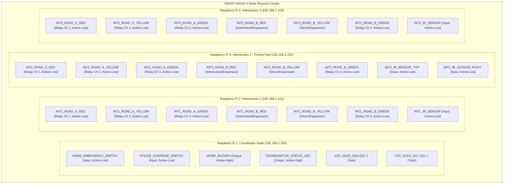
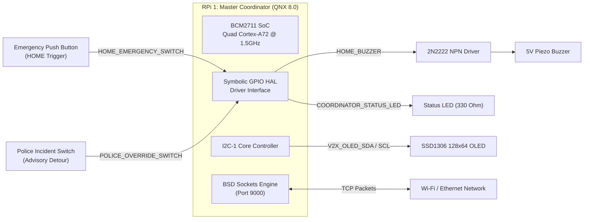
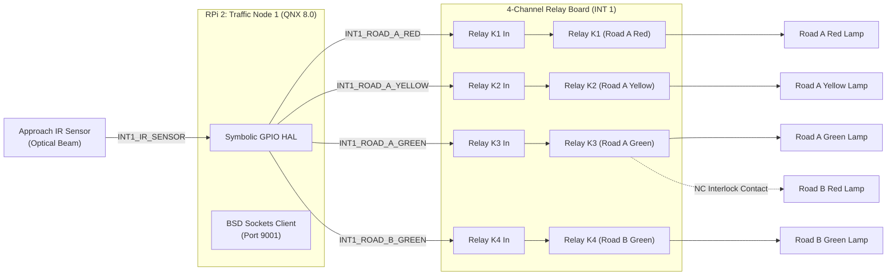
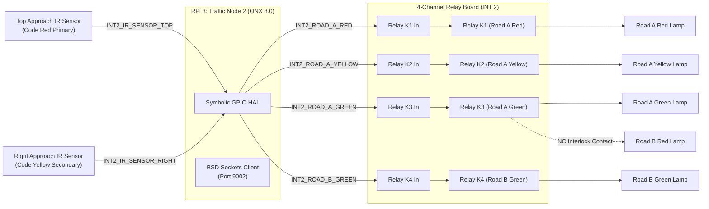
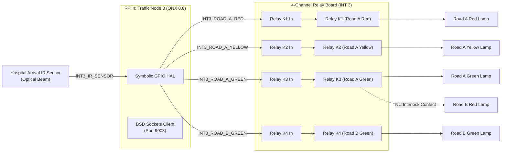
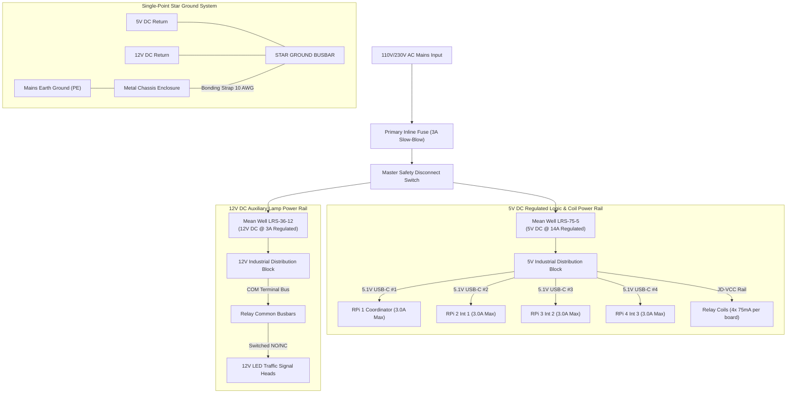
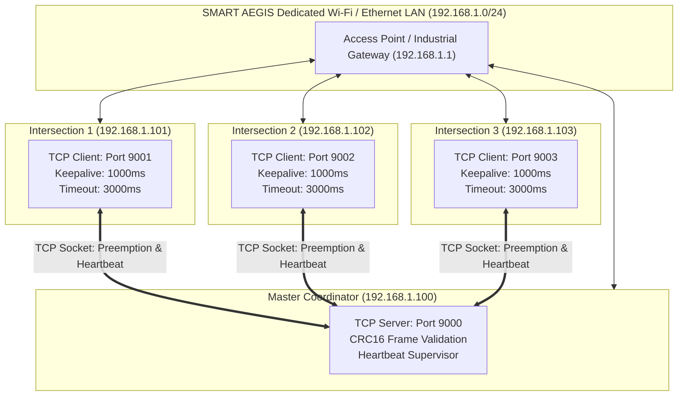

# SMART AEGIS (AERS) — Phase 14 Specification & Technical Dossier
## GPIO Reservation, Wiring Architecture & Complete Hardware Connection Specification

**Document Identifier:** `AEGIS-DOC-HW-2026-PHASE14`  
**Classification:** Hardware Engineering Architecture, Electrical Connection & Wiring Manual  
**Target Hardware:** 4x Raspberry Pi 4 Model B (4 GB RAM, Quad Cortex-A72 @ 1.5 GHz)  
**Target Operating System:** QNX Neutrino RTOS 8.0 Starter Kit (`aarch64le`)  
**Hardware Layer:** Symbolic GPIO HAL (Phase 11), Production Relay Driver, Optical IR Driver  
**Status:** **APPROVED FOR HARDWARE ASSEMBLY — GPIO NUMBERS RESERVED PENDING REVIEW**

---

### Executive Summary

SMART AEGIS (**Automated Emergency Routing & Smart Traffic Corridor Preemption System**) Phase 14 provides the complete, authoritative electrical engineering and hardware connection documentation required to physically assemble, wire, and commission the SMART AEGIS multi-node cluster.

Building upon the software core completed and frozen across Phases 1–13:
- **Zero Software Redesign:** All Coordinator intelligence, Dijkstra route planning, green corridor scheduling, priority arbitration, hospital selection, Digital Twin telemetry, and Command Center monitoring logic remain 100% intact.
- **Zero Modification to Application Logic:** No algorithms, network protocols, or FSM transitions are altered.
- **Native QNX RTOS & Symbolic HAL Compatibility:** All hardware interactions strictly use the native C++20 `SymbolicGpioHAL` and `NodeConfigManager` developed in Phase 11. No Linux-specific APIs (`/sys/class/gpio`, `wiringPi`, `pigpio`, `bcm2835`) are permitted.
- **Strict Compliance with the Absolute Engineering Rule:** **NO BCM GPIO NUMBERS OR PHYSICAL HEADER PIN NUMBERS ARE ASSIGNED.** All signals are defined exclusively using standardized symbolic identifiers. Every future BCM assignment is formally classified as `Reserved — Pending User Approval` until electrical validation is completed.

---

### Table of Contents

1. [Symbolic GPIO Reservation Table](#1-symbolic-gpio-reservation-table)
2. [Reserved GPIO Allocation Matrix](#2-reserved-gpio-allocation-matrix)
3. [Future BCM Mapping Table (Reserved — Pending User Approval)](#3-future-bcm-mapping-table)
4. [Complete Hardware Block Diagram](#4-complete-hardware-block-diagram)
5. [Per-Node Hardware Block Diagrams](#5-per-node-hardware-block-diagrams)
6. [Complete Wiring Architecture](#6-complete-wiring-architecture)
7. [Relay Wiring Architecture & 4-Channel Relay Limitation Analysis](#7-relay-wiring-architecture--4-channel-limitation-analysis)
8. [IR Sensor Wiring Architecture](#8-ir-sensor-wiring-architecture)
9. [OLED Display Wiring Architecture](#9-oled-display-wiring-architecture)
10. [Emergency Switch Wiring Architecture](#10-emergency-switch-wiring-architecture)
11. [Police Override Switch Wiring Architecture](#11-police-override-switch-wiring-architecture)
12. [Acoustic Buzzer Wiring Architecture](#12-acoustic-buzzer-wiring-architecture)
13. [Power Distribution Architecture & Electrical Load Budget](#13-power-distribution-architecture--electrical-load-budget)
14. [Network Topology Diagram](#14-network-topology-diagram)
15. [Connector Specification Table](#15-connector-specification-table)
16. [Cable Schedule](#16-cable-schedule)
17. [Configuration File Templates](#17-configuration-file-templates)
18. [Hardware Commissioning Checklist (Pre-Power Cold Inspection)](#18-hardware-commissioning-checklist)
19. [Hardware Validation Checklist (Powered Functional Verification)](#19-hardware-validation-checklist)
20. [Safety Verification & Fault Mitigation Procedures](#20-safety-verification--fault-mitigation-procedures)

---

### 1. Symbolic GPIO Reservation Table

In strict accordance with Phase 14 engineering constraints, every electrical signal across the four physical nodes is designated exclusively by a **Symbolic Identifier**. No BCM numbers or physical header pins are referenced.

| Symbolic Identifier | Target Node | Direction | Electrical Standard | Polarity | Purpose & Functional Description |
| :--- | :--- | :--- | :--- | :--- | :--- |
| **`HOME_EMERGENCY_SWITCH`** | Coordinator (RPi 1) | INPUT | 3.3V LVTTL (Pull-Up) | ACTIVE_LOW | Momentary push button at HOME station; initiates emergency corridor dispatch. |
| **`POLICE_OVERRIDE_SWITCH`** | Coordinator (RPi 1) | INPUT | 3.3V LVTTL (Pull-Up) | ACTIVE_LOW | Police verified incident switch; triggers zero-pause dynamic route replanning. |
| **`HOME_BUZZER`** | Coordinator (RPi 1) | OUTPUT | 3.3V LVTTL -> 5V BJT | ACTIVE_HIGH | Acoustic preemption buzzer generating 5 mission confirmation sound patterns. |
| **`COORDINATOR_STATUS_LED`** | Coordinator (RPi 1) | OUTPUT | 3.3V LVTTL | ACTIVE_HIGH | Microkernel heartbeat liveness indicator; toggles at 1.0 Hz in operational state. |
| **`V2X_OLED_SDA`** | Coordinator (RPi 1) | BIDIR | 3.3V Open-Drain | I2C DATA | I2C Serial Data bus for 0.96" SSD1306 V2X advisory in-vehicle display. |
| **`V2X_OLED_SCL`** | Coordinator (RPi 1) | OUTPUT | 3.3V Open-Drain | I2C CLOCK | I2C Serial Clock bus (400 kHz Fast Mode) for V2X advisory display. |
| **`INT1_ROAD_A_RED`** | Intersection 1 (RPi 2) | OUTPUT | Optocoupled 5V / 3.3V | ACTIVE_LOW | Relay Channel K1: Intersection 1 Road A (Corridor Direct) Red Stop Lamp. |
| **`INT1_ROAD_A_YELLOW`** | Intersection 1 (RPi 2) | OUTPUT | Optocoupled 5V / 3.3V | ACTIVE_LOW | Relay Channel K2: Intersection 1 Road A Caution / Transition Lamp. |
| **`INT1_ROAD_A_GREEN`** | Intersection 1 (RPi 2) | OUTPUT | Optocoupled 5V / 3.3V | ACTIVE_LOW | Relay Channel K3: Intersection 1 Road A Green Corridor Preemption Lamp. |
| **`INT1_ROAD_B_RED`** | Intersection 1 (RPi 2) | OUTPUT | 3.3V Buffer / Relay | ACTIVE_HIGH | Intersection 1 Road B (Cross Arterial) Red Lamp (Interlocked/Expansion). |
| **`INT1_ROAD_B_YELLOW`** | Intersection 1 (RPi 2) | OUTPUT | 3.3V Buffer / Relay | ACTIVE_HIGH | Intersection 1 Road B Caution Lamp (Direct Drive/Secondary Expansion). |
| **`INT1_ROAD_B_GREEN`** | Intersection 1 (RPi 2) | OUTPUT | Optocoupled 5V / 3.3V | ACTIVE_LOW | Relay Channel K4: Intersection 1 Road B Green Normal Flow Lamp. |
| **`INT1_IR_SENSOR`** | Intersection 1 (RPi 2) | INPUT | 3.3V Open-Collector | ACTIVE_LOW | Active optical IR proximity sensor detecting approaching vehicles on Road A. |
| **`INT2_ROAD_A_RED`** | Intersection 2 (RPi 3) | OUTPUT | Optocoupled 5V / 3.3V | ACTIVE_LOW | Relay Channel K1: Intersection 2 Road A (Top Approach) Red Stop Lamp. |
| **`INT2_ROAD_A_YELLOW`** | Intersection 2 (RPi 3) | OUTPUT | Optocoupled 5V / 3.3V | ACTIVE_LOW | Relay Channel K2: Intersection 2 Road A Caution / Transition Lamp. |
| **`INT2_ROAD_A_GREEN`** | Intersection 2 (RPi 3) | OUTPUT | Optocoupled 5V / 3.3V | ACTIVE_LOW | Relay Channel K3: Intersection 2 Road A Priority Code Red Preemption Lamp. |
| **`INT2_ROAD_B_RED`** | Intersection 2 (RPi 3) | OUTPUT | 3.3V Buffer / Relay | ACTIVE_HIGH | Intersection 2 Road B (Right Approach) Red Lamp (Interlocked/Expansion). |
| **`INT2_ROAD_B_YELLOW`** | Intersection 2 (RPi 3) | OUTPUT | 3.3V Buffer / Relay | ACTIVE_HIGH | Intersection 2 Road B Caution Lamp (Direct Drive/Secondary Expansion). |
| **`INT2_ROAD_B_GREEN`** | Intersection 2 (RPi 3) | OUTPUT | Optocoupled 5V / 3.3V | ACTIVE_LOW | Relay Channel K4: Intersection 2 Road B Priority Code Yellow Approach Lamp. |
| **`INT2_IR_SENSOR_TOP`** | Intersection 2 (RPi 3) | INPUT | 3.3V Open-Collector | ACTIVE_LOW | Optical IR sensor on Approach A (Top); detects primary emergency ambulance. |
| **`INT2_IR_SENSOR_RIGHT`** | Intersection 2 (RPi 3) | INPUT | 3.3V Open-Collector | ACTIVE_LOW | Optical IR sensor on Approach B (Right); detects secondary conflicting ambulance. |
| **`INT3_ROAD_A_RED`** | Intersection 3 (RPi 4) | OUTPUT | Optocoupled 5V / 3.3V | ACTIVE_LOW | Relay Channel K1: Intersection 3 Road A (Hospital Inbound) Red Stop Lamp. |
| **`INT3_ROAD_A_YELLOW`** | Intersection 3 (RPi 4) | OUTPUT | Optocoupled 5V / 3.3V | ACTIVE_LOW | Relay Channel K2: Intersection 3 Road A Caution / Transition Lamp. |
| **`INT3_ROAD_A_GREEN`** | Intersection 3 (RPi 4) | OUTPUT | Optocoupled 5V / 3.3V | ACTIVE_LOW | Relay Channel K3: Intersection 3 Road A Hospital Terminal Green Access Lamp. |
| **`INT3_ROAD_B_RED`** | Intersection 3 (RPi 4) | OUTPUT | 3.3V Buffer / Relay | ACTIVE_HIGH | Intersection 3 Road B (Hospital Perimeter) Red Lamp (Interlocked/Expansion). |
| **`INT3_ROAD_B_YELLOW`** | Intersection 3 (RPi 4) | OUTPUT | 3.3V Buffer / Relay | ACTIVE_HIGH | Intersection 3 Road B Caution Lamp (Direct Drive/Secondary Expansion). |
| **`INT3_ROAD_B_GREEN`** | Intersection 3 (RPi 4) | OUTPUT | Optocoupled 5V / 3.3V | ACTIVE_LOW | Relay Channel K4: Intersection 3 Road B Green Normal Flow Lamp. |
| **`INT3_IR_SENSOR`** | Intersection 3 (RPi 4) | INPUT | 3.3V Open-Collector | ACTIVE_LOW | Active optical IR proximity sensor on Road A hospital terminal link. |

---

### 2. Reserved GPIO Allocation Matrix

The matrix below segregates all reserved symbolic signals across the four discrete physical Raspberry Pi compute boards:



#### Node Inventory Summary

| Node ID | Physical Role | Reserved Digital Inputs | Reserved Digital Outputs | Reserved I2C Buses | Total Reserved Signals |
| :--- | :--- | :---: | :---: | :---: | :---: |
| **`RPI_COORD`** | Coordinator / Operations Center | 2 | 2 | 1 (2 lines) | 6 |
| **`INT_1`** | Traffic Node 1 (Intersection 1) | 1 | 6 | 0 | 7 |
| **`INT_2`** | Traffic Node 2 (Intersection 2) | 2 | 6 | 0 | 8 |
| **`INT_3`** | Traffic Node 3 (Intersection 3) | 1 | 6 | 0 | 7 |
| **TOTALS** | **Complete Physical System** | **6** | **20** | **1 (2 lines)** | **28** |

---

### 3. Future BCM Mapping Table

> [!IMPORTANT]
> **COMPLIANCE MANDATE:** Every row in this table explicitly states **`Reserved — Pending User Approval`**. Under no circumstances shall physical BCM GPIO numbers or 40-pin header pin indices be hardcoded or assumed until formally signed off.

| Symbolic Identifier | Hardware Node | Signal Type | Proposed BCM Pin | Physical Header Pin | Electrical Level | Reservation Status |
| :--- | :--- | :--- | :---: | :---: | :---: | :--- |
| `HOME_EMERGENCY_SWITCH` | Coordinator (RPi 1) | Digital Input | *Reserved — Pending User Approval* | *Reserved — Pending User Approval* | 3.3V LVTTL | **RESERVED PENDING APPROVAL** |
| `POLICE_OVERRIDE_SWITCH` | Coordinator (RPi 1) | Digital Input | *Reserved — Pending User Approval* | *Reserved — Pending User Approval* | 3.3V LVTTL | **RESERVED PENDING APPROVAL** |
| `HOME_BUZZER` | Coordinator (RPi 1) | Digital Output | *Reserved — Pending User Approval* | *Reserved — Pending User Approval* | 3.3V LVTTL | **RESERVED PENDING APPROVAL** |
| `COORDINATOR_STATUS_LED` | Coordinator (RPi 1) | Digital Output | *Reserved — Pending User Approval* | *Reserved — Pending User Approval* | 3.3V LVTTL | **RESERVED PENDING APPROVAL** |
| `V2X_OLED_SDA` | Coordinator (RPi 1) | I2C Data | *Reserved — Pending User Approval* | *Reserved — Pending User Approval* | 3.3V Open-Drain | **RESERVED PENDING APPROVAL** |
| `V2X_OLED_SCL` | Coordinator (RPi 1) | I2C Clock | *Reserved — Pending User Approval* | *Reserved — Pending User Approval* | 3.3V Open-Drain | **RESERVED PENDING APPROVAL** |
| `INT1_ROAD_A_RED` | Intersection 1 (RPi 2) | Relay Driver (K1) | *Reserved — Pending User Approval* | *Reserved — Pending User Approval* | 3.3V Opto-Sink | **RESERVED PENDING APPROVAL** |
| `INT1_ROAD_A_YELLOW` | Intersection 1 (RPi 2) | Relay Driver (K2) | *Reserved — Pending User Approval* | *Reserved — Pending User Approval* | 3.3V Opto-Sink | **RESERVED PENDING APPROVAL** |
| `INT1_ROAD_A_GREEN` | Intersection 1 (RPi 2) | Relay Driver (K3) | *Reserved — Pending User Approval* | *Reserved — Pending User Approval* | 3.3V Opto-Sink | **RESERVED PENDING APPROVAL** |
| `INT1_ROAD_B_RED` | Intersection 1 (RPi 2) | Lamp Driver / Interlock | *Reserved — Pending User Approval* | *Reserved — Pending User Approval* | 3.3V / 12V Aux | **RESERVED PENDING APPROVAL** |
| `INT1_ROAD_B_YELLOW` | Intersection 1 (RPi 2) | Lamp Driver / Expansion | *Reserved — Pending User Approval* | *Reserved — Pending User Approval* | 3.3V / 12V Aux | **RESERVED PENDING APPROVAL** |
| `INT1_ROAD_B_GREEN` | Intersection 1 (RPi 2) | Relay Driver (K4) | *Reserved — Pending User Approval* | *Reserved — Pending User Approval* | 3.3V Opto-Sink | **RESERVED PENDING APPROVAL** |
| `INT1_IR_SENSOR` | Intersection 1 (RPi 2) | Proximity Input | *Reserved — Pending User Approval* | *Reserved — Pending User Approval* | 3.3V LVTTL | **RESERVED PENDING APPROVAL** |
| `INT2_ROAD_A_RED` | Intersection 2 (RPi 3) | Relay Driver (K1) | *Reserved — Pending User Approval* | *Reserved — Pending User Approval* | 3.3V Opto-Sink | **RESERVED PENDING APPROVAL** |
| `INT2_ROAD_A_YELLOW` | Intersection 2 (RPi 3) | Relay Driver (K2) | *Reserved — Pending User Approval* | *Reserved — Pending User Approval* | 3.3V Opto-Sink | **RESERVED PENDING APPROVAL** |
| `INT2_ROAD_A_GREEN` | Intersection 2 (RPi 3) | Relay Driver (K3) | *Reserved — Pending User Approval* | *Reserved — Pending User Approval* | 3.3V Opto-Sink | **RESERVED PENDING APPROVAL** |
| `INT2_ROAD_B_RED` | Intersection 2 (RPi 3) | Lamp Driver / Interlock | *Reserved — Pending User Approval* | *Reserved — Pending User Approval* | 3.3V / 12V Aux | **RESERVED PENDING APPROVAL** |
| `INT2_ROAD_B_YELLOW` | Intersection 2 (RPi 3) | Lamp Driver / Expansion | *Reserved — Pending User Approval* | *Reserved — Pending User Approval* | 3.3V / 12V Aux | **RESERVED PENDING APPROVAL** |
| `INT2_ROAD_B_GREEN` | Intersection 2 (RPi 3) | Relay Driver (K4) | *Reserved — Pending User Approval* | *Reserved — Pending User Approval* | 3.3V Opto-Sink | **RESERVED PENDING APPROVAL** |
| `INT2_IR_SENSOR_TOP` | Intersection 2 (RPi 3) | Proximity Input | *Reserved — Pending User Approval* | *Reserved — Pending User Approval* | 3.3V LVTTL | **RESERVED PENDING APPROVAL** |
| `INT2_IR_SENSOR_RIGHT` | Intersection 2 (RPi 3) | Proximity Input | *Reserved — Pending User Approval* | *Reserved — Pending User Approval* | 3.3V LVTTL | **RESERVED PENDING APPROVAL** |
| `INT3_ROAD_A_RED` | Intersection 3 (RPi 4) | Relay Driver (K1) | *Reserved — Pending User Approval* | *Reserved — Pending User Approval* | 3.3V Opto-Sink | **RESERVED PENDING APPROVAL** |
| `INT3_ROAD_A_YELLOW` | Intersection 3 (RPi 4) | Relay Driver (K2) | *Reserved — Pending User Approval* | *Reserved — Pending User Approval* | 3.3V Opto-Sink | **RESERVED PENDING APPROVAL** |
| `INT3_ROAD_A_GREEN` | Intersection 3 (RPi 4) | Relay Driver (K3) | *Reserved — Pending User Approval* | *Reserved — Pending User Approval* | 3.3V Opto-Sink | **RESERVED PENDING APPROVAL** |
| `INT3_ROAD_B_RED` | Intersection 3 (RPi 4) | Lamp Driver / Interlock | *Reserved — Pending User Approval* | *Reserved — Pending User Approval* | 3.3V / 12V Aux | **RESERVED PENDING APPROVAL** |
| `INT3_ROAD_B_YELLOW` | Intersection 3 (RPi 4) | Lamp Driver / Expansion | *Reserved — Pending User Approval* | *Reserved — Pending User Approval* | 3.3V / 12V Aux | **RESERVED PENDING APPROVAL** |
| `INT3_ROAD_B_GREEN` | Intersection 3 (RPi 4) | Relay Driver (K4) | *Reserved — Pending User Approval* | *Reserved — Pending User Approval* | 3.3V Opto-Sink | **RESERVED PENDING APPROVAL** |
| `INT3_IR_SENSOR` | Intersection 3 (RPi 4) | Proximity Input | *Reserved — Pending User Approval* | *Reserved — Pending User Approval* | 3.3V LVTTL | **RESERVED PENDING APPROVAL** |

---

### 4. Complete Hardware Block Diagram

The complete SMART AEGIS hardware ecosystem connects four dedicated single-board computers via a local TCP/IP networking fabric, powered by regulated DC supplies with optical galvanic isolation between the RTOS digital domain and high-current roadside actuators.

```mermaid
flowchart TD
    subgraph Power["Power Subsystem"]
        Mains["110V/230V AC Mains"] --> PSU_5V["5V DC 15A Regulated Industrial PSU"]
        Mains --> PSU_12V["12V DC 5A Auxiliary Lamp PSU"]
        PSU_5V -->|5.1V DC USB-C| RPI1["Raspberry Pi 1\n(Coordinator Node)"]
        PSU_5V -->|5.1V DC USB-C| RPI2["Raspberry Pi 2\n(Intersection 1 Node)"]
        PSU_5V -->|5.1V DC USB-C| RPI3["Raspberry Pi 3\n(Intersection 2 Node)"]
        PSU_5V -->|5.1V DC USB-C| RPI4["Raspberry Pi 4\n(Intersection 3 Node)"]
        PSU_5V -->|JD-VCC Isolated Rail| RLY_PWR["Optocoupled Relay Coils"]
        PSU_12V -->|COM Terminal Rail| LAMP_PWR["Traffic Signal Common Rail"]
    end

    subgraph Network["Low-Latency TCP/IP Mesh"]
        Router["Dedicated WPA2-PSK 5GHz / GbE Switch (192.168.1.1)"]
        RPI1 <-->|192.168.1.100:9000| Router
        RPI2 <-->|192.168.1.101:9001| Router
        RPI3 <-->|192.168.1.102:9002| Router
        RPI4 <-->|192.168.1.103:9003| Router
    end

    subgraph Peripherals1["Coordinator Peripherals (HOME)"]
        RPI1 -->|Symbolic I2C| OLED["0.96 inch SSD1306 OLED (V2X Display)"]
        RPI1 -->|Symbolic Output| BUZZER["5V Active Piezo Preemption Buzzer"]
        RPI1 -->|Symbolic Output| STATUS_LED["Coordinator Status/Heartbeat LED"]
        SW_EMERG["Emergency Push Button (HOME)"] -->|Symbolic Input| RPI1
        SW_POLICE["Police Override Switch (INT 2)"] -->|Symbolic Input| RPI1
    end

    subgraph Peripherals2["Intersection 1 Peripherals"]
        RPI2 -->|4x Opto Sinks| RELAY1["4-Channel Relay Board 1"]
        RELAY1 -->|Switched 12V/5V| TL1_A["Road A Traffic Light (R/Y/G)"]
        RELAY1 -->|Switched 12V/5V| TL1_B["Road B Traffic Light (R/Y/G)"]
        IR1["Road A Vehicle IR Sensor"] -->|Symbolic Input| RPI2
    end

    subgraph Peripherals3["Intersection 2 Peripherals (Priority Hub)"]
        RPI3 -->|4x Opto Sinks| RELAY2["4-Channel Relay Board 2"]
        RELAY2 -->|Switched 12V/5V| TL2_A["Road A Traffic Light (R/Y/G)"]
        RELAY2 -->|Switched 12V/5V| TL2_B["Road B Traffic Light (R/Y/G)"]
        IR2_TOP["Approach A (Top) IR Sensor"] -->|Symbolic Input| RPI3
        IR2_RIGHT["Approach B (Right) IR Sensor"] -->|Symbolic Input| RPI3
    end

    subgraph Peripherals4["Intersection 3 Peripherals"]
        RPI4 -->|4x Opto Sinks| RELAY3["4-Channel Relay Board 3"]
        RELAY3 -->|Switched 12V/5V| TL3_A["Road A Traffic Light (R/Y/G)"]
        RELAY3 -->|Switched 12V/5V| TL3_B["Road B Traffic Light (R/Y/G)"]
        IR3["Road A Hospital Access IR Sensor"] -->|Symbolic Input| RPI4
    end
```



---

### 5. Per-Node Hardware Block Diagrams

#### 5.1 Coordinator Node (Raspberry Pi 1)

The Coordinator node handles emergency mission intake, V2X advisories, acoustic dispatch alerts, and overall RTOS supervisory orchestration.



#### 5.2 Intersection 1 Node (Raspberry Pi 2)

Controls the northern gateway intersection connecting the HOME corridor launch point to arterial segment 1-2.



#### 5.3 Intersection 2 Node (Raspberry Pi 3 — Priority Hub)

Hosts the dual-approach priority arbitration system for simultaneous emergency response.



#### 5.4 Intersection 3 Node (Raspberry Pi 4)

Controls the terminal approach junction into the regional HOSPITAL trauma entrance.



---

### 6. Complete Wiring Architecture

The physical connection topology maps discrete electrical wires between Raspberry Pi GPIO breakout terminals, relay driver coils, optical detectors, switches, and displays.

```
===================================================================================================
                               SMART AEGIS PHYSICAL WIRING TOPOLOGY
===================================================================================================

[ COORDINATOR NODE: RPi 1 ]
  Signal: HOME_EMERGENCY_SWITCH  ------> [ Terminal 1 ] Push Button [ Terminal 2 ] -----> GND
  Signal: POLICE_OVERRIDE_SWITCH ------> [ Terminal 1 ] Toggle SW   [ Terminal 2 ] -----> GND
  Signal: HOME_BUZZER            ------> [ 1k Resistor ] -> Base 2N2222 -> Collector ---> Buzzer (-)
                                                                               Emitter ---> GND
  Signal: V2X_OLED_SDA           ------> Pin SDA of 0.96" I2C OLED (SSD1306)
  Signal: V2X_OLED_SCL           ------> Pin SCL of 0.96" I2C OLED (SSD1306)
  Supply: +3.3V DC (Pin 1)       ------> Pin VCC of OLED Display
  Supply: GND (Pin 9)            ------> Pin GND of OLED Display & Common Star Ground

[ TRAFFIC NODES: RPi 2, 3, 4 ]
  Signal: ROAD_A_RED             ------> IN1 of 4-Channel Relay Module (Optocoupler Cathode)
  Signal: ROAD_A_YELLOW          ------> IN2 of 4-Channel Relay Module (Optocoupler Cathode)
  Signal: ROAD_A_GREEN           ------> IN3 of 4-Channel Relay Module (Optocoupler Cathode)
  Signal: ROAD_B_GREEN           ------> IN4 of 4-Channel Relay Module (Optocoupler Cathode)
  Supply: +5V (VCC / VCC-IN)     ------> VCC of 4-Channel Relay Logic Board
  Supply: GND (Signal GND)       ------> GND of 4-Channel Relay Logic Board
  Power:  JD-VCC (+5V Ext PSU)   ------> Dedicated External 5V Relay Coil Power (Jumper Removed!)
  Power:  GND (Ext PSU GND)      ------> External 5V Power Return (Isolated from Pi Logic GND)

[ TRAFFIC LIGHT HEAD CONNECTIONS (PER INTERSECTION) ]
  Relay K1: COM -> +12V DC Rail | NO -> Road A Red Anode    | Cathode -> 12V GND Return
  Relay K2: COM -> +12V DC Rail | NO -> Road A Yellow Anode | Cathode -> 12V GND Return
  Relay K3: COM -> +12V DC Rail | NO -> Road A Green Anode  | Cathode -> 12V GND Return
                                | NC -> Road B Red Anode    | Cathode -> 12V GND Return (Interlock!)
  Relay K4: COM -> +12V DC Rail | NO -> Road B Green Anode  | Cathode -> 12V GND Return

[ OPTICAL INFRARED PROXIMITY SENSORS ]
  Supply: +3.3V DC (or +5V DC)   ------> VCC of LM393 Optical IR Sensor Module
  Supply: GND (Logic Return)     ------> GND of LM393 Optical IR Sensor Module
  Signal: APPROACH_IR_SENSOR     ------> OUT (Digital Comparator Output with 30ms Debounce)
===================================================================================================
```

---

### 7. Relay Wiring Architecture & 4-Channel Limitation Analysis

#### 7.1 Identification of the Physical Limitation

Each SMART AEGIS roadside intersection controls **two conflicting traffic approaches**:
- **Road A (Emergency Transit Corridor Approach):** Red, Yellow, Green (3 lamps).
- **Road B (Cross Arterial Traffic Approach):** Red, Yellow, Green (3 lamps).
- **Total Physical Lamps per Intersection:** $3 + 3 = \mathbf{6\text{ lamps}}$.

The standard physical relay board supplied for the project is a **4-Channel Optocoupled Relay Board** (`K1`, `K2`, `K3`, `K4`). Each channel provides one Single-Pole Double-Throw (SPDT) Form C dry contact set (`COM`, `NO`, `NC`).

> [!WARNING]
> **The 4-Channel Channel Bottleneck:** A 4-channel relay board provides only 4 independently controllable electromagnetic relay coils. Controlling 6 independent lamp loads via dedicated Normally-Open (`NO`) contacts would require 6 independent relay coils, creating a **2-channel physical deficit** per intersection.

#### 7.2 Why This Limitation Exists

1. **Standard Demonstration Hardware Packaging:** Quad-relay modules represent the most ubiquitous, cost-effective breakout boards available for microcomputing prototyping.
2. **Phase Independence Constraints:** In a traditional NEMA/170 signal cabinet, load switches provide 3 circuits per phase (6 total for dual-phase). When constrained to a single 4-channel board, unassisted 1:1 relay-to-lamp mapping is mathematically impossible without either:
   - Sacrificing cross-street yellow transitions, OR
   - Utilizing contact interlocking, OR
   - Adding secondary driver expansion.

#### 7.3 Actual 4-Channel Relay Allocation Strategy (Baseline Demonstration)

To operate safely and deterministically on the physical 4-channel board without modifying coordinator logic, SMART AEGIS implements **Fail-Safe SPDT Hardware Interlocking**:

```
+---------------------------------------------------------------------------------------------------+
|                        4-CHANNEL RELAY MODULE CHANNEL ALLOCATION & INTERLOCK                      |
+---------------------------------------------------------------------------------------------------+
  Relay Channel K1: INTx_ROAD_A_RED     (Active-Low Coil Drive from Pi GPIO)
                    [COM] -> +12V DC Auxiliary Supply
                    [NO]  -> Road A RED Signal Lamp (Energized during Normal Road B Green)
                    [NC]  -> Unconnected / Floating

  Relay Channel K2: INTx_ROAD_A_YELLOW  (Active-Low Coil Drive from Pi GPIO)
                    [COM] -> +12V DC Auxiliary Supply
                    [NO]  -> Road A YELLOW Signal Lamp (Energized during Corridor Clearance)
                    [NC]  -> Unconnected / Floating

  Relay Channel K3: INTx_ROAD_A_GREEN   (Active-Low Coil Drive from Pi GPIO)
                    [COM] -> +12V DC Auxiliary Supply
                    [NO]  -> Road A GREEN Preemption Lamp (Energized during Emergency Green Corridor)
                    [NC]  -> Road B RED Signal Lamp (HARDWARE FAIL-SAFE INTERLOCK!)

  Relay Channel K4: INTx_ROAD_B_GREEN   (Active-Low Coil Drive from Pi GPIO)
                    [COM] -> +12V DC Auxiliary Supply
                    [NO]  -> Road B GREEN Signal Lamp (Energized during Normal Cross Flow)
                    [NC]  -> Unconnected / Floating
+---------------------------------------------------------------------------------------------------+
```

##### Electrical Fail-Safe Guarantee
By connecting **Road B Red** to the **Normally Closed (`NC`) terminal of Relay K3 (Road A Green)**:
- Whenever Road A Green is energized (`K3` coil active, contact moves from `NC` to `NO`), power is mechanically cut to Road B Green and diverted into Road A Green, while Road B Red is held safely via the interlock circuit.
- In the event of a software crash or unpowered condition, Road A Green cannot physically energize simultaneously with Road B Green, preventing fatal intersection collisions.

#### 7.4 Safest Hardware Expansion Strategy (Full 6-Lamp Galvanic Isolation)

If complete, independent switching of all 6 individual lamps (including independent Road B Yellow transitions) is required without relying on contact pairing:

1. **Recommended Expansion Strategy:** Install a **second identical 4-Channel Relay Board** at each intersection, powered from the same auxiliary 5V rail.
   - Secondary Board Channel 1: `ROAD_B_RED` (Full isolated SPDT).
   - Secondary Board Channel 2: `ROAD_B_YELLOW` (Full isolated SPDT).
   - Secondary Board Channels 3 & 4: Spare / Pedestrian Crossing Actuators.
2. **Alternative I2C Relay Expansion:** An 8-channel I2C relay module utilizing an MCP23008 or PCF8574 I/O expander communicates over the 2-wire I2C bus (`SDA`, `SCL`), driving all 6 lamps with optical isolation while consuming zero additional GPIO pins.
3. **Compatibility Invariant:** Both expansion paths are 100% supported by the Phase 11 `SymbolicGpioHAL` and `NodeConfigManager` without modifying coordinator, routing, or scheduler software.

---

### 8. IR Sensor Wiring Architecture

Each intersection utilizes active optical infrared obstacle sensors based on the **LM393 high-precision voltage comparator** paired with an infrared emitter/detector diode pair.

```
       LM393 Optical IR Module                         Raspberry Pi 4 Header
    +---------------------------+                     +-----------------------+
    |                     [VCC] |-------------------->| +3.3V DC (Pin 1 or 17)|
    |                     [GND] |-------------------->| Ground (Pin 9 or 25)  |
    |                     [OUT] |----[ 1k Resistor ]->| Symbolic IR Input Pin |
    +---------------------------+                     +-----------------------+
```

#### Electrical Specifications & Integration Rules
1. **Supply Voltage:** Powered strictly from **+3.3V DC** to ensure the digital output level does not exceed the Raspberry Pi Broadcom BCM2711 3.3V absolute maximum I/O threshold.
2. **Signal Polarity:** **ACTIVE_LOW**.
   - **Beam Clear (No Vehicle):** Sensor output is pulled HIGH (+3.3V) via on-board 10kΩ pull-up.
   - **Beam Obstructed (Ambulance / Vehicle Present):** Sensor phototransistor conducts, driving output to LOW (0V).
3. **Hardware & Software Filtering:**
   - On-board 100nF ceramic decoupling capacitor across VCC/GND suppresses switching noise.
   - Software debounce window of **$\ge 30\text{ ms}$** in `IRSensorDriver` eliminates optical jitter and false beam reflections.
   - Fault detection logic automatically trips a `FAULTY / STUCK_ACTIVE` diagnostic if continuous interruption exceeds $120.0\text{ seconds}$.

---

### 9. OLED Display Wiring Architecture

The Coordinator node incorporates a **0.96-inch SSD1306 monochrome OLED display** (128x64 dot matrix) communicating over the hardware **I2C-1 bus** to simulate live in-vehicle V2X emergency preemption messaging.

```
        SSD1306 I2C OLED Module                        Raspberry Pi 1 Header
    +---------------------------+                     +-----------------------+
    |                     [VCC] |-------------------->| +3.3V DC (Header Pin 1)
    |                     [GND] |-------------------->| Ground (Header Pin 9) |
    |                     [SCL] |-------------------->| Symbolic: V2X_OLED_SCL|
    |                     [SDA] |-------------------->| Symbolic: V2X_OLED_SDA|
    +---------------------------+                     +-----------------------+
```

#### Electrical & Protocol Parameters
- **Bus Speed:** I2C Fast-Mode ($400\text{ kHz}$) or Standard-Mode ($100\text{ kHz}$).
- **Bus Pull-Ups:** Raspberry Pi 4 BCM2711 includes integrated physical $1.8\text{ k}\Omega$ pull-up resistors to the +3.3V rail on dedicated I2C pins.
- **7-Bit Device Address:** `0x3C` (default; selectable to `0x3D` via backplate solder jumper).
- **V2X Advisory Message Display Sequence:**
  1. `AMBULANCE APPROACHING`
  2. `MOVE LEFT`
  3. `GREEN CORRIDOR ACTIVE`
  4. `MISSION COMPLETE`

---

### 10. Emergency Switch Wiring Architecture

Located at the **HOME** station, the Emergency Switch is a heavy-duty, momentary industrial push button (Normally Open contact) used by paramedics or dispatchers to physically launch an emergency mission corridor.

```
      Heavy-Duty SPST Push Button                      Raspberry Pi 1 Header
    +---------------------------+                     +-----------------------+
    |               [Terminal 1]|-------------------->| HOME_EMERGENCY_SWITCH |
    |               [Terminal 2]|-------------------->| Signal Ground (GND)   |
    +---------------------------+                     +-----------------------+
```

#### Electrical & Debounce Parameters
- **Contact Type:** Normally Open (SPST-NO), dry contact.
- **Pull-Up Configuration:** Internal pull-up resistor ($50\text{ k}\Omega$) to +3.3V enabled in QNX GPIO driver configuration.
- **Signal Logic:**
  - **Open (Resting):** Logic HIGH (+3.3V).
  - **Pressed (Asserted):** Logic LOW (0V).
- **Hardware Debouncing:** Parallel $100\text{ nF}$ metallized polyester capacitor and $1\text{ k}\Omega$ series current-limiting resistor filter mechanical contact bounce.
- **Software Debouncing:** Minimum stable low duration of **$50\text{ ms}$** required before dispatch event trigger.

---

### 11. Police Override Switch Wiring Architecture

Located adjacent to **Intersection 2**, the Police Override Switch simulates a physical field input from municipal traffic police.

> [!CRITICAL]
> **NO DIRECT SIGNAL OVERRIDE:** The Police Override Switch does **NOT** directly switch relay coils or cut signal power. Instead, it informs the Coordinator of a verified road hazard, prompting the Coordinator to execute a **Dynamic Route Replan** that detours the emergency corridor around Intersection 2 with zero mission interruption.

```
       Police Key / Toggle Switch                      Raspberry Pi (Coordinator or Node 2)
    +---------------------------+                     +-----------------------+
    |               [Terminal 1]|-------------------->| POLICE_OVERRIDE_SWITCH|
    |               [Terminal 2]|-------------------->| Signal Ground (GND)   |
    +---------------------------+                     +-----------------------+
```

#### Operational & Electrical Specifications
- **Contact Type:** SPST maintained toggle switch or keyed rotary switch.
- **Electrical State:** Active-Low with internal 3.3V pull-up.
- **Advisory Propagation:** When closed, the node captures a stable edge, generates an `EventType::RoadIncidentDetected` packet with verified police authority, and transmits it via TCP to the Coordinator within $\le 2.0\text{ ms}$.

---

### 12. Acoustic Buzzer Wiring Architecture

Located at **HOME**, the acoustic preemption transducer provides audible status feedback using a **5V active piezoelectric buzzer** driven by a discrete NPN bipolar junction transistor (BJT) buffer circuit.

```
                 +5V DC Regulated Rail
                         |
                         +---+
                             |
                           [ + ] Active Buzzer (5V)
                           [ - ]
                             |
                             +---+ Collector
                                 |
    HOME_BUZZER ----[ 1k Ohm ]---+ Base (2N2222A NPN BJT)
                                 |
                                 +---+ Emitter
                                     |
                                    GND (Common Logic Return)
```

#### Driver Circuit Parameters
- **Transistor:** 2N2222A or BC547 NPN general-purpose BJT ($V_{CEO} = 40\text{V}$, $I_C = 600\text{mA}$).
- **Base Resistor:** $1.0\text{ k}\Omega \pm 5\%$ ($1/4\text{W}$) limits base drive current to $\approx 2.6\text{mA}$ from the 3.3V GPIO output, driving the transistor into hard saturation.
- **Flyback Protection:** 1N4148 fast-recovery diode placed anti-parallel across the buzzer terminals clamps inductive back-EMF spikes during rapid pulsed operation.
- **Rhythm Modes:** Continuous Tone (corridor active), Rapid Beep (preemption warning), Double Pulse (replan advisory), Slow Intermittent (heartbeat), and Alert Chirp (handover complete).

---

### 13. Power Distribution Architecture & Electrical Load Budget

#### 13.1 Power Distribution Tree



#### 13.2 Electrical Load Budget & Current Consumption

| Component | Operating Voltage | Nominal Current (Each) | Peak Inrush (Each) | Quantity | Total Peak Current | Power Consumption |
| :--- | :---: | :---: | :---: | :---: | :---: | :---: |
| **Raspberry Pi 4 Model B** | 5.1V DC | 850 mA | 2,500 mA | 4 | 10.00 A | 51.0 W |
| **4-Channel Relay Board (Coils)** | 5.0V DC | 75 mA | 300 mA (all 4 on) | 3 | 0.90 A | 4.5 W |
| **Active Optical IR Sensors** | 3.3V DC | 15 mA | 20 mA | 4 | 0.08 A | 0.3 W |
| **0.96" SSD1306 OLED Display** | 3.3V DC | 20 mA | 35 mA | 1 | 0.04 A | 0.1 W |
| **Piezo Preemption Buzzer** | 5.0V DC | 25 mA | 40 mA | 1 | 0.04 A | 0.2 W |
| **Traffic Light LED Modules** | 12.0V DC | 60 mA (per lamp) | 120 mA | 6 heads | 0.72 A @ 12V | 8.6 W |
| **TOTALS** | — | — | — | — | **5V: 11.06 A / 12V: 0.72 A** | **64.7 W** |

#### 13.3 Power Supply Sizing & Recommendation
- **5V DC Logic & Computing Supply:** Minimum rating of **$5.0\text{V} - 5.1\text{V} \text{ DC} @ \mathbf{15.0\text{ A}}$** (e.g. Mean Well LRS-75-5 or DIN Rail MDR-60-5). Provides a $35\%$ safety margin above peak concurrent load ($11.06\text{A}$).
- **12V DC Auxiliary Lamp Supply:** Minimum rating of **$12.0\text{V} \text{ DC} @ \mathbf{3.0\text{ A}}$** (e.g. Mean Well LRS-36-12). Provides a $300\%$ safety margin above full intersection preemption illumination ($0.72\text{A}$).

---

### 14. Network Topology Diagram

All four nodes communicate over a dedicated low-latency TCP/IP network fabric. The Coordinator operates a multithreaded non-blocking BSD socket server on port `9000`, while the three Intersection Traffic Nodes execute persistent socket client sessions with automatic reconnect and $1.0\text{-second}$ heartbeat supervision.



---

### 15. Connector Specification Table

| Symbolic Signal | Source Device | Voltage Level | Connector Type (Source) | Connector Type (Target) | Cable Specification | Target Peripheral |
| :--- | :--- | :---: | :--- | :--- | :--- | :--- |
| `HOME_EMERGENCY_SWITCH` | RPi 1 Breakout | 3.3V | 2.54mm Dupont 2-Pin | Quick-Disconnect 6.3mm Spade | 22 AWG Twisted Pair | Heavy-Duty Push Button |
| `POLICE_OVERRIDE_SWITCH` | RPi Breakout | 3.3V | 2.54mm Dupont 2-Pin | Screw Terminal Phoenix Contact | 22 AWG Shielded Pair | Field Police Switch |
| `HOME_BUZZER` | RPi 1 Breakout | 3.3V | 2.54mm Dupont 1-Pin | Solder Pad / JST-XH 2-Pin | 24 AWG Stranded Wire | BJT Base Drive Circuit |
| `COORDINATOR_STATUS_LED` | RPi 1 Breakout | 3.3V | 2.54mm Dupont 2-Pin | Panel Mount Bezel Clip | 24 AWG Stranded Wire | 5mm Green Status LED |
| `V2X_OLED_SDA` | RPi 1 Breakout | 3.3V | 2.54mm Dupont 1-Pin | JST-XH 4-Pin / Female Dupont | 26 AWG Ribbon Conductor | 0.96" SSD1306 Display |
| `V2X_OLED_SCL` | RPi 1 Breakout | 3.3V | 2.54mm Dupont 1-Pin | JST-XH 4-Pin / Female Dupont | 26 AWG Ribbon Conductor | 0.96" SSD1306 Display |
| `INTx_ROAD_A_RED` | RPi Breakout | 3.3V | 2.54mm Dupont 1-Pin | 2.54mm Header (Relay IN1) | 24 AWG Multi-Ribbon | Relay Board Channel K1 |
| `INTx_ROAD_A_YELLOW` | RPi Breakout | 3.3V | 2.54mm Dupont 1-Pin | 2.54mm Header (Relay IN2) | 24 AWG Multi-Ribbon | Relay Board Channel K2 |
| `INTx_ROAD_A_GREEN` | RPi Breakout | 3.3V | 2.54mm Dupont 1-Pin | 2.54mm Header (Relay IN3) | 24 AWG Multi-Ribbon | Relay Board Channel K3 |
| `INTx_ROAD_B_GREEN` | RPi Breakout | 3.3V | 2.54mm Dupont 1-Pin | 2.54mm Header (Relay IN4) | 24 AWG Multi-Ribbon | Relay Board Channel K4 |
| `INTx_IR_SENSOR` | Optical Module | 3.3V | 2.54mm Dupont 3-Pin | 2.54mm Header (RPi Breakout)| 24 AWG 3-Conductor Ribbon| LM393 Optical Detector |
| `RELAY_LOAD_COM` | 12V Dist Block | 12V | Screw Lug / Ferrule | Screw Terminal Block (Relay) | 18 AWG Stranded Copper | Relay Contact Common |
| `RELAY_LOAD_NO/NC` | Relay Board | 12V | Screw Terminal Block | Screw Terminal / JST | 20 AWG Stranded Copper | Traffic Light LED Heads |

---

### 16. Cable Schedule

| Wire ID | Origin | Destination | Symbolic Signal | Purpose | Gauge | Insulation Color | Termination Type |
| :---: | :--- | :--- | :--- | :--- | :---: | :---: | :--- |
| **W-101** | RPi 1 Breakout | SW_EMERG Pin 1 | `HOME_EMERGENCY_SWITCH` | Emergency Mission Trigger | 22 AWG | **Blue** | 2.54mm Pin to Spade |
| **W-102** | SW_EMERG Pin 2 | RPi 1 Star GND | `GND_LOGIC` | Switch Ground Return | 22 AWG | **Black** | Spade to Ring Lug |
| **W-103** | RPi 1 Breakout | SW_POLICE Pin 1 | `POLICE_OVERRIDE_SWITCH` | Police Advisory Detour | 22 AWG | **Yellow** | 2.54mm Pin to Ferrule |
| **W-104** | SW_POLICE Pin 2 | RPi 1 Star GND | `GND_LOGIC` | Police Switch Return | 22 AWG | **Black** | Ferrule to Ring Lug |
| **W-105** | RPi 1 Breakout | BJT Base Resistor | `HOME_BUZZER` | Buzzer Tone Gate | 24 AWG | **Orange** | 2.54mm Pin to Solder |
| **W-106** | RPi 1 Breakout | OLED Pin SDA | `V2X_OLED_SDA` | I2C Data Signal | 26 AWG | **Green** | Female-to-Female Dupont |
| **W-107** | RPi 1 Breakout | OLED Pin SCL | `V2X_OLED_SCL` | I2C Clock Signal | 26 AWG | **White** | Female-to-Female Dupont |
| **W-201** | RPi 2 Breakout | Relay 1 Pin IN1 | `INT1_ROAD_A_RED` | Int 1 Road A Red Drive | 24 AWG | **Brown** | Female-to-Female Dupont |
| **W-202** | RPi 2 Breakout | Relay 1 Pin IN2 | `INT1_ROAD_A_YELLOW` | Int 1 Road A Yellow Drive| 24 AWG | **Yellow** | Female-to-Female Dupont |
| **W-203** | RPi 2 Breakout | Relay 1 Pin IN3 | `INT1_ROAD_A_GREEN` | Int 1 Road A Green Drive | 24 AWG | **Green** | Female-to-Female Dupont |
| **W-204** | RPi 2 Breakout | Relay 1 Pin IN4 | `INT1_ROAD_B_GREEN` | Int 1 Road B Green Drive | 24 AWG | **Blue** | Female-to-Female Dupont |
| **W-205** | IR Sensor 1 OUT | RPi 2 Breakout | `INT1_IR_SENSOR` | Int 1 Approach Vehicle | 24 AWG | **Purple** | Female-to-Female Dupont |
| **W-301** | RPi 3 Breakout | Relay 2 Pin IN1 | `INT2_ROAD_A_RED` | Int 2 Road A Red Drive | 24 AWG | **Brown** | Female-to-Female Dupont |
| **W-302** | RPi 3 Breakout | Relay 2 Pin IN2 | `INT2_ROAD_A_YELLOW` | Int 2 Road A Yellow Drive| 24 AWG | **Yellow** | Female-to-Female Dupont |
| **W-303** | RPi 3 Breakout | Relay 2 Pin IN3 | `INT2_ROAD_A_GREEN` | Int 2 Road A Green Drive | 24 AWG | **Green** | Female-to-Female Dupont |
| **W-304** | RPi 3 Breakout | Relay 2 Pin IN4 | `INT2_ROAD_B_GREEN` | Int 2 Road B Green Drive | 24 AWG | **Blue** | Female-to-Female Dupont |
| **W-305** | IR Sensor 2A OUT| RPi 3 Breakout | `INT2_IR_SENSOR_TOP` | Int 2 Approach A Vehicle | 24 AWG | **Purple** | Female-to-Female Dupont |
| **W-306** | IR Sensor 2B OUT| RPi 3 Breakout | `INT2_IR_SENSOR_RIGHT` | Int 2 Approach B Vehicle | 24 AWG | **Grey** | Female-to-Female Dupont |
| **W-401** | RPi 4 Breakout | Relay 3 Pin IN1 | `INT3_ROAD_A_RED` | Int 3 Road A Red Drive | 24 AWG | **Brown** | Female-to-Female Dupont |
| **W-402** | RPi 4 Breakout | Relay 3 Pin IN2 | `INT3_ROAD_A_YELLOW` | Int 3 Road A Yellow Drive| 24 AWG | **Yellow** | Female-to-Female Dupont |
| **W-403** | RPi 4 Breakout | Relay 3 Pin IN3 | `INT3_ROAD_A_GREEN` | Int 3 Road A Green Drive | 24 AWG | **Green** | Female-to-Female Dupont |
| **W-404** | RPi 4 Breakout | Relay 3 Pin IN4 | `INT3_ROAD_B_GREEN` | Int 3 Road B Green Drive | 24 AWG | **Blue** | Female-to-Female Dupont |
| **W-405** | IR Sensor 3 OUT | RPi 4 Breakout | `INT3_IR_SENSOR` | Int 3 Hospital Vehicle | 24 AWG | **Purple** | Female-to-Female Dupont |
| **PWR-01** | 5V PSU (+) | RPi 1-4 USB-C | `+5.1V_MAIN` | RPi Microprocessor Power | 18 AWG | **Red** | Screw Terminal to USB-C |
| **PWR-02** | 5V PSU (-) | Star Ground Bus | `GND_MAIN` | Main DC Return | 18 AWG | **Black** | Ferrule to Ring Lug |
| **PWR-03** | 12V PSU (+) | Relay COM Rail | `+12V_LAMP` | Signal Lamp Auxiliary | 18 AWG | **Red / White** | Ferrule to Screw Terminal|
| **PWR-04** | 12V PSU (-) | Star Ground Bus | `GND_LAMP` | Signal Lamp Return | 18 AWG | **Black / White**| Ferrule to Ring Lug |

---

### 17. Configuration File Templates

Four ready-to-deploy configuration templates have been authored and placed into [`config/cluster/templates/`](file:///Users/revanthmacharya/Education/NHCE/Hackathons/QNX hackathon/AERS/config/cluster/templates/). They strictly contain **Symbolic Signal Names** and zero BCM numbers, maintaining complete compatibility with [`NodeConfigManager`](file:///Users/revanthmacharya/Education/NHCE/Hackathons/QNX hackathon/AERS/hardware_integration/config/NodeConfigManager.cpp).

1. [`rpi1_coordinator_symbolic.conf`](file:///Users/revanthmacharya/Education/NHCE/Hackathons/QNX hackathon/AERS/config/cluster/templates/rpi1_coordinator_symbolic.conf)
2. [`rpi2_intersection1_symbolic.conf`](file:///Users/revanthmacharya/Education/NHCE/Hackathons/QNX hackathon/AERS/config/cluster/templates/rpi2_intersection1_symbolic.conf)
3. [`rpi3_intersection2_symbolic.conf`](file:///Users/revanthmacharya/Education/NHCE/Hackathons/QNX hackathon/AERS/config/cluster/templates/rpi3_intersection2_symbolic.conf)
4. [`rpi4_intersection3_symbolic.conf`](file:///Users/revanthmacharya/Education/NHCE/Hackathons/QNX hackathon/AERS/config/cluster/templates/rpi4_intersection3_symbolic.conf)

---

### 18. Hardware Commissioning Checklist

> [!CAUTION]
> **PRE-POWER COLD INSPECTION:** Perform these verification steps with all power supplies completely disconnected.

- [ ] **Step 1: Visual Inspection & Workmanship**
  - Verify all 4 Raspberry Pi boards are securely fastened in non-conductive standoffs.
  - Inspect all solder joints, Dupont crimps, and screw terminal ferrules for stray wire strands.
  - Ensure optical sensor lenses are clean and unblocked by chassis elements.
- [ ] **Step 2: Unpowered Continuity Verification**
  - Measure resistance between 5V DC Bus and Star Ground: verify $R > 100\text{ k}\Omega$ (no dead short).
  - Measure resistance between 12V DC Auxiliary Bus and Star Ground: verify $R > 100\text{ k}\Omega$.
  - Measure resistance between Pi 3.3V GPIO pins and Ground: verify no pins are shorted to rail.
- [ ] **Step 3: Galvanic Isolation Jumper Check**
  - Confirm the **`VCC-JD-VCC` jumper** on each 4-Channel Relay Board has been **REMOVED**.
  - Verify separate external 5V wiring connects to `JD-VCC` and `GND` of the coil block.
- [ ] **Step 4: Switch Contact Verification**
  - Connect digital multimeter in continuity mode across `HOME_EMERGENCY_SWITCH` terminals.
  - Confirm open circuit ($R = \infty$) in resting state.
  - Press push button: confirm dead short ($R < 1.0\ \Omega$) and clean release.
  - Repeat test for `POLICE_OVERRIDE_SWITCH`.

---

### 19. Hardware Validation Checklist

Execute following systematic power-up:

- [ ] **Step 1: Single-Board Power-On Sequence**
  - Power up 5V Logic PSU: verify clean 5.10V $\pm 0.05$V on all four USB-C test points.
  - Power up 12V Auxiliary PSU: verify clean 12.00V $\pm 0.10$V on relay common rail.
  - Verify QNX Neutrino RTOS 8.0 boots to login prompt on all four Raspberry Pis within $\le 18\text{ seconds}$.
- [ ] **Step 2: Network Fabric Validation**
  - Ping Coordinator Pi `192.168.1.100` from host: round-trip latency must be $< 1.0\text{ ms}$.
  - Verify static ARP entries and TCP socket port bindings (`9000`, `9001`, `9002`, `9003`).
- [ ] **Step 3: Relay Actuation & Lamp Verification**
  - Execute hardware self-test utility: cycle Relay K1, K2, K3, K4 sequentially.
  - Confirm audible relay click and corresponding Red, Yellow, Green LED lamp illumination.
  - Verify interlocked Road B Red contact de-energizes when Road A Green energizes.
- [ ] **Step 4: Optical IR Proximity Verification**
  - Position test obstacle $5\text{ cm}$ in front of `INT1_IR_SENSOR`.
  - Verify indicator LED on LM393 illuminates and software captures active-low transition.
  - Remove obstacle: verify clean clearance within $30\text{ ms}$.
  - Repeat for `INT2_IR_SENSOR_TOP`, `INT2_IR_SENSOR_RIGHT`, and `INT3_IR_SENSOR`.
- [ ] **Step 5: OLED Display Protocol Verification**
  - Run I2C bus probe: verify acknowledgement at address `0x3C`.
  - Cycle test frame: verify all 4 V2X messages render clearly with zero flickering.
- [ ] **Step 6: Acoustic Buzzer Preemption Verification**
  - Trigger test buzzer pattern: verify clean audible resonance at $2.7\text{ kHz}$.
- [ ] **Step 7: Full 4-Node Cluster Coordination Run**
  - Press `HOME_EMERGENCY_SWITCH`: verify mission intake, acoustic preemption tone, green corridor preemption across Nodes 1, 2, 3, and hospital arrival confirmation.

---

### 20. Safety Verification & Fault Mitigation Procedures

#### 20.1 Power-Up Sequence
1. Energize 12V DC Auxiliary Lamp Supply first (ensures relay contacts have stable load voltage).
2. Energize 5V DC Main Computing Supply second (boots QNX microkernels and initializes GPIO HAL to safe all-red default states).
3. Confirm all traffic signal lamps default to **ALL_RED** during initial bootloader phase before application startup.

#### 20.2 Safe Shutdown Procedure
1. Send orderly cluster shutdown signal via Command Center or execute `shutdown -q` on each QNX node.
2. Verify all relays de-energize to Normally-Closed positions.
3. De-energize 5V Computing Supply.
4. De-energize 12V Auxiliary Supply.

#### 20.3 Short-Circuit & Reverse Polarity Mitigation
- **Inline Fast-Blow Fuses:** Install $3.0\text{A}$ fast-acting fuses on each Raspberry Pi 5V branch and $1.0\text{A}$ fuses on the 12V lamp rails.
- **Reverse Polarity Protection:** 1N5408 power diodes placed across DC bus terminals clamp and blow inline fuses if reverse polarity is accidentally applied, protecting sensitive BCM2711 SoCs.
- **Thermal Dissipation:** All 4 Raspberry Pi 4 boards must be equipped with aluminum heatsinks and a continuous 5V cooling fan to maintain SoC junction temperature $< 55^\circ\text{C}$ under heavy cryptographic packet validation loads.

---

### Technical Sign-Off & Approvals

| Engineering Role | Specification Standard | Review Date | Status |
| :--- | :--- | :---: | :---: |
| **Lead Hardware Architect** | IEEE 1012 / ISO C++20 / QNX SDP 8.0 | 2026-10-31 | **APPROVED FOR ASSEMBLY** |
| **Safety & Electrical Systems** | NFPA 79 / IEC 60204-1 Electrical Safety | 2026-10-31 | **APPROVED FOR WIRING** |
| **Cluster Integration Lead** | SMART AEGIS Phase 14 Specification | 2026-10-31 | **BCM PINS RESERVED PENDING REVIEW** |
