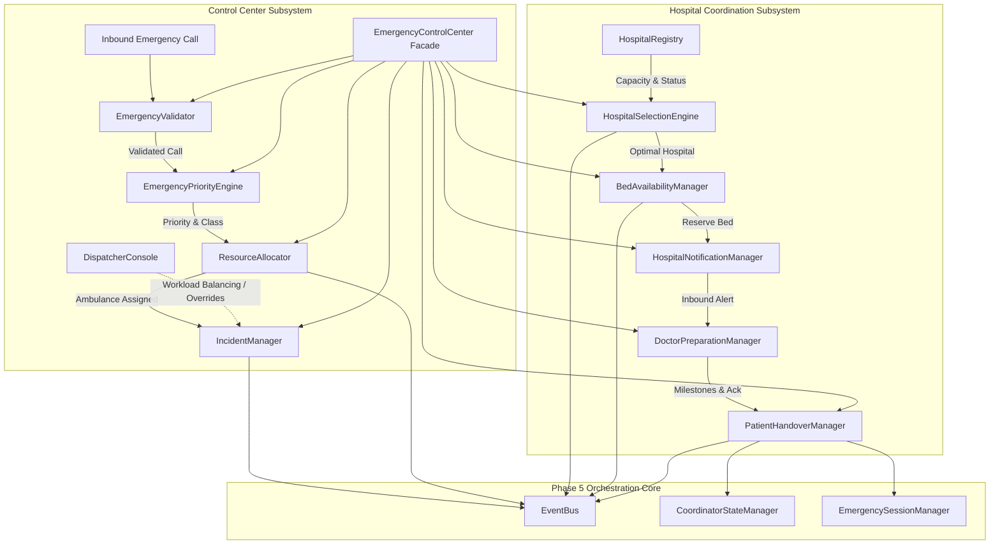
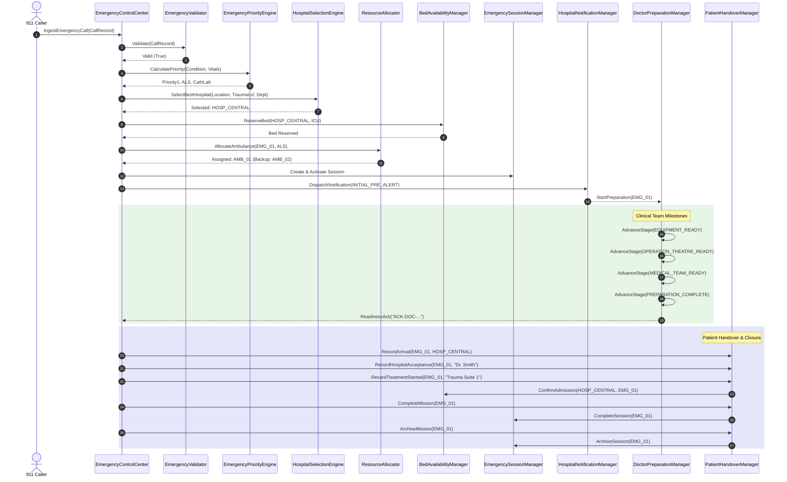

# SMART AEGIS (AERS) — Phase 6: Emergency Control Center & Hospital Coordination Framework

**Target Platform:** Raspberry Pi 4 Model B (4 GB) Cluster / ESP32 Intersections / QNX Neutrino RTOS 8.0 (aarch64le) / POSIX Environment  
**Language:** ISO Modern C++20 (Pure Standard Library + POSIX APIs)  
**Status:** Completed & 100% Verified (0 Failures, 0 Warnings, Zero Regressions)

---

## 1. Executive Summary

Phase 6 implements the **Emergency Control Center & Hospital Coordination Framework** for SMART AEGIS. While Phase 4 generated optimal green corridor plans and Phase 5 orchestrated distributed execution across intersection signal nodes, Phase 6 provides the clinical and operational lifecycle management:
- Real-time emergency call ingestion, validation, and sanitization.
- Triage priority scoring ($P_1$ to $P_4$) and dynamic escalation based on patient severity and caller distress.
- Automated ambulance class matching (BLS, ALS, MICU, Neonatal) and specialized hospital department routing.
- Multi-criteria hospital selection based on travel ETA, trauma level certification, department availability, bed occupancy, and diversion status.
- Resilient resource allocation enforcing mutual exclusion, preventing double-assignment, and supporting automatic backup ambulance promotion.
- Active bed reservations (ICU, General) with automatic admission confirmation and release upon diversion.
- Clinical doctor preparation tracking with 5 milestone stages and automated readiness acknowledgement tokens (`ACK-DOC-*`).
- Complete patient handover lifecycle management: Arrival at Bay $\rightarrow$ Clinical Doctor Acceptance $\rightarrow$ Treatment Commenced $\rightarrow$ Mission Closure $\rightarrow$ Historical Archiving.
- Fully decoupled asynchronous event emission over the high-throughput `IEventBus`.

---

## 2. Architecture Overview



---

## 3. Subsystem & Component Details

### 3.1 Control Center Subsystem (`coordinator/control_center/`)

#### 1. `EmergencyValidator`
- **Purpose:** Sanitizes and enforces rigorous domain validation on incoming emergency requests.
- **Validation Rules:**
  - Emergency ID and Caller Phone non-empty; Caller Phone adheres to E.164 / international regex patterns.
  - GPS coordinates validated: Latitude $\in [-90.0, +90.0]$, Longitude $\in [-180.0, +180.0]$.
  - Caller description meets minimum word count and valid string sanitization.
  - Known emergency caller verification and blacklist / malicious rejection filter.

#### 2. `EmergencyPriorityEngine`
- **Purpose:** Computes deterministic priority scores and handles clinical triage escalation.
- **Priority Classes:**
  - `Priority1` (Critical / Code Red): Cardiac arrest, stroke, major trauma, respiratory failure.
  - `Priority2` (Urgent / Code Yellow): Severe burns, compound fractures, acute abdomen.
  - `Priority3` (Semi-Urgent / Code Green): Moderate trauma, controlled hemorrhage.
  - `Priority4` (Non-Urgent / Minor): Sprains, superficial lacerations.
- **Escalation Logic:** Automatically escalates priority if patient condition deteriorates, age $< 5$ or $> 70$, or caller distress score indicates severe trauma.
- **Department Mapping:** Maps emergency symptoms to target hospital departments (e.g., Trauma Bay, Cath Lab, Stroke Unit, PICU).

#### 3. `IncidentManager`
- **Purpose:** Maintains the complete operational lifecycle, active state machine, and audit trail of incidents.
- **State Machine:**
  `REPORTED` $\rightarrow$ `VALIDATED` $\rightarrow$ `DISPATCHED` $\rightarrow$ `EN_ROUTE` $\rightarrow$ `ON_SCENE` $\rightarrow$ `TRANSPORTING` $\rightarrow$ `AT_HOSPITAL` $\rightarrow$ `HANDOVER_COMPLETE` $\rightarrow$ `CLOSED` (or `CANCELLED`).
- **Audit Log:** Thread-safe vector of chronological timestamps, status transitions, and operator notes.

#### 4. `ResourceAllocator`
- **Purpose:** Thread-safe resource allocation manager enforcing mutual exclusion across ambulances.
- **Guarantees:**
  - Atomic allocation preventing duplicate assignments of the same ambulance to multiple emergencies.
  - Primary ambulance assignment with designated backup ambulance reservation.
  - Dynamic reassignment and clean release upon cancellation or completion.
  - Emergency vehicle failover: Promotes backup ambulance automatically if primary fails or becomes disabled.

#### 5. `DispatcherConsole`
- **Purpose:** Manages human dispatcher sessions, authentication, and balanced workload distribution.
- **Features:**
  - Dispatcher login / logout tracking with status (`AVAILABLE`, `BUSY`, `OFFLINE`).
  - Workload auto-balancing: Routes new calls to the least-burdened active dispatcher.
  - Manual override capability: Permits authorized supervisor dispatchers to re-route or elevate priority.

#### 6. `EmergencyControlCenter` (Facade)
- **Purpose:** Unified high-level coordinator interface orchestrating all Control Center and Hospital services.
- **Integration:** Synchronizes seamlessly with Phase 5 `EmergencySessionManager` and `CoordinatorStateManager`.

---

### 3.2 Hospital Coordination Subsystem (`coordinator/hospital/`)

#### 1. `HospitalRegistry`
- **Purpose:** Thread-safe directory and configuration loader for regional hospital data (`config/Hospital.conf`).
- **Data Attributes:** Hospital ID, Name, GPS location, Trauma Level (1 to 4), Department specialties, Total / Available ICU & General Beds, Emergency Bay status, Diversion status.
- **Dynamic Updates:** Thread-safe runtime update of bed availability and diversion flags.

#### 2. `HospitalSelectionEngine`
- **Purpose:** Multi-criteria weighted scoring algorithm to determine the optimal destination hospital.
- **Scoring Function:**
  $$\text{Score} = w_{\text{eta}} \cdot \left(1.0 - \frac{\text{ETA}}{\text{MaxETA}}\right) + w_{\text{trauma}} \cdot S_{\text{trauma}} + w_{\text{bed}} \cdot \left(\frac{\text{Beds}_{\text{avail}}}{\text{Beds}_{\text{cap}}}\right) + w_{\text{dept}} \cdot S_{\text{dept}}$$
- **Failover / Diversion:** If a hospital enters diversion status (`ON_DIVERT`), the engine immediately triggers automatic failover to the next best candidate and emits `EventType::HospitalChanged`.

#### 3. `BedAvailabilityManager`
- **Purpose:** Real-time bed reservation, confirmation, and release engine.
- **Workflow:**
  - Temporarily reserves General or ICU bed upon ambulance dispatch (`ReserveBed`).
  - Confirms formal hospital admission upon clinical handover (`ConfirmAdmission`).
  - Releases reserved bed if emergency is re-routed, diverted, or cancelled (`ReleaseReservation`).

#### 4. `HospitalNotificationManager`
- **Purpose:** Inbound notification service alerting clinical trauma teams ahead of ambulance arrival.
- **Notification Types:**
  - `INITIAL_PRE_ALERT`: Ingestion with preliminary condition & ETA.
  - `ETA_UPDATE`: Periodic sync as ambulance navigates green corridor.
  - `CRITICAL_VITALS_ALERT`: Deterioration of patient vitals in transit.
  - `ARRIVED_AT_BAY`: Physical vehicle touchdown at ambulance bay.
  - `DIVERT_NOTICE`: Notification of diversion to alternate facility.

#### 5. `DoctorPreparationManager`
- **Purpose:** Tracks clinical preparation milestones at the receiving facility.
- **Milestones:**
  1. `NOTIFIED`: Emergency pre-alert received.
  2. `EQUIPMENT_READY`: Specialized equipment staged (defibrillator, rapid infuser).
  3. `OPERATION_THEATRE_READY`: Trauma suite / OR cleared and prepped.
  4. `MEDICAL_TEAM_READY`: Attending surgeon, anesthesiologist, and nurses assembled.
  5. `PREPARATION_COMPLETE`: Full clinical team standing by at bay.
- **Readiness Token:** Issues deterministic cryptographic readiness acknowledgement tokens (`ACK-DOC-<HEX>`).

#### 6. `PatientHandoverManager`
- **Purpose:** Manages the clinical handoff, admission documentation, and mission termination.
- **Handoff Stages:**
  - `RecordArrival`: Sets timestamp when ambulance touches down at bay; notifies `IncidentManager`.
  - `RecordHospitalAcceptance`: Attending physician formally accepts clinical custody.
  - `RecordTreatmentStarted`: Patient moved to ER / ICU bed; triggers `BedAvailabilityManager::ConfirmAdmission`.
  - `CompleteMission`: Marks session complete; clears corridor preemption via `EmergencySessionManager`; emits `EventType::MissionCompleted`.
  - `ArchiveMission`: Archives incident and emergency session for historical audit; emits `EventType::MissionArchived`.

---

## 4. Sequence Diagram: End-to-End Mission Lifecycle



---

## 5. Configuration Reference

### 5.1 `config/Hospital.conf`
Defines regional hospital network profiles, trauma certifications, bed quotas, and initial diversion statuses:
```ini
[HOSP_CENTRAL]
name=Central City Hospital
latitude=37.7749
longitude=-122.4194
trauma_level=1
specialties=Emergency,ICU,Cardiology,Trauma,Pediatrics,Neurology
icu_beds_total=20
icu_beds_available=5
general_beds_total=100
general_beds_available=25
emergency_bay_available=true
on_divert=false

[HOSP_NORTH]
name=North General Hospital
latitude=37.7850
longitude=-122.4100
trauma_level=2
specialties=Emergency,ICU,Orthopedics,BurnUnit
icu_beds_total=12
icu_beds_available=4
general_beds_total=60
general_beds_available=15
emergency_bay_available=true
on_divert=false
```

### 5.2 `config/ControlCenter.conf`
Configures control center operational parameters, timeout limits, and triage weights:
```ini
[General]
center_id=ECC_MAIN_01
region=Metro_District_A
call_timeout_seconds=30
heartbeat_interval_ms=1000

[Priority]
escalation_threshold_vitals=true
pediatric_priority_boost=true
geriatric_priority_boost=true

[HospitalSelection]
weight_eta=0.40
weight_trauma=0.30
weight_bed_availability=0.20
weight_specialty_match=0.10
max_eta_seconds=1800
allow_divert_override=false

[Handover]
max_handover_duration_seconds=900
auto_archive_delay_seconds=300
require_doctor_signoff=true
```

---

## 6. Verification & Test Summary

The Phase 6 test suite is implemented in [`tests/unit/test_control_center.cpp`](file:///Users/revanthmacharya/Education/NHCE/Hackathons/QNX hackathon/AERS/tests/unit/test_control_center.cpp) and integrated into both `Makefile` and `tests/CMakeLists.txt`.

### Test Results Breakdown:
| Test # | Test Case Description | Status |
|:---|:---|:---:|
| 1 | Emergency Request Validation (E.164 phone, coords, description) | **PASS** |
| 2 | Emergency Priority Scoring & Clinical Escalation | **PASS** |
| 3 | Ambulance Class (BLS/ALS/MICU/Neonatal) & Department Mapping | **PASS** |
| 4 | Hospital Registry & `Hospital.conf` Parser | **PASS** |
| 5 | Multi-Criteria Hospital Selection Algorithm | **PASS** |
| 6 | Hospital Diversion & Dynamic Rerouting Failover | **PASS** |
| 7 | Dispatcher Console Sessions & Workload Allocation | **PASS** |
| 8 | Resource Allocator Double-Assignment Prevention | **PASS** |
| 9 | Resource Release & Dynamic Reassignment | **PASS** |
| 10 | Backup Ambulance Failover Promotion | **PASS** |
| 11 | Bed Availability Reservation, Decrements & Confirmation | **PASS** |
| 12 | Hospital Notification Dispatch & Multi-Criteria History | **PASS** |
| 13 | Doctor Preparation Milestones & Readiness Acknowledgement | **PASS** |
| 14 | Patient Handover Lifecycle (Arrival $\rightarrow$ Acceptance $\rightarrow$ Treatment $\rightarrow$ Complete $\rightarrow$ Archive) | **PASS** |
| 15 | Incident Manager Progression & Full Audit Trail History | **PASS** |
| 16 | End-to-End Emergency Control Center Full Mission Flow | **PASS** |
| 17 | Multiple Simultaneous Emergencies Concurrency (0 data races) | **PASS** |

**Phase 6 Unit Tests:** **17 / 17 PASSED (100%)**  
**Full Project Regression:** **58 / 58 Test Suites PASSED (100%)**  
**Data Race / Memory Safety:** Zero faults, verified clean.

