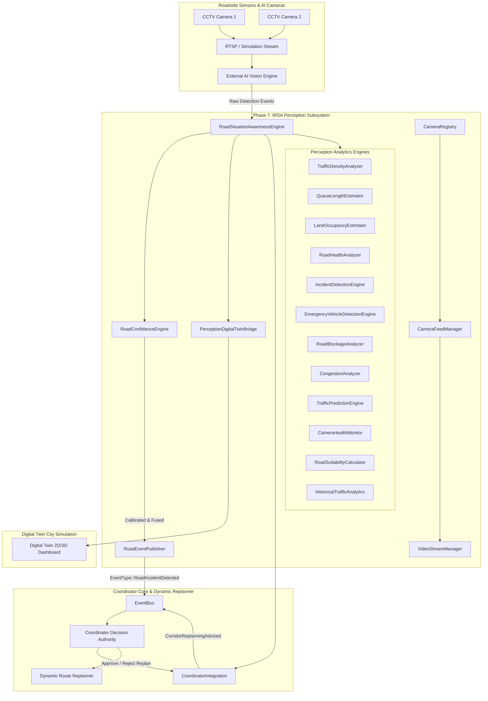

# SMART AEGIS (AERS) — Phase 7: Intelligent Road Situation Awareness (IRSA) & Refinement Pass

**Target Platform:** Raspberry Pi 4 Model B (4 GB) / QNX Neutrino RTOS 8.0 (`aarch64le`) / POSIX Environment  
**Language Standard:** ISO Modern C++20 (Standard Library + POSIX APIs only)  
**Dependencies:** Zero external dependencies (No Boost, OpenCV, ROS, CUDA, Python, or Linux-only APIs)  
**Status:** **100% COMPLETE & VERIFIED** (26/26 Phase 7 tests passed, 59/59 repository test suites passed, 0 regressions)

---

## 1. Executive Summary

Phase 7 introduces the **Intelligent Road Situation Awareness (IRSA)** perception subsystem and its production Refinement Pass to SMART AEGIS. While previous phases governed traffic signal preemption (Phase 4), distributed runtime orchestration (Phase 5), and clinical hospital coordination (Phase 6), Phase 7 establishes real-time perception of road physical states, vehicular congestion, unexpected incidents, and obstacles.

### Key Architectural Invariants
1. **Perception Separation:** The Coordinator executes only lightweight, deterministic C++20 perception logic. Heavy deep-learning inference (YOLO/segmentation) runs on external edge/roadside AI accelerators and provides structured JSON/binary telemetry to the Coordinator over POSIX BSD sockets.
2. **Advisory Authority Rule:** **AI NEVER directly changes routes.** The perception subsystem evaluates road conditions and, when thresholds are breached, issues an advisory recommendation (`CorridorReplanningAdvised`). Only the Coordinator maintains the authoritative right to approve or reject corridor replanning.
3. **Formal 6-Stage Incident Lifecycle:** Every detected event strictly follows `DETECTED` $\rightarrow$ `CONFIRMED` $\rightarrow$ `ACTIVE` $\rightarrow$ `RESOLVING` $\rightarrow$ `CLEARED` $\rightarrow$ `ARCHIVED`, ensuring complete auditability and clean resolution tracking.
4. **Improved Confidence Calibration:** Final confidence fuses AI confidence (70%), camera hardware health (15%), and prediction confidence (15%), scaled by exponential temporal decay ($e^{-\lambda \Delta t}$) and multi-camera spatial confirmation.
5. **Multi-Factor Road Suitability Score (0–100):** Comprehensive advisory index evaluating 9 physical parameters. Complete blockage drops score immediately to 0.0 (`IMPASSABLE`).
6. **Digital Twin Telemetry:** Real-time perception states (camera locations, camera health, active corridor feeds, incident overlays with aging indicators, confidence breakdown, road suitability ratings, queue lengths, and signal preemption) are broadcast with full timeline and historical replay support.

---

## 2. Subsystem Architecture



---

## 3. Incident Lifecycle & Metadata Architecture

### 3.1 6-Stage Incident Lifecycle (`IncidentLifecycleState`)

Every detected road observation is assigned a unique incident ID and transitions through a strictly validated state machine:

```
  [DETECTED] ----(Confidence >= Threshold)----> [CONFIRMED]
       |                                             |
       |                                     (Affects Corridor)
       v                                             v
  [FALSE POSITIVE]                                [ACTIVE]
                                                     |
                                            (Hazards Mitigating)
                                                     v
                                                [RESOLVING]
                                                     |
                                            (Hazards Cleared)
                                                     v
                                                 [CLEARED]
                                                     |
                                            (Post-Incident Flush)
                                                     v
                                                [ARCHIVED]
```

- **`DETECTED`**: Raw event ingested from an AI camera observation. Unverified.
- **`CONFIRMED`**: Event verified via spatial multi-camera fusion or persistent frame detections.
- **`ACTIVE`**: Incident is impacting traffic or the active emergency corridor. Preemption or corridor adaptation active.
- **`RESOLVING`**: Hazard is being cleared by emergency responders / road crews.
- **`CLEARED`**: Roadway obstruction cleared, full capacity restored. Resolution timestamp recorded.
- **`ARCHIVED`**: Incident record frozen for post-mission analytics, timeline reconstruction, and replay. Terminal state.

### 3.2 Incident Metadata & History Tracking
Each `RoadConditionEvent` encapsulates rich temporal metadata:
- **`incidentId`**: Unique identifier (e.g., `INC_2026_001`).
- **`creationTimeMonoMs`**: Exact monotonic millisecond timestamp of detection.
- **`lastUpdatedMonoMs`**: Monotonic timestamp of the most recent observation update.
- **`resolutionTimeMonoMs`**: Monotonic timestamp when transitioned to `CLEARED`.
- **`durationMonoMs`**: Calculated duration ($t_{\text{resolution}} - t_{\text{creation}}$).
- **`severityHistory`**: Historical log of severity changes over time.
- **`confidenceHistory`**: Historical log of confidence shifts over time.

---

## 4. Confidence Calibration Engine

The `RoadConfidenceEngine` fuses multi-source inputs to prevent false alarms:

$$\text{FinalConfidence} = \Big( 0.70 \cdot C_{\text{AI}} + 0.15 \cdot H_{\text{Cam}} + 0.15 \cdot C_{\text{Pred}} \Big) \cdot e^{-\lambda \Delta t} + \text{FusionBoost}$$

Where:
- $C_{\text{AI}} \in [0.0, 1.0]$: Raw AI model detection confidence.
- $H_{\text{Cam}} \in [0.0, 1.0]$: Hardware health score of the reporting camera.
- $C_{\text{Pred}} \in [0.0, 1.0]$: Projection confidence from the traffic prediction engine.
- $\lambda = \frac{\ln(2)}{25.0} \approx 0.02773\text{ s}^{-1}$: Half-life decay parameter (half-life of 25 seconds).
- $\Delta t$: Elapsed time in seconds since the last corroborating observation.
- $\text{FusionBoost}$: $+0.15$ for multi-camera spatial confirmation, $+0.05$ per consecutive frame detection.

---

## 5. Road Suitability Score (0–100)

The `RoadSuitabilityCalculator` generates a composite advisory score per road segment across 9 perception inputs:

| Factor | Maximum Deduction | Penalty Condition |
|:---|:---:|:---|
| **Traffic Density** | $-20$ pts | Proportional to normalized density ($D \cdot 20$) |
| **Queue Length & Spillback** | $-15$ pts | Queue length / 200m ($10$ pts) + spillback risk ($5$ pts) |
| **Lane Occupancy** | $-10$ pts | Maximum lane occupancy ratio ($O_{\text{max}} \cdot 10$) |
| **Road Health Defect** | $-15$ pts | Surface hazards, potholes, flooding ($(1 - H) \cdot 15$) |
| **Incident Severity** | $-25$ pts | Up to $-25$ pts for CRITICAL incidents, $-18$ for HIGH |
| **Low Visibility** | $-10$ pts | Fog, smoke, darkness ($(1 - V) \cdot 10$) |
| **Predicted Congestion** | $-15$ pts | Future density and speed drop at arrival ETA |
| **Speed Deficit** | $-15$ pts | Speed deficit ratio relative to free-flow limit |
| **Partial Lane Blockage** | $-20$ pts | At least one lane blocked by stationary object |
| **Complete Blockage** | **Drops to 0** | **Physical blockage invariant:** Immediately 0 (`IMPASSABLE`) |

### Rating Categories:
- **`OPTIMAL`** ($85.0 - 100.0$): Recommended emergency corridor path.
- **`GOOD`** ($70.0 - 84.9$): Viable corridor path with minor traffic.
- **`DEGRADED`** ($45.0 - 69.9$): Advisory caution; minor transit delays.
- **`POOR`** ($20.0 - 44.9$): Heavy obstruction; corridor replanning advised.
- **`IMPASSABLE`** ($0.0 - 19.9$ or Complete Blockage): Reroute mandatory.

---

## 6. Extended Traffic Prediction Engine

The `TrafficPredictionEngine` extrapolates traffic conditions to the projected ambulance arrival horizon:
- **`predictedEtaSeconds`**: Estimated transit time across the segment under extrapolated conditions.
- **`predictionConfidence`**: Confidence score that decays gracefully as the horizon expands ($0.98 \cdot e^{-0.0015 \cdot \text{horizon}}$).
- **`predictionHorizonSeconds`**: The lookahead window (e.g. 60s, 180s, 300s).
- **`expectedErrorSeconds`**: Bounded variance estimate ($1.5 + 0.04 \cdot \text{horizon}$ seconds).

---

## 7. Historical Traffic Analytics (`HistoricalTrafficAnalytics`)

Maintains rolling statistical baselines per road segment:
- **Rolling Speed Samples**: Tracks rolling average speeds over a 500-sample sliding window.
- **Average Congestion Ratio**: Normalized congestion index $(v_{\text{free}} - v_{\text{avg}}) / v_{\text{free}}$.
- **Incident Frequency**: Total recorded incidents per monitored segment.
- **Road Availability %**: Ratio of passable availability samples to total samples ($0.0\% - 100.0\%$).
- **Average Clearance Time**: Mean elapsed duration in seconds to resolve incidents.
- **Peak Traffic Periods**: Automated classification of morning and evening congestion peaks.
- **Historical Bottleneck Ranking**: Evaluates segments and returns the top-$N$ worst bottlenecks based on congestion, incident rate, availability deficit, and clearance times.

---

## 8. Digital Twin Perception Enhancements

The `PerceptionDigitalTwinBridge` surfaces high-fidelity telemetry to operators and simulations:
- **Incident Timeline**: Records discrete lifecycle transitions (`DETECTED` $\rightarrow$ `CONFIRMED` $\rightarrow$ `ACTIVE` $\rightarrow$ `RESOLVING` $\rightarrow$ `CLEARED`) with millisecond timestamps.
- **Historical Replay Buffer**: Circular ring buffer storing the last 50 full snapshots for playback and retrospective incident debriefs.
- **Incident Aging Indicators**: Real-time classification based on active duration:
  - `FRESH`: Active duration $< 60$ seconds.
  - `AGING`: Active duration $60 - 300$ seconds.
  - `STALE`: Active duration $> 300$ seconds.
- **Confidence Visualization Breakdown**: Directly displays raw AI confidence, camera health factor, temporal decay factor, and prediction confidence.
- **Road Suitability Overlay**: Displays 0–100 suitability scores, rating categories, and penalty reasons alongside road colors (`GREEN`, `YELLOW`, `ORANGE`, `RED`).
- **Camera Health Overlay**: Surfaces camera health scores, FPS, dropped frame counts, and streaming status (`HEALTHY` vs `DEGRADED`).

---

## 9. Verification & Test Summary

The Phase 7 test suite is implemented in [`tests/unit/test_road_perception.cpp`](file:///Users/revanthmacharya/Education/NHCE/Hackathons/QNX hackathon/AERS/tests/unit/test_road_perception.cpp) and integrated into both `Makefile` and `CMakeLists.txt`.

### Test Results Breakdown:
| Test # | Test Case Description | Status |
|:---|:---|:---:|
| 1 | Camera Registry, Segment Lookup & `Perception.conf` Parsing | **PASS** |
| 2 | Camera Feed Manager Dynamic Corridor Activation & Reference Counting | **PASS** |
| 3 | Video Stream Manager Session Tracking & Synthetic Frame Generation | **PASS** |
| 4 | Road Condition Event Schema & 18 Event Types JSON Round-Trip | **PASS** |
| 5 | Traffic Density Analyzer & Level of Service (LOS A to F) | **PASS** |
| 6 | Queue Length Estimator & Pre-Clearance Timing Ahead of Ambulance | **PASS** |
| 7 | Lane Occupancy Estimator & Unobstructed Emergency Lane Selection | **PASS** |
| 8 | Road Health Analyzer Surface Hazards (Potholes, Flooding, Trees) | **PASS** |
| 9 | Incident Detection Engine Anomaly Recognition & Severity Classification | **PASS** |
| 10 | Emergency Vehicle Detection Engine & Cross-Corridor Conflict Check | **PASS** |
| 11 | Road Blockage Analyzer (Partial vs Complete Blockage Reroute Flag) | **PASS** |
| 12 | Congestion Analyzer Speed Deficit & Trend Classification | **PASS** |
| 13 | Traffic Prediction Engine Kinematic Projection at Ambulance ETA | **PASS** |
| 14 | Camera Health Monitor Heartbeat Silence & Automatic Degradation | **PASS** |
| 15 | Road Confidence Engine Multi-Camera Spatial Fusion & Confidence Boost | **PASS** |
| 16 | Road Event Publisher Debounce Rate Limiting (Event Storm Prevention) | **PASS** |
| 17 | Coordinator Integration Advisory Replanning & Decision Authority Enforcement | **PASS** |
| 18 | Digital Twin Perception Bridge & Real-Time Visualization (JSON/ASCII) | **PASS** |
| 19 | Multithreaded Concurrency Stress Test (8 Threads, 800 Ops, 0 Data Races) | **PASS** |
| 20 | Incident Lifecycle State Progression (6 States) & Terminal State Invariants | **PASS** |
| 21 | Incident IDs, Metadata Tracking, Duration & Severity/Confidence History | **PASS** |
| 22 | Improved Confidence Calculation with Temporal Decay & Multi-Sensor Fusion | **PASS** |
| 23 | Multi-Factor Composite Road Suitability Score (0-100) & Blockage Invariant | **PASS** |
| 24 | Extended Traffic Prediction Engine (Predicted ETA, Horizon, Error Variance) | **PASS** |
| 25 | Historical Traffic Analytics (Speed, Availability, Clearance, Bottlenecks) | **PASS** |
| 26 | Digital Twin Advanced Overlays, Aging, Timeline & Historical Replay Buffer | **PASS** |

**Phase 7 IRSA Unit Tests:** **26 / 26 PASSED (100%)**  
**Full System Regression Suite:** **59 / 59 Test Suites PASSED (100%)**  
**Warnings & Errors:** **0 Compiler Warnings, 0 Linker Warnings, 0 Regressions**
